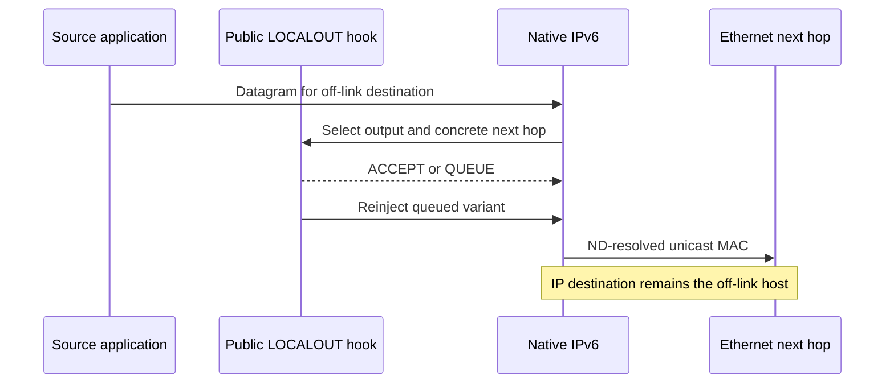

# Pinned IPv6 unicast next hops

An explicitly selected output interface does not imply Ethernet broadcast. If the caller supplies a concrete unicast next-hop address, IPv6 must resolve that neighbor's MAC while preserving the datagram's distinct final IP destination.

`PinnedUnicastNextHop.test` uses two native IPv6 Ethernet hosts and no AODV module. A public LOCALOUT hook selects source `eth0` and next hop `2001:db8:1::2` for data addressed to off-link `2001:db8:9::99`. Native ND resolves the neighbor. The receiver observes its own unicast MAC on both packets and checks the unchanged IPv6 destination and UDP ports.



The first packet has its output selected before IP enters LOCALOUT, then the hook supplies the next hop and returns ACCEPT. The second obtains its tags in the hook, queues in the real network protocol and resumes through the public reinjection operation 50 ms later. Thus both entry paths reach `Ipv6::datagramLocalOut()` with a pinned interface and concrete next hop. The parent branch broadcasts in that branch, so the receiver-MAC assertion is the expected distinguishing failure. This comparison remains source-based until the exact fixture runs against the parent binary.

The correction delegates this specific branch to the existing native routing/ND path. It does not change multicast handling or the existing unspecified-next-hop interface behavior used by link control. Fixed configuration General, run 0, seed 0 supplies the deterministic reproduction.

```sh
flock /tmp/inet-aodv-test-runner.lock opp_run_protocol_tests --load . -p inet -m debug --no-build --no-concurrent -w '^tests/protocol/ipv6$' -f 'PinnedUnicastNextHop\.test$'
```

Execution status: **PASS**, 1/1 case, exit 0, matching debug build after the protocol ownership audit, General/run 0/seed 0. Library SHA256: `bcb9f5d13fa867ddca91b87c45121fe280c38c2a6042d8fc4b830e7d777e1011`; build log: `/tmp/aodv-owned-protocol-debug-build.log`. The runner output is `/tmp/aodv-pinned-owned-protocol.log`, and generated fixture output was copied under the runner lock to `/tmp/aodv-pinned-owned-protocol-artifacts/PinnedUnicastNextHop`. Both paths reached the receiver-MAC assertion. The diagram rendered successfully in `/home/miguel/workspace/ai-logs/executions/aodv-diagrams-20261114/results.json`. The identical parent execution remains **NOT_RUN**. This is direct L2-destination and public-hook evidence, not a proof of AODV route choice or arbitrary custom interface behavior.
