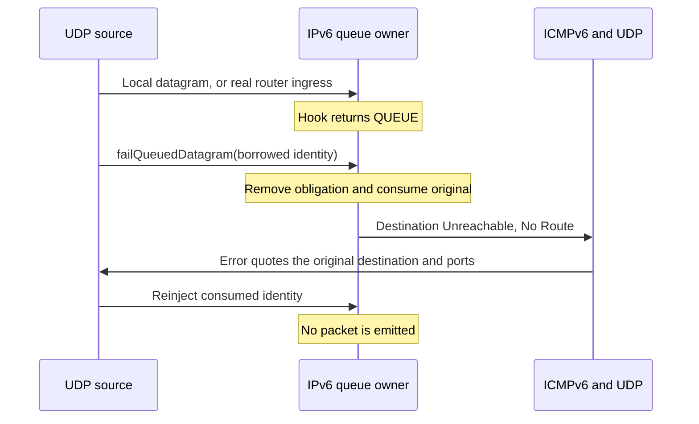

# Queued IPv6 failure reporting

These C2 tests apply the public queued-failure contract to native IPv6, neighbor discovery, ICMPv6 and UDP. They use the same shared peer as the IPv4 tests, with `StandardHost6`/`Router6`, fixed Ethernet links, General/run 0/seed 0 and a 5-second start after native address configuration. They neither replace the IPv6 queue implementation nor invoke its private handlers.

The files are `QueuedDatagramFailure<Case>.test`. `LocalUnspecified` requires local error delivery before a source address has been chosen; `LocalBound` binds the configured source explicitly. Each requires one ICMPv6 type 1/code 0 indication at the originating socket, the quoted original destination and UDP ports 41000/42000, and one destruction of the original local packet. `UnknownPointer` verifies that an unrelated live packet remains owned by its caller while the real obligation remains actionable. `RepeatedFailure` verifies one indication and one destruction despite a repeated call for the consumed identity.

`Transit` queues the real datagram on the router's PREROUTING path and requires the No Route error back at the source. `SuppressedIcmp` queues a received ICMPv6 error and requires native error-about-error suppression. Both require that stale reinjection cannot emit the original. The local packet destructor assertion is not used to claim router-packet destructor coverage: link-layer duplication can change its C++ identity.

This is direct production-path verification of queue detachment, local/transit error delivery and native suppression. It does not establish AODV's choice of when to report exhaustion; that belongs to C3. Whole-node cleanup and non-IP fallback are covered by the companion C2 module tests described in the [IPv4 reviewer document](../ipv4/queued-datagram-failure.md).

The parent has no failure API, so the unchanged fixture cannot compile there; that setup difference is not reported as a runtime defect reproduction. The new implementation removes the obligation before invoking the existing ICMPv6 path and retains silent deletion as a separate operation.

On 2026-11-14, all six IPv6 cases passed in the combined locked IPv4/IPv6 debug-8 run documented in the [IPv4 execution record](../ipv4/queued-datagram-failure.md), which records the matching build and unchanged library hash. The run used General/run 0/seed 0 and `--no-build --no-concurrent`; command exit status was 0. Raw output is `audit/aodv-remaining-features/netfilter-debug8-final/c2-protocol.log`, and the IPv6 per-case stdout, stderr, INI and NED files are preserved in that directory's `artifacts/ipv6/`. Its `verification.json` records the exact execution metadata. The two companion module cases also passed. No exact-parent runtime comparison is claimed because the parent lacks this API.

The diagram matches the exercised sequence. Mermaid rendering passed in the series-wide [implementation record](../../../doc/project/evidence/model/aodv/remaining-features-results.md).
