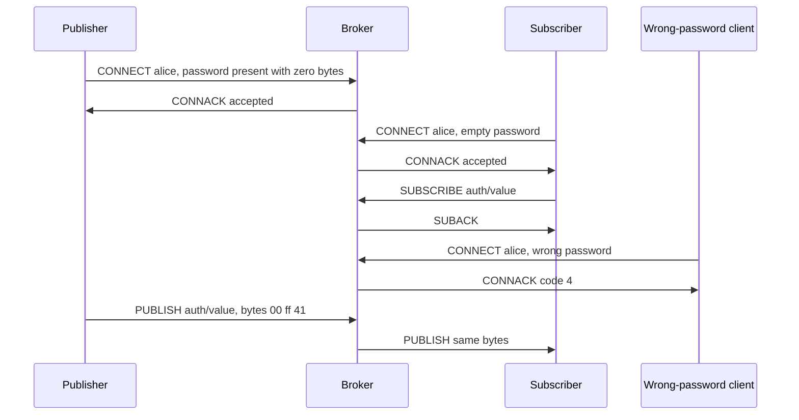

# MQTT username and empty-password admission

> **Kind:** report · **Status:** draft · **Seal:** none · **Owns:** — · **Stands on:** [implementation plan](../../../plan/pending/mqtt.md)

The C2 connection increment must allow a production client to represent the exact username/password pair configured at the broker. A nonempty username enables the broker's admission policy; its password may be empty. This is the model's admission contract over ordinary TCP, not a cryptographic authentication-service model.

`MqttAuthentication.test` uses the wired `MqttTestNetwork`, with one production broker, a production publisher and subscriber configured with username `alice` and empty passwords, and a second production publisher configured with password `wrong`. All clients start at 0.1 seconds; rejected clients wait ten seconds before retrying, beyond the three-second simulation limit. The test uses seed 0 and no scripted MQTT endpoint.



The fixture observes exactly one CONNECT with User Name Present and Password Present, an empty password array and the configured username at the valid publisher. It separately requires an accepted CONNACK for that publisher, a refused CONNACK for the wrong-password client, no active transition for the rejected client, successful subscription and an exact binary application delivery. A subsequent bounded absence check excludes the rejected client's attempted publication. The publication is due 0.5 seconds after the valid connection, allowing the subscriber to complete admission first.

The faulty client omits Password Present for an empty string even when its username is configured. The broker then refuses the matching credentials before the workload can run; the CONNECT-field and accepted-response observations and the subscriber's SUBACK cannot pass. The corrected client includes the password field whenever credentials cause the username field to be sent. Anonymous clients continue to omit both fields, and nonempty/wrong passwords keep their existing encoding and comparison.

C2's immediate parent has no production MQTT endpoints, so this fixture cannot establish a runtime parent failure at that boundary. The unchanged pre-correction integrated implementation can run the fixture; its failure and the corrected pass are recorded separately in the coverage evidence. The test establishes the endpoint configuration and delivery contract, not live external interoperability, TLS, brute-force resistance or arbitrary credential encodings. Existing `MqttConnect.test` supplies the anonymous admission control.

From the INET root after loading `.envrc`, build debug mode and run:

```sh
make MODE=debug -j4
opp_run_protocol_tests --load . -p inet -m debug --no-build \
  -w '^tests/protocol/mqtt$' -f 'Mqtt(Authentication|Connect)[.]test$' --no-concurrent
```
