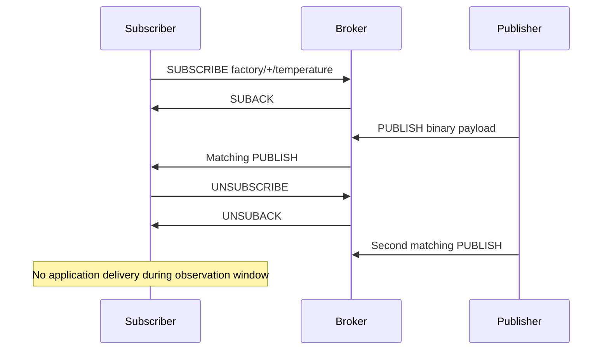

# MQTT connection and routing

> **Kind:** report · **Status:** draft · **Seal:** none · **Owns:** — · **Stands on:** [implementation plan](../../../plan/pending/mqtt.md)

C2 introduces production applications for MQTT 3.1.1 sections 3.1–3.3, 3.8–3.11 and 4.7. Its parent has only a codec/framer. The client now establishes a TCP connection and sends CONNECT, and the broker admits the connection and answers CONNACK. The clean-session QoS 0 stage does not claim persistence, nonzero keepalive, Wills or retained messages.

`MqttConnect.test` observes CONNECT at the client, an accepted CONNACK with Session Present false, then the active transition. Its hosts use a wired switch with 1ms links and seed 0. The client starts at 0.1s; each observation has a one-second bound. A missing callback, invalid response or early workload cannot satisfy these observations.

`MqttDefaults.test` instantiates both applications with their NED defaults. An empty client destination leaves it inactive: initialization must complete and no MQTT packet may be sent over a one-second window. Configured experiments set a destination and a unique client identifier.

`MqttRouting.test` subscribes `factory/+/temperature`, then publishes binary bytes `00 ff 41` on `factory/line1/temperature`. It requires one matching application delivery with those exact bytes, then UNSUBACK after unsubscribe, and no later delivery for 1.5s despite a second matching publication. The production broker performs matching and forwarding; test code supplies no routing substitute.

`MqttBoundaryCases.test` extends admission with empty, nonalphanumeric and overlong identifiers, unsupported protocol level, absent/wrong/correct credentials, and a fresh TCP connection after every refusal. It checks malformed headers, length prefixes, UTF-8, duplicate CONNECT and invalid active controls. Its routing matrix covers empty levels, a parent matched by `#`, `+`, case sensitivity, the leading `$` exception and UTF-8 topic bytes. Multi-filter SUBACK preserves result order; overlapping live matches produce one copy. The test runs against production broker instances on ports 1883 and 1884.

`MqttInvalidServer.test` reverses the roles: a scripted broker sends invalid/refused CONNACK and malformed or excessive SUBACK grants to a production client. A silent first connection checks the positive connection timeout. A valid SUBACK failure must unblock the next publication and must not cause an immediate subscription retry. Actual results and exact commands are in the [coverage ledger](../../../doc/project/evidence/model/mqtt/coverage.md). Diagram rendering is unverified.
