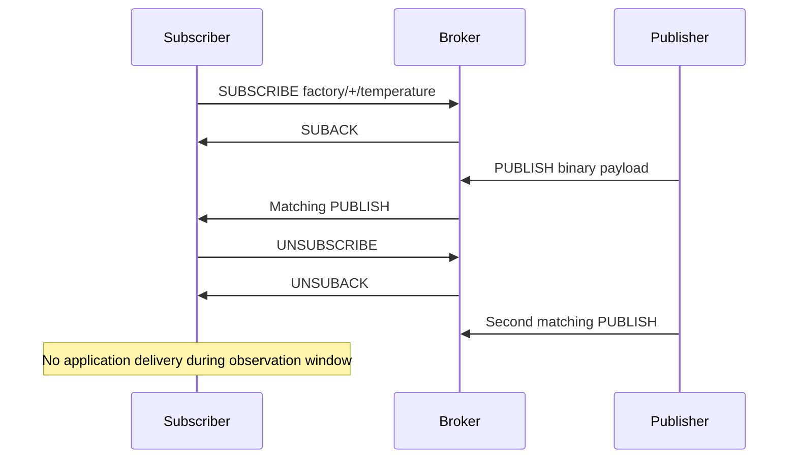

# MQTT connection and routing

> **Kind:** report · **Status:** draft · **Seal:** none · **Owns:** — · **Stands on:** [implementation plan](../../../plan/pending/mqtt.md)

C2 introduces production applications for MQTT 3.1.1 sections 3.1–3.3, 3.8–3.11 and 4.7. Its parent has only a codec/framer. The client now establishes a TCP connection and sends CONNECT, and the broker admits the connection and answers CONNACK. The clean-session QoS 0 stage does not claim persistence, nonzero keepalive, Wills or retained messages.

`MqttConnect.test` observes CONNECT at the client, an accepted CONNACK with Session Present false, then the active transition. Its hosts use a wired switch with 1ms links and seed 0. The client starts at 0.1s; each observation has a one-second bound. A missing callback, invalid response or early workload cannot satisfy these observations.

`MqttRouting.test` subscribes `factory/+/temperature`, then publishes binary bytes `00 ff 41` on `factory/line1/temperature`. It requires one matching application delivery with those exact bytes, then UNSUBACK after unsubscribe, and no later delivery for 1.5s despite a second matching publication. The production broker performs matching and forwarding; test code supplies no routing substitute.

These cases establish normal connection and routing only. Admission failures, split-connection cleanup and XML failure boundaries remain assigned coverage until their cases are added and executed. Actual results, commands and limits belong in the model coverage ledger; no pass is inferred from compilation. Diagram rendering is unverified.
