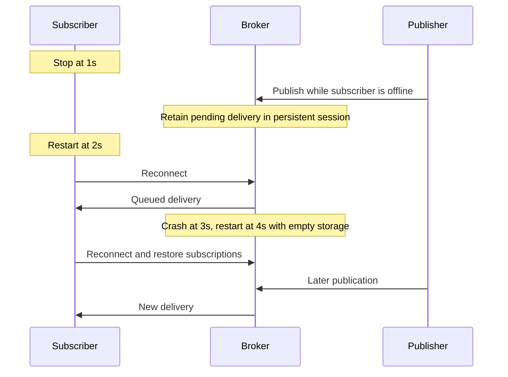

# MQTT lifecycle and malformed exchanges

> **Kind:** report · **Status:** draft · **Seal:** none · **Owns:** — · **Stands on:** [implementation plan](../../../plan/pending/mqtt.md)

C6 completes lifecycle transitions and malformed-exchange handling. Earlier stages provide per-resource cancellation but not post-crash reset policy or safe deletion of terminal accepted sockets. The client now restarts a crashed workload and resets incompatible broker state with Clean Session true until acceptance. The broker reaps closed sockets after callbacks, retains eligible data on ordinary stop and clears it on crash. The five-second graceful-stop timeout destroys transport without silently turning an ordinary stop into application state loss.

`MqttFailureHandling.test` connects a scripted peer to the production broker and sends `11 00`: CONNECT with an invalid reserved fixed-header flag. The broker must emit no MQTT response and close TCP within one second. The one-second negative response observation excludes acknowledgement of malformed input. The codec's field/UTF-8 and length checks supplement this integration case.

`MqttLifecycle.test` uses the production publisher, broker and subscriber. After a first delivery, the subscriber application stops at 1s and restarts at 2s; a publication while it is offline must be delivered on persistent-session restoration. A subsequent publication proves continued service. The broker crashes at 3s and restarts at 4s; client reconnection and another publication at about 6.6s prove resumed service with new broker state. A 0.7s interval after subscriber closure must contain no delivery. Every expected transition has a bounded deadline; seed 0 and 1ms links are fixed.

`tests/module/mqtt_lifecycle.test` repeatedly stops/restarts and crashes/restarts the actual client and broker while timers are pending. A complete eight-second simulation without stale self-message errors or undisposed-object diagnostics checks lifecycle resource ownership. It does not establish every packet-exchange condition. Planned post-crash Clean Session refusal/acceptance boundaries and the full malformed-input matrix require their own recorded probes; no completion is inferred from these initial cases. Execution status belongs in the model ledger and diagram rendering is unverified.
