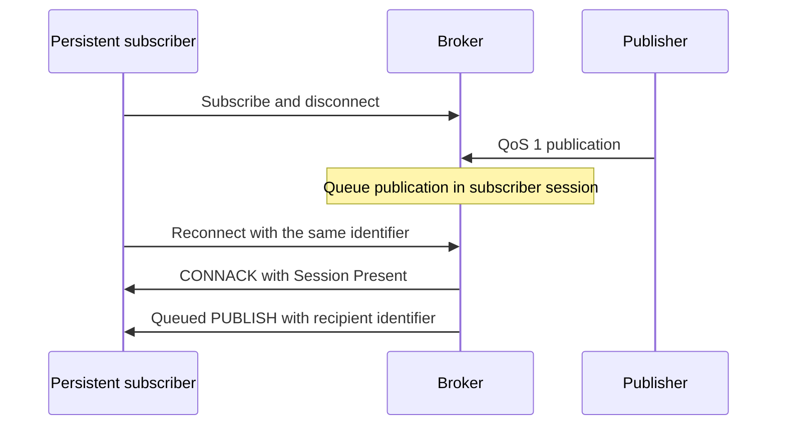

# MQTT QoS 1 and sessions

> **Kind:** report · **Status:** draft · **Seal:** none · **Owns:** — · **Stands on:** [implementation plan](../../../plan/pending/mqtt.md)

C3 adds MQTT 3.1.1 sections 3.1.2.4, 3.4 and 4.3.2–4.6. C2 has only transient QoS 0 operation. Session-owned publication queues and outgoing acknowledgements now survive eligible transport disconnection, with independent identifier allocation per sender. A broker's subscriber delivery has its own acknowledgement; it never borrows the incoming publisher's identifier.

`MqttQos1.test` publishes binary `00 ff 41` through a production publisher, broker and subscriber, observes the exact payload handoff and its PUBACK, and requires no second delivery during a one-second fault-free window. This normal-path case does not impose exactly-once semantics on QoS 1 under failure.

`MqttSession.test` connects a scripted subscriber with Clean Session false, installs `factory/#` at QoS 1, then sends DISCONNECT and closes before publication. A production publisher sends `41` while it is offline. At 2s the subscriber reconnects with the same identifier; CONNACK must report Session Present and a queued QoS 1 PUBLISH must contain `41`. Each exchange has a one-second deadline; seed 0 and 1ms Ethernet links make the setup deterministic. C2 would not admit this persistent session or deliver its queued publication.

These cases establish normal QoS 1 and offline queueing. Interrupted ACKs, exhaustion, subscription-reconciliation boundaries and ordering across identifier wrap require the additional planned probes; their completion must be recorded separately. Execution status is in the model coverage ledger. Rendering is unverified.
