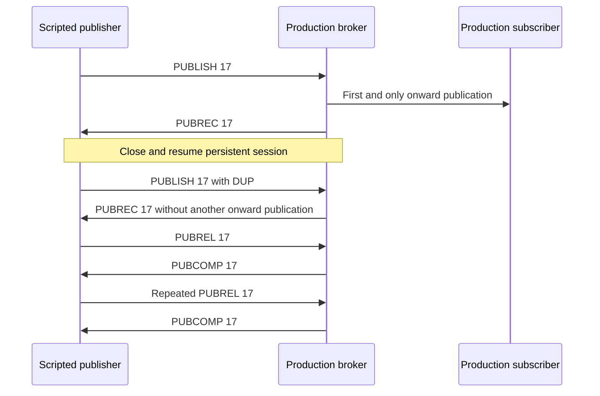

# MQTT QoS 2

> **Kind:** report · **Status:** draft · **Seal:** none · **Owns:** — · **Stands on:** [implementation plan](../../../plan/pending/mqtt.md)

C4 adds the sender and receiver states in MQTT 3.1.1 section 4.3.3. Its parent supports QoS 1 only. The sender retains PUBLISH until PUBREC, then replaces it with PUBREL until PUBCOMP. The receiver uses Method B: record the identifier and hand the publication onward once, retain that record until PUBREL, then return PUBCOMP. Completed identifiers can be reused without tombstones.

`MqttQos2.test` uses production applications throughout. It requires the QoS 2 subscriber's handoff before PUBREC, then PUBREL and PUBCOMP, followed by one second without another handoff. Two additional subscribers require one copy each at granted QoS 0 and 1. This checks the normal state machine and QoS capping on the independent delivery legs.

`MqttQos2Reconnect.test` uses a scripted publisher and production broker/subscriber. Identifier 17 first reaches PUBREC. The publisher closes TCP before PUBREL, reconnects with the same persistent client identifier and observes Session Present. It repeats PUBLISH with DUP and identifier 17; the broker must repeat PUBREC without another subscriber delivery. The publisher then sends PUBREL twice and requires PUBCOMP both times. A new PUBLISH using completed identifier 17 must be delivered again. The whole scenario requires exactly two handoffs and a final one-second absence check. Seed 0, 1ms links and event-driven actions establish the intended ordering.

`MqttClientRecovery.test` and `MqttBrokerRecovery.test` interrupt the production sender after PUBREC and before PUBCOMP. Reconnect must send PUBREL with the old identifier and fixed header byte `62`, rather than resend PUBLISH. The client case also duplicates inbound PUBLISH/PUBREL, runs opposite-direction exchanges with the same identifier number, and then reconnects to a broker reporting Session Present false. A new inbound publication using an old incomplete identifier must be handed onward in that new session. Exactly three distinct inbound publications are required. Results belong in the [coverage ledger](../../../doc/project/evidence/model/mqtt/coverage.md); rendering is unverified.
