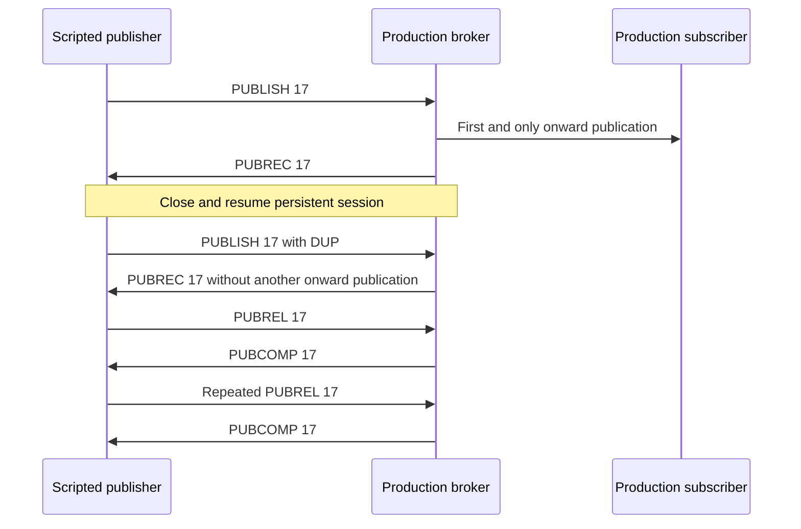

# MQTT QoS 2

> **Kind:** report · **Status:** draft · **Seal:** none · **Owns:** — · **Stands on:** [implementation plan](../../../plan/pending/mqtt.md)

C4 adds the sender and receiver states in MQTT 3.1.1 section 4.3.3. Its parent supports QoS 1 only. The sender retains PUBLISH until PUBREC, then replaces it with PUBREL until PUBCOMP. The receiver uses Method B: record the identifier and hand the publication onward once, retain that record until PUBREL, then return PUBCOMP. Completed identifiers can be reused without tombstones.

`MqttQos2.test` uses production applications on all three hosts. It requires the subscriber's handoff before PUBREC, then PUBREL and PUBCOMP, followed by one second without another handoff. This proves the normal subscriber leg traverses the production state machine.

`MqttQos2Reconnect.test` uses a scripted publisher and production broker/subscriber. Identifier 17 first reaches PUBREC. The publisher closes TCP before PUBREL, reconnects with the same persistent client identifier and observes Session Present. It repeats PUBLISH with DUP and identifier 17; the broker must repeat PUBREC without a second subscriber delivery. The publisher then sends PUBREL twice and requires PUBCOMP both times. The whole scenario has a single handoff observation window and a final one-second absence check. Seed 0, 1ms links and event-driven actions establish the intended ordering.

The normal case and interrupted inbound case do not alone establish every planned sender role, lost-PUBCOMP permutation, mixed QoS route or broker state-loss boundary. Those additional probes must be recorded explicitly rather than inferred from helper tests. Results belong in the model ledger; rendering is unverified.
