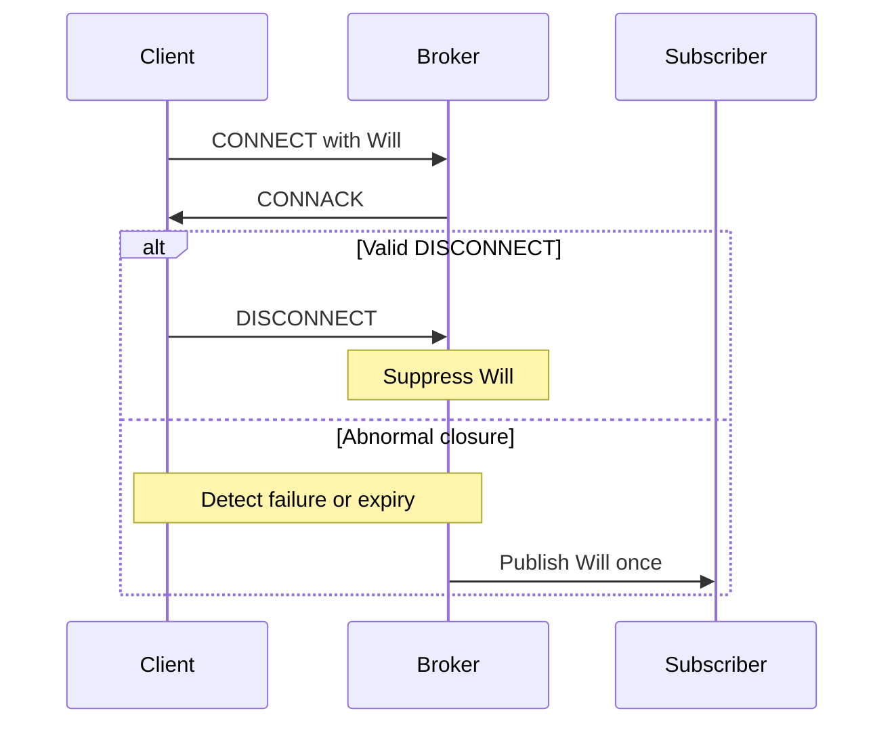

# MQTT retained values keepalive and Wills

> **Kind:** report · **Status:** draft · **Seal:** none · **Owns:** — · **Stands on:** [implementation plan](../../../plan/pending/mqtt.md)

C5 implements retained publication state, connection-owned Wills and liveness deadlines under MQTT 3.1.1 sections 3.1.2.5–3.1.2.10, 3.3.1.3 and 3.12–3.14. C4 has QoS exchanges but none of these features. Retained records live outside session maps, and Wills are removed on DISCONNECT or published once when the owning connection closes abnormally.

`MqttRetained.test` stores `41` before a subscriber connects at 1s. The subscriber must receive a retained PUBLISH. A zero-byte retained publication at about 2.1s must be forwarded live with RETAIN false; an observer subscribing at 3s must receive no stale replay during a two-second window. The test checks flags and payload lengths, not only message counts.

`MqttKeepAlive.test` starts an idle production client with keepalive 2s. It requires PINGREQ within 3s, PINGRESP within one second, and no disconnected transition over the following two seconds. Client and broker timers run in their production owners; the client send boundary is the TCP handoff, as documented in the model profile.

`MqttWill.test` connects a scripted publisher with Will topic `factory/status` and byte `ff`, then closes TCP without DISCONNECT. A production subscriber must receive exactly one live publication with that topic/payload and RETAIN false. One-second exchange deadlines and a final absence window bound the observation. All three fixtures use seed 0 and 1ms wired links.

`MqttBrokerLiveness.test` adds keepalive-zero, silent expiry, partial-PUBLISH reception, complete-PING renewal, DISCONNECT suppression, protocol-error Will and identifier-takeover Will. Expiry is checked at three seconds from the remote CONNACK/PINGRESP observation, with one-millisecond tolerance for the known symmetric path. Renewal is sent well away from expiry. A separate TCP connection sends no CONNECT and must expire without a CONNACK. Six-second count/absence guards bound Will observations.

`MqttMissingPingResponse.test` withholds PINGRESP from a production client. The first unanswered ping must disconnect it at its configured two-second response bound; later pings cannot extend that bound. Its outstanding QoS 1 publication must not be retransmitted while the connection is active.

`MqttPartitionWill.test` drops link frames through the shared tap for three seconds while an observer stays connected locally to the broker. No Will may be delivered during the first 0.5s after partition onset; failure detection must then cause exactly one QoS 1 notification with byte `ff`.

`MqttBrokerPersistence.test` shuts down the broker with an active retained QoS 2 Will, then restarts it. A live subscriber receives the Will at its granted QoS 1 with RETAIN false. A late subscriber and its resubscription each replay the saved Will and ordinary retained value at QoS 0 with RETAIN true. These records outlive deletion of the clean publisher session. After broker crash, a still later subscriber receives no replay; a new publication proves recovery. Results and limits are in the [coverage ledger](../../../doc/project/evidence/model/mqtt/coverage.md). Diagram rendering is unverified.
