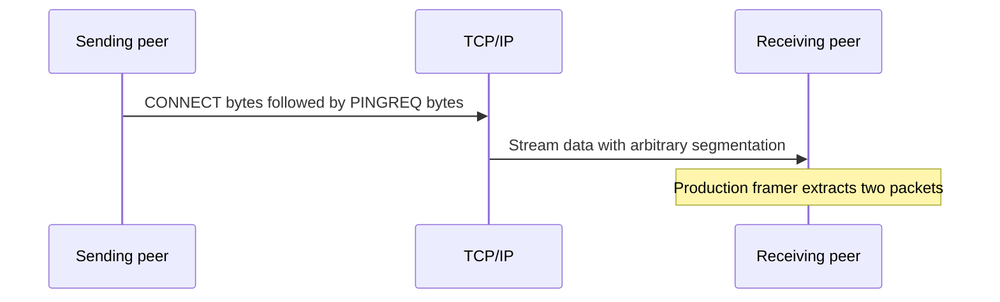

# MQTT wire format

> **Kind:** report · **Status:** draft · **Seal:** none · **Owns:** — · **Stands on:** [implementation plan](../../../plan/pending/mqtt.md)

C1 implements MQTT 3.1.1 sections 1.5 and 2 and the control packet layouts in chapter 3. No MQTT codec exists on its parent. The packet serializer and framer provide the missing representation; this commit does not claim a client or broker state machine.

`MqttWireFormat.test` uses two scripted applications on ordinary TCP/IP hosts with a 1ms link delay and seed 0. One opens port 1883, the other connects and writes independently specified CONNECT and PINGREQ bytes together. The receiving application passes stream data through the production framer. It must observe exactly two decoded packets within 0.5s, with client identifier `c` and the correct packet types. An incorrect length or premature dispatch changes that count or those fields.

`tests/module/mqtt_framing.test` tests every split point of a short CONNECT, concatenation, an incomplete suffix, clearing and malformed length/UTF-8 boundaries. These are helper checks; the protocol case supplies TCP integration evidence. Serializer round-trip fillers cover the concrete chunk independently of the golden-byte expectation. Current execution results are recorded in the model coverage ledger; unexecuted cases remain NOT_RUN. Mermaid rendering is unverified until a renderer is available.
