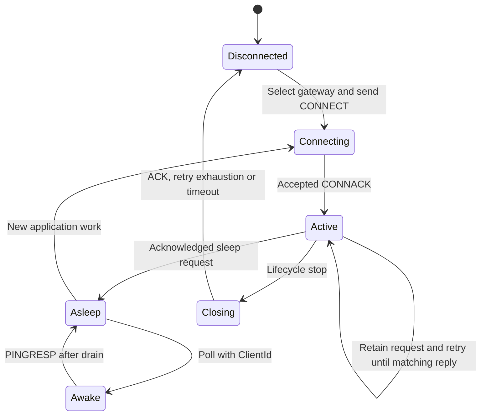

# MQTT-SN client review

> **Kind:** report · **Status:** current · **Seal:** none · **Owns:** — · **Stands on:** [publication map P4](../../../plan/pending/mqtt-sn.md), [requirements](../../../doc/project/evidence/standard/mqtt-sn-v1.2/catalog.md)

The client commit supplies the previously absent sensor endpoint over the wire/session contracts introduced by its parent. Its UDP socket, selected gateway, workload cursor, request deadlines and lifecycle paths are owned by one application. QoS 0/1/2, registration/subscription, Will setup/updates, sleep/poll and discovery use the same retained exchange records. The complete endpoint stays together because partially enabling those paths would create untested intermediate behavior.

The tests below use the common switched Ethernet fixture, seed 0, a production client and a scripted UDP gateway (or real UDP discovery stimuli). Their descriptions name the input and required observation. The parent has no MqttSnClient type or NED module, so the identical fixtures cannot initialize there. This is a source-based missing-capability comparison, not a claimed observed parent runtime assertion failure. After the commit, each named response, retry or silence window reaches the production client's receive/timer path.

| Test | Scenario and required observation |
| --- | --- |
| [MqttSnGatewayPing](MqttSnGatewayPing.test) | A gateway-originated PINGREQ receives the production client's PINGRESP while autonomous keepalive is disabled. |
| [MqttSnCleanSessionDiscard](MqttSnCleanSessionDiscard.test) | Clean-session client discards the pending PUBREL after unsolicited disconnect and sends only new work after reconnect. |
| [MqttSnClientQosTwoDuplicate](MqttSnClientQosTwoDuplicate.test) | Duplicate QoS 2 PUBLISH hands off once, duplicate PUBREL is answered, and completed identifier reuse succeeds. |
| [MqttSnCongestion](MqttSnCongestion.test) | A QoS 1 congestion PUBACK suspends publishing for TWAIT and cancels the former retry deadline before a new bounded attempt. |
| [MqttSnConnectRetry](MqttSnConnectRetry.test) | Client retry exhaustion: original CONNECT plus exactly two retransmissions, then a quiet interval before reconnection. |
| [MqttSnDiscoveryBackoff](MqttSnDiscoveryBackoff.test) | Without a gateway, production discovery observes response windows and exponential wait capped at searchRetryMax. Five searches occur at exact deterministic times. |
| [MqttSnDiscoveryExpiry](MqttSnDiscoveryExpiry.test) | Real UDP advertisements and client-originated GWINFO populate production candidate state. A neighboring GWINFO cancels the delayed client response to SEARCHGW. GWINFO-only candidates expire independently of the advertisement missed-count bound. The test-only subclass exposes observations; no production timing or state is changed. |
| [MqttSnGatewayPing](MqttSnGatewayPing.test) | A production client answers a gateway-originated ping, with autonomous keepalive disabled. |
| [MqttSnKeepAlive](MqttSnKeepAlive.test) | Production client sends PINGREQ at its keepalive boundary, retries missing PINGRESP with bounded count, and handles a valid response. |
| [MqttSnPollRetry](MqttSnPollRetry.test) | A missing drain PINGRESP causes bounded polling retry without a second QoS2 application handoff. |
| [MqttSnQosOne](MqttSnQosOne.test) | Production client retransmits QoS 1 with the original id and DUP after lost PUBACK, then releases the queued second publication. |
| [MqttSnQosTwo](MqttSnQosTwo.test) | Production client retries PUBLISH, transitions to PUBREL, repeats PUBREL for duplicate PUBREC and timeout, and releases a later publication. |
| [MqttSnQosTwoCongestion](MqttSnQosTwoCongestion.test) | A QoS 2 congestion PUBACK suspends publishing for TWAIT and cancels the former retry deadline before a new bounded attempt. |
| [MqttSnQosTwoErrors](MqttSnQosTwoErrors.test) | QoS 2 accepts error PUBACK before PUBREC, repairs registration, ignores accepted PUBACK and a late old-phase error, and completes PUBREL. |
| [MqttSnQosZeroCongestion](MqttSnQosZeroCongestion.test) | QoS 0 congestion feedback with message id zero defers later workload until TWAIT. |
| [MqttSnQosZeroNamespace](MqttSnQosZeroNamespace.test) | An error for predefined topic 1 must not erase normal topic 1 in the client. |
| [MqttSnQosZeroRepair](MqttSnQosZeroRepair.test) | An invalid normal-topic QoS 0 error repairs registration before later data. |
| [MqttSnSessionRecovery](MqttSnSessionRecovery.test) | Persistent client retains PUBREL across unsolicited disconnect and resumes the original exchange after reconnect. |
| [MqttSnSleepClientActive](MqttSnSleepClientActive.test) | New work after sleep reconnects to active and cancels the old sleep relationship. |
| [MqttSnStaleAndWrongPeer](MqttSnStaleAndWrongPeer.test) | Wrong-peer, unmatched-id and stale acknowledgements do not release the pending production publication. |
| [MqttSnSubscriptionRetries](MqttSnSubscriptionRetries.test) | SUBSCRIBE retry retains identifier/filter/QoS with DUP, UNSUBSCRIBE retry keeps its unused bit zero. |
| [MqttSnWillClient](MqttSnWillClient.test) | Production sensor negotiates Will topic/message, then serializes independent topic and message updates with their idless response types. |
| [MqttSnWillClientRetry](MqttSnWillClientRetry.test) | Client repeats Will replies and retries each independent Will update after a missing response. |

The three module cases mqttsn_stop_ack, mqttsn_stop_retry and mqttsn_stop_timeout separately finish shutdown through acknowledgement, request retry exhaustion and the lifecycle timeout. They require a new CONNECT after restart and forbid stale DISCONNECT output while down. The parent cannot instantiate the client. These checks do not claim gateway forwarding or broker interoperability, which belong to the next commit.

Exact per-stage commands, selected counts and results are recorded in the [coverage ledger](../../../doc/project/evidence/model/mqttsn/coverage.md). Diagram rendering is unverified. These deterministic cases select individual faults rather than every possible timer/message ordering. Memory loss and zero-id feedback correlation retain the profile limits described in the plan.
