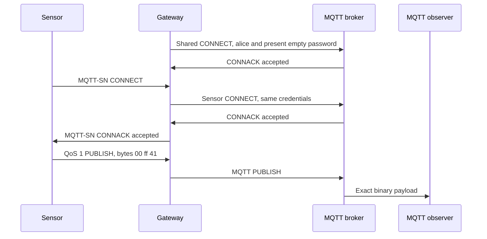
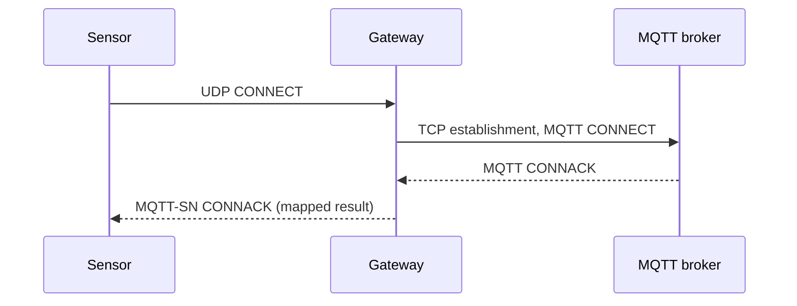

# MQTT-SN: Connection admission

> **Kind:** report · **Status:** draft · **Seal:** none · **Owns:** — · **Stands on:** [plan](../../../plan/pending/mqtt-sn.md), [requirements](../../../doc/project/evidence/standard/mqtt-sn-v1.2/catalog.md)

C3 implements the selected profile of MQTT-SN v1.2 sections 6.2, 6.3, 6.12 and 6.13. The publication gateway commit's immediate parent already has the wire/session helpers and production client, but no MqttSnGateway C++/NED type. Its gateway fixtures therefore cannot build or initialize on that parent. This is a source-based missing-capability comparison, not an observed parent runtime failure. Client-only cases are controls already introduced by the client commit.

The production sensor sends CONNECT over UDP. The gateway establishes a distinct TCP MQTT connection and waits for broker CONNACK before accepting the sensor. Unsupported ProtocolId remains structurally decodable and is refused with code 3. A broker refusal maps to a single refusing CONNACK rather than an unrelated DISCONNECT.

The shared Ethernet fixture has sensor, second sensor, gateway, alternative gateway, broker and MQTT observer hosts, 100Mbps links with 1ms delay, static addresses and seed 0. Unused hosts have no application. MqttSnConnect checks MQTT acceptance precedes MQTT-SN acceptance. MqttSnConnectRetry uses a scripted gateway to withhold CONNACK, checks the original request and exactly two retries, then closes a quiet window. MqttSnBrokerRefusal uses a scripted TCP broker to accept the shared gateway connection and refuse the sensor. MqttSnMalformedInput sends unsupported ProtocolId followed by a valid connection. MqttSnIpv6 assigns static IPv6 addresses and checks accepted CONNACK source family and exact binary delivery in both directions.

MqttSnBrokerRefusal1–4 and the original refusal case cover all five MQTT refusal codes; MqttSnUnavailableBroker exercises failed TCP setup. MqttSnPartialConnack closes the first sensor connection after three CONNACK bytes, then requires refusal followed by a healthy new acceptance. MqttSnChangedPort verifies that the obsolete UDP endpoint cannot register a topic after the ClientId moves. MqttSnDuplicateConnect repeats CONNECT both during setup and after acceptance and counts exactly one upstream sensor CONNECT.

Every positive event has a deadline. Scripted-peer expectations check message type and relevant fields in order; completion is asserted before simulation end. These are independent connection scenarios, not every possible simultaneous socket/UDP failure ordering.

## Gateway credentials with an empty password

`MqttSnAuthentication.test` connects the production gateway and sensor to the production MQTT broker with username `alice` and an empty password. MQTT 3.1.1 sections 3.1.2.8–3.1.2.9 distinguish a present zero-length password from an omitted password. The supplied broker requires both credential fields when username authentication is configured.

The original gateway derives Password Present from whether the password string is nonempty, so its shared and per-sensor connections are refused despite matching credentials. The correction uses the same presence rule as the MQTT client: a configured username or password enables the username field and a present password field, including zero bytes. The fixture observes two gateway MQTT CONNECT packets with username `alice`, Password Present true and zero password bytes. The sensor must become active, publish binary bytes `00 ff 41` at QoS 1, and deliver those exact bytes to the authenticated MQTT observer.

A second production gateway uses the wrong password. Its sensor must receive one MQTT-SN refusal and remain inactive throughout the 2.5-second observation window. Long retry/reconnect intervals prevent another attempt from confusing the refusal count. Both paths use the shared Ethernet topology above and seed 0. The same fixture runs against the pre-correction implementation and fails its acceptance/presence assertions; no missing API or fixture adaptation prevents that comparison.

This establishes gateway credential construction, broker admission and forwarding, with wrong-password refusal as a control. It does not establish encrypted authentication or external broker interoperability. Execution belongs to the coverage ledger; diagram rendering remains unverified.

Execution results, commands and remaining coverage limits belong to the [coverage ledger](../../../doc/project/evidence/model/mqttsn/coverage.md). Diagram rendering is unverified. The role-based publication trees and their directly executed checks are recorded in the ledger. The original C1–C9 capability labels are not separate historical commits.
