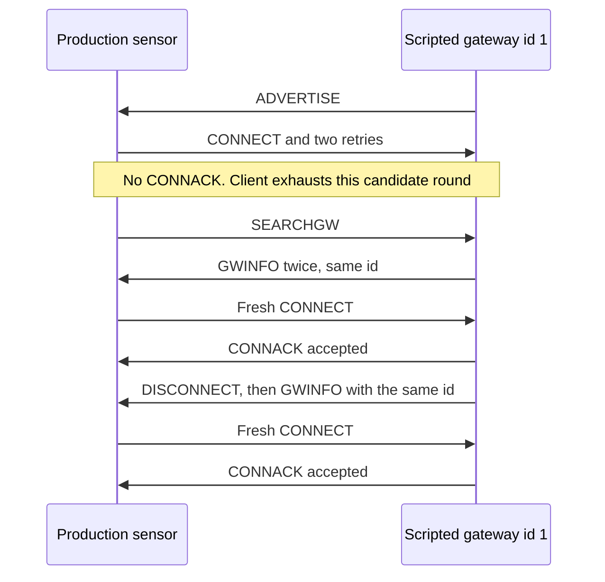
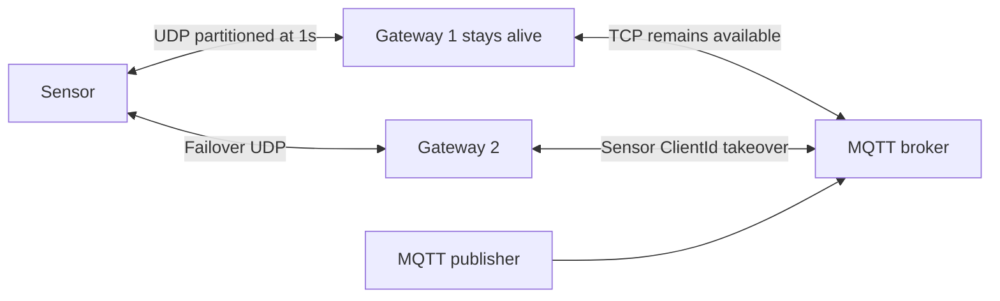

# MQTT-SN: Discovery, failover and lifecycle

> **Kind:** report · **Status:** draft · **Seal:** none · **Owns:** — · **Stands on:** [plan](../../../plan/pending/mqtt-sn.md), [requirements](../../../doc/project/evidence/standard/mqtt-sn-v1.2/catalog.md)

C8 implements the selected profile of MQTT-SN v1.2 sections 6.1, 6.13 and 6.14. The publication gateway commit's immediate parent already has the wire/session helpers and production client, but no MqttSnGateway C++/NED type. Its gateway fixtures therefore cannot build or initialize on that parent. This is a source-based missing-capability comparison, not an observed parent runtime failure. Client-only cases are controls already introduced by the client commit.

MqttSnDiscovery starts the production client without a configured gateway. IPv4 interface-scoped broadcast search/advertisement leads to connection and bidirectional delivery. Discovery broadcasts use hop limit 1; ordinary unicast retains its normal routing scope.

MqttSnGatewayFailover uses TapSwitchNetwork: sensor peer[0], original gateway host1 behind PacketTap, alternative gateway peer[1], broker peer[2] and publisher peer[3]. At 1s the tap drops only UDP destination port 1884. The original gateway stays alive and its TCP connection remains available. The sensor exhausts retries, selects gateway 2, restores its desired subscription and receives distinct payloads 41 and 42. A four-second closed window excludes autonomous per-sensor MQTT CONNECT from the old gateway after broker takeover.

mqttsn_lifecycle shuts down and restarts, then crashes and restarts the production client at 1/2/3/4 seconds. Sends and deliveries are forbidden during down intervals. Persistent ordinary restart receives queued payload 42, while crash/reset discards old payload 44; final delivered set is 41,42,43,45. These assertions complement protocol exchange tests and do not establish all pending-resource combinations. Malformed wire inputs are covered by the codec fixture; MqttSnMalformedInput checks live admission refusal followed by a healthy valid request.

DiscoveryBackoff checks five searches at 0.1/0.3/0.6/0.9/1.2s with a 100ms response window and 200ms backoff cap. DiscoveryExpiry injects real UDP ADVERTISE, direct GWINFO and client-relayed GWINFO, observes the parsed address, suppresses a delayed client response with neighboring GWINFO, and checks independent expiry of GWINFO-only and advertisement candidates. Its test-only subclass exposes observations without modifying production state. MalformedDatagrams exercises invalid bytes around a healthy session. StaleAndWrongPeer sends an unmatched id, an acknowledgement from another host and an old completed id; none may release the current publication.

The three mqttsn_stop module cases separately acknowledge shutdown, exhaust DISCONNECT retries, and force the lifecycle timeout before the first retry. Each then restarts and requires a fresh CONNECT with no old DISCONNECT. These cases caught and corrected failure to finish a timed-out stop and stale shutdown transactions surviving restart. A persistent stop now retains eligible data phases while removing only its shutdown exchange.

Tests use fixed seed 0, static Ethernet addressing and finite windows. Short discovery/retry timers exercise policy, not default timing realism. The fixtures establish their selected failure paths, not every malformed message and simultaneous lifecycle interleaving.

## Rediscovering a recovered gateway

`MqttSnGatewayRediscovery.test` checks the selected recovery policy derived from MQTT-SN v1.2 section 6.1. The production sensor initially learns gateway id 1 from an advertisement. The scripted UDP gateway receives CONNECT three times but withholds CONNACK, exhausting the original request and two retries. After the sensor starts a new discovery round, the peer sends two GWINFO messages for the same id. The sensor must send a new CONNECT and become active. The peer later sends DISCONNECT and announces that same gateway again; a second accepted connection must follow.

Before the correction, the candidate remains in the attempted-gateway set. GWINFO cancels the discovery response timer without clearing that set, so the client skips the responding gateway and the script times out waiting for CONNECT. The correction clears attempts when the client starts another discovery round, after it has tried the remaining candidates. It does not add a timer or change the unanswered-search backoff. The test requires exactly five CONNECT transmissions, two active-state transitions and script completion, all within 2.5 seconds. It uses seed 0, retryInterval 100ms, retryCount 2, a 100ms search response window and a 200ms backoff cap.

The fixture uses unicast announcements and the real client/UDP path. The scripted socket does not consume broadcast SEARCHGW; the diagram shows the sensor's search action, not a script receive assertion. Existing Discovery and DiscoveryBackoff cases cover broadcast discovery and no-response timing, while GatewayFailover checks preference for an alternative gateway. This regression does not establish a production gateway's recovery or all announcement/timeout orderings. The identical fixture is compatible with the pre-correction implementation and fails there at runtime. Commands and observed outcomes are recorded in the coverage ledger; Mermaid rendering remains unverified.

Execution results, commands and remaining coverage limits belong to the [coverage ledger](../../../doc/project/evidence/model/mqttsn/coverage.md). Diagram rendering is unverified. The role-based publication trees and their directly executed checks are recorded in the ledger. The original C1–C9 capability labels are not separate historical commits.
