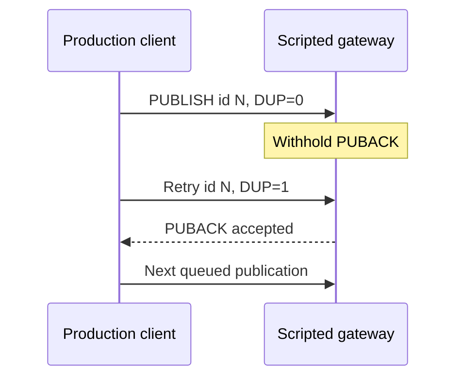

# MQTT-SN: Connectionless and QoS 1 delivery

> **Kind:** report · **Status:** draft · **Seal:** none · **Owns:** — · **Stands on:** [plan](../../../plan/pending/mqtt-sn.md), [requirements](../../../doc/project/evidence/standard/mqtt-sn-v1.2/catalog.md)

C5 implements the selected profile of MQTT-SN v1.2 sections 6.6, 6.8, 6.13 and 7.1. The publication gateway commit's immediate parent already has the wire/session helpers and production client, but no MqttSnGateway C++/NED type. Its gateway fixtures therefore cannot build or initialize on that parent. This is a source-based missing-capability comparison, not an observed parent runtime failure. Client-only cases are controls already introduced by the client commit.

MqttSnQosMinusOne configures a predefined topic and sends production sensor PUBLISH without CONNECT. The MQTT observer must receive the payload; the test excludes sensor CONNECT throughout its bounded observation. The shared gateway connection carries this traffic with MQTT QoS 0.

MqttSnQosOne uses a production client and scripted UDP gateway. The first PUBACK is withheld. The repeated PUBLISH must retain message-id and payload and set DUP, then an accepted PUBACK releases the next queued publication. MqttSnCongestion rejects a publication with congestion, asserts a 450ms quiet window within the 500ms wait, then accepts the new attempt. MqttSnRoutingQos1 checks both complete production directions.

MqttSnGatewayQosOne checks the opposite sender's repeated PUBLISH with unchanged id and DUP after missing PUBACK. The six QosZero cases exercise congestion, registration repair and equal-number normal/predefined namespaces in both endpoints. With message id zero there is no ACK transaction: the session stores the latest representation sent for that TopicId. Congestion postpones later data, and invalid-topic feedback removes only a normal binding. Late feedback after representation reuse is inherently ambiguous and applies to that latest context, as documented in the plan.

These fixtures use seed 0 and the shared Ethernet topology. Fault cases set retryInterval=100ms and retryCount=2 for bounded tests. Expected scripts check each packet in order and fail on unexpected traffic. QoS 1 may deliver duplicates; this evidence does not claim exactly-once application delivery or crash persistence.

Execution results, commands and remaining coverage limits belong to the [coverage ledger](../../../doc/project/evidence/model/mqttsn/coverage.md). Diagram rendering is unverified. The role-based publication trees and their directly executed checks are recorded in the ledger. The original C1–C9 capability labels are not separate historical commits.
