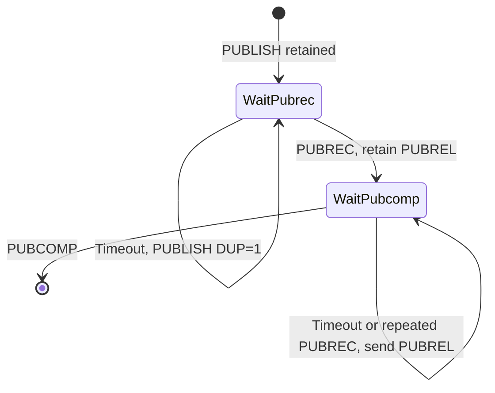

# MQTT-SN: QoS 2 and retained phases

> **Kind:** report · **Status:** draft · **Seal:** none · **Owns:** — · **Stands on:** [plan](../../../plan/pending/mqtt-sn.md), [requirements](../../../doc/project/evidence/standard/mqtt-sn-v1.2/catalog.md)

C6 implements the selected profile of MQTT-SN v1.2 sections 6.3, 6.6, 6.10 and inherited MQTT QoS 2. The publication gateway commit's immediate parent already has the wire/session helpers and production client, but no MqttSnGateway C++/NED type. Its gateway fixtures therefore cannot build or initialize on that parent. This is a source-based missing-capability comparison, not an observed parent runtime failure. Client-only cases are controls already introduced by the client commit.

MqttSnQosTwo drives the production client with a scripted gateway. It checks repeated PUBLISH after missing PUBREC, transition to retained PUBREL, duplicate PUBREC response, PUBREL timeout retry, PUBCOMP completion and release of the next publication. MqttSnGatewayQosTwo exercises the opposite production sender's PUBREL retry. MqttSnRoutingQos2 verifies binary data through both real protocols.

MqttSnSessionRecovery disconnects a persistent client while PUBREL is pending; reconnection must resume the original phase and identifier. MqttSnQosTwoErrors rejects a QoS2 PUBLISH with invalid-topic PUBACK and requires registration repair. It checks that accepted PUBACK does not complete a transaction awaiting PUBREC and that a late error after PUBREL does not roll the phase back.

MqttSnClientQosTwoDuplicate and GatewayQosTwoDuplicate repeat incoming PUBLISH/PUBREL, count payload handoffs and reuse a completed id. QosTwoCongestion checks the phase-specific congestion PUBACK. CleanSessionDiscard ends a pending PUBREL and requires only the next workload publication after clean reconnection. BrokerSessionLoss uses a scripted broker to clear Session Present, restore subscriptions and reuse an incoming MQTT QoS2 id with new data. mqttsn_restoration_capacity fills all 65535 outgoing MQTT ids and drives the production restoration handlers: freed ids go to subscriptions first, and the last SUBACK releases queued new data. The capacity fixture isolates handler state and does not send 65535 network publications.

These are bounded seed-0 switched Ethernet tests, with 100ms retries in scripted fault cases. Each expected packet includes its phase and identifier; distinct next payloads detect premature queue release. Method B delivers once while its incoming identifier is retained, and releases that identifier on PUBREL. No evidence here establishes continuity after memory loss or external broker interoperability.

Execution results, commands and remaining coverage limits belong to the [coverage ledger](../../../doc/project/evidence/model/mqttsn/coverage.md). Diagram rendering is unverified. The role-based publication trees and their directly executed checks are recorded in the ledger. The original C1–C9 capability labels are not separate historical commits.
