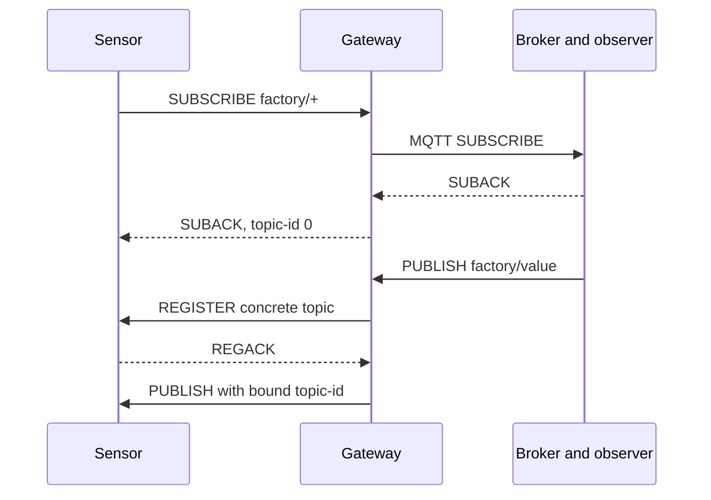

# MQTT-SN: Topics and bidirectional routing

> **Kind:** report · **Status:** draft · **Seal:** none · **Owns:** — · **Stands on:** [plan](../../../plan/pending/mqtt-sn.md), [requirements](../../../doc/project/evidence/standard/mqtt-sn-v1.2/catalog.md)

C4 implements the selected profile of MQTT-SN v1.2 sections 6.5, 6.7, 6.9 and 6.10. The publication gateway commit's immediate parent already has the wire/session helpers and production client, but no MqttSnGateway C++/NED type. Its gateway fixtures therefore cannot build or initialize on that parent. This is a source-based missing-capability comparison, not an observed parent runtime failure. Client-only cases are controls already introduced by the client commit.

MqttSnTopics drives the production gateway with a scripted UDP sensor. It checks message-id 65535, registration allocating topic-id 1, identical duplicate registration replay, zero-id wildcard SUBACK, invalid normal-topic PUBLISH error, UNSUBACK and ordinary disconnect. The script asserts each response's type, identifiers and result.

MqttSnRouting uses production endpoints and the existing MQTT broker. The observer must receive exactly the checked sensor bytes 00 ff 41, and the sensor must receive 42 00 ff after wildcard subscription and concrete downlink registration. The QoS1/2 variants reuse this path with the corresponding hop QoS; MqttSnIpv6 covers IPv6 unicast. mqttsn_topic_capacity checks allocation exhaustion, reserved identifiers, reuse and independent records. mqttsn_gateway_capacity fills a selected peer table in a test-only subclass before invoking the real UDP handler: congestion REGACK and another peer's unchanged mapping are asserted.

MqttSnTopicIsolation checks equal normal topic ids at two sensors against both original MQTT topic names and distinct payloads. MqttSnRetainedReplay distinguishes duplicate SUBSCRIBE from a new DUP=0 action with the same id, and checks retained deletion by an empty payload. MqttSnUnsubscribeReuse then repeats a completed unsubscribe after a fresh subscription with the same identifiers: the old unsubscribe cache must not preserve a broker subscription. MqttSnRegistrationRetry withholds REGACK and requires stable REGISTER before data; RegistrationRefusal rejects one concrete topic and still receives another match of the wildcard. SubscriptionRetries checks client retry bits. The five Suback cases cover lower grants, refusal, excessive grants, wrong ids and wrong result counts; invalid upstream replies must close the relationship without accepted SUBACK. MqttSnIpv6Qos0 repeats the original QoS 0 production path over IPv6.

All network cases use the common switched Ethernet topology, static addressing and seed 0; capacity setup avoids 65534 timed registrations. Helper capacity evidence alone is not handler proof. These tests cover the named branches without enumerating all possible filters and interleavings.

Execution results, commands and remaining coverage limits belong to the [coverage ledger](../../../doc/project/evidence/model/mqttsn/coverage.md). Diagram rendering is unverified. The role-based publication trees and their directly executed checks are recorded in the ledger. The original C1–C9 capability labels are not separate historical commits.
