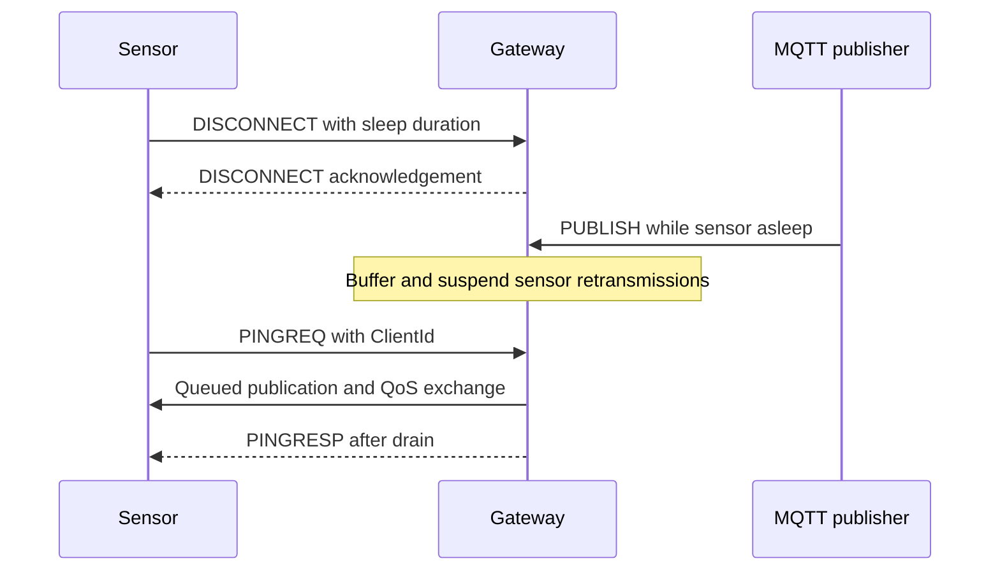

# MQTT-SN: Will, liveness and sleeping delivery

> **Kind:** report · **Status:** draft · **Seal:** none · **Owns:** — · **Stands on:** [plan](../../../plan/pending/mqtt-sn.md), [requirements](../../../doc/project/evidence/standard/mqtt-sn-v1.2/catalog.md)

C7 implements the selected profile of MQTT-SN v1.2 sections 6.2–6.4, 6.11 and 6.14. The publication gateway commit's immediate parent already has the wire/session helpers and production client, but no MqttSnGateway C++/NED type. Its gateway fixtures therefore cannot build or initialize on that parent. This is a source-based missing-capability comparison, not an observed parent runtime failure. Client-only cases are controls already introduced by the client commit.

MqttSnWillClient checks production-client Will negotiation and independent updates. MqttSnWill checks a production gateway negotiating and updating a Will, detecting silent sensor loss and publishing the current payload through the shared MQTT connection. WillPersistent, WillReplace, WillClean and WillDelete distinguish reconnect retention, replacement, clean reset and deletion by an empty Will topic.

MqttSnKeepAlive checks idle client ping/retry. KeepAlive60 and KeepAlive61 use silent scripted sensors and actual duration fields 60 and 61. No loss is allowed just before 90s and 67.1s respectively; loss must occur within the next bounded window. This is the selected tolerance interpretation, not a claim that the specification defines its boundary unambiguously.

MqttSnSleep connects a clean-session sensor, subscribes to short topic tt at QoS2, sleeps for 3s, and holds it asleep past the former active keepalive deadline without UDP publication. A real MQTT publication queues at the gateway. Polling resumes delivery, PUBREL retry is observed, completion precedes PINGRESP, and an empty poll returns PINGRESP. Ordinary disconnect closes the scenario.

WillRetry and WillClientRetry withhold setup/update responses. QueuedWill interrupts only the shared connection, then loses a clean-session sensor: its queued Will must survive sensor cleanup and appear only after shared recovery. GatewayPing checks client response with autonomous keepalive disabled. SleepLatePubrec advances a saved phase without sending while asleep; SleepPendingPubrel suspends its former retry deadline. SleepAckRetry repeats the sleep request, PollRetry loses the final PINGRESP without another QoS2 payload handoff, and SleepDrainArrival queues distinct payloads both asleep and during the drain. SleepClientActive reconnects before new work. SleepChangeDuration replaces the former sleep deadline. SleepZero and SleepWill check expiry, including replacing active supervision.

Network cases use the common Ethernet topology and seed 0. Scripts assert ordered types, identifiers, payloads and closed silence windows. Sleep is protocol buffering; these tests neither turn off the radio nor measure energy. The tests select individual interleavings rather than a full cross-product of durations and faults.

Execution results, commands and remaining coverage limits belong to the [coverage ledger](../../../doc/project/evidence/model/mqttsn/coverage.md). Diagram rendering is unverified. The role-based publication trees and their directly executed checks are recorded in the ledger. The original C1–C9 capability labels are not separate historical commits.
