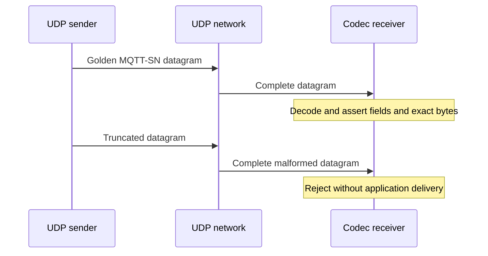

# MQTT-SN wire format

> **Kind:** report · **Status:** draft · **Seal:** none · **Owns:** — · **Stands on:** [plan C2](../../../plan/pending/mqtt-sn.md), [wire catalog](../../../doc/project/evidence/standard/mqtt-sn-v1.2/catalog.md)

C2, “Add MQTT-SN packet encoding and inspection”, introduces the production wire codec, typed message, serializer and inspection registrations. Before C2 these artifacts do not exist, so the fixture cannot initialize; that is a missing capability, not an observed runtime assertion failure on the parent.

`tests/module/mqttsn_serializer.test` uses independently transcribed specification-table bytes for every supported message type. It checks exact encode/decode through both the direct codec and packet serializer boundary, optional Will deletion, extended lengths, binary bytes, unsupported-but-decodable CONNECT versions and malformed bounds. It also checks the one-octet/extended length transition and the full codec length bound. The UDP profile's smaller payload limit is an endpoint responsibility.

`tests/protocol/mqttsn/MqttSnWireFormat.test` sends golden datagrams through real UDP to a fixture that invokes this production codec. A malformed input must not cause delivery or prevent the next valid datagram. It exercises transport integration, not connection or QoS conformance.

The codec module, its 34 filler variants and UDP wire-format case pass; execution details and the broader serializer-suite setup failure are in the [coverage ledger](../../../doc/project/evidence/model/mqttsn/coverage.md). Diagram rendering is unverified. These fixtures do not validate application session state, native sensor links or interoperability with an external implementation.
