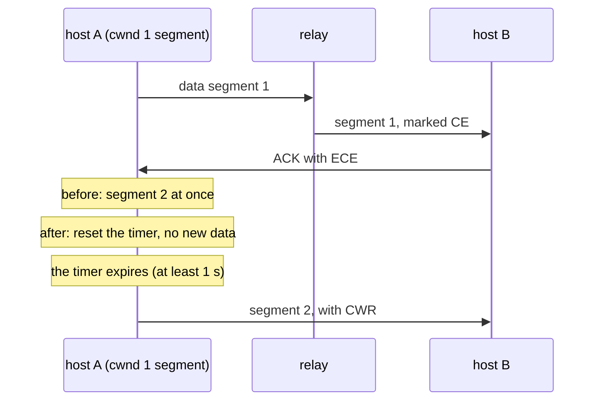

# The ECN-Echo at a congestion window of one segment: tests for "tcp: fix: an ECN-Echo at a window of one segment holds new data until the RTO (RFC 3168)"

Plan and commit: [baseline-catch-up-defect-repairs.md](../../../plan/pending/baseline-catch-up-defect-repairs.md), change R8, commit C15, subject "tcp: fix: an ECN-Echo at a window of one segment holds new data until the RTO (RFC 3168)". The fault is BD-7 of [baseline-catch-up-defects.md](../../../plan/pending/baseline-catch-up-defects.md).
Included tests:

- [Rfc3168EceAtOneSegmentWaitsForTimer.test](rfc/Rfc3168EceAtOneSegmentWaitsForTimer.test), program `rfc3168_ece_at_one_segment_waits_for_timer`
- [Rfc3168EceAtTwoSegmentsSendsAtOnce.test](rfc/Rfc3168EceAtTwoSegmentsSendsAtOnce.test), program `rfc3168_ece_at_two_segments_sends_at_once`

## Protocol requirement and current gap

RFC 3168 section 6.1.2: "The value of the congestion window is bounded below by a value of one MSS. However, the sending TCP should still decrease its congestion window in response to the receipt of an ECN-Echo ACK packet. The sending TCP MUST reset the retransmit timer on receiving the ECN-Echo packet when the congestion window is one. The sending TCP will then be able to send a new packet only when the retransmit timer expires."

`TcpClassicAlgorithmBase::processEce()`, the ECN response of `TcpReno`, `TcpNewReno` and `TcpCubic`, halved cwnd to at least one MSS and reset the retransmission timer when cwnd was one MSS after the halving, so also after a halving from two segments, where the window did decrease. Nothing held new data: `sendData()` after the ECN-Echo and the next ACKs sent new data at once.

Linux does not wait: at an ECE it enters CWR (`tcp_enter_cwr()`), and PRR (`tcp_cwnd_reduction()`) sends new data as the ACKs arrive.

## Code correction and protocol result

`processEce()` notes whether cwnd is one segment at the ECN-Echo, before the halving. Only then it resets the retransmission timer and sets the state variable `eceHold`. While `eceHold` holds, `TcpAlgorithmBase::sendData()` sends no new data. The expiry of the retransmission timer ends it; with nothing in flight that expiry is no loss and sends new data (`e01c747832`). The new parameter `eceAtOneSegment` selects the behavior: "rfc", the default of `Tcp`, as RFC 3168 says; "linux", which `LinuxTcp` sets, resets no timer and holds no data, as Linux.

## Test scenarios and assertions

Both tests: host A uses ECN (`tcpEcnMode = "rfc3168"`) and sends 100000 bytes to host B; the relay marks the first data segment of host A CE, so the ACK of host B carries ECE and acknowledges all data in flight.

**Rfc3168EceAtOneSegmentWaitsForTimer.** Host A starts with a window of one segment (`initialWindow = "rfc2001"`). Assertions: after the ACK with ECE, host A sends no data segment for 0.9 s, less than the lower limit of the RTO; then it sends the next data segment within 3 s; the run ends with the acknowledgment of all data. Before the commit, host A sends the next data segment at the ACK with ECE, at 0.40025684 s; after it, the test passes.

**Rfc3168EceAtTwoSegmentsSendsAtOnce.** Host A starts with a window of two segments (`initialCwnd = 2`), and host B acknowledges both with one ACK with ECE. The halving to one segment is a decrease, so no wait: the next data segment leaves in the same event. It passes before and after the commit, and it fails for a wait that starts also after a halving.

## Protocol diagrams

## Execution and evidence

- In the editor, after a debug build: `run_protocol_tests!(project; file = "Rfc3168|TcpAlgorithmClass|DcTcp|Ecn", mode = "debug")`, 45 tests, and `run_module_tests!(project; file = "tcp_(ecn|dctcp|algorithm|cwnd|rto_cwnd)", mode = "debug")`, 36 tests, pass; the first new test fails before the commit as above.
- The fingerprints and the statistical tests that move, with their reasons, are in the message of the commit.

## Coverage limits

- Limited Transmit and the SACK recovery send new data in paths of their own, which need data in flight; at an ECN-Echo at one segment the ACK normally acknowledges all data, and the tests cover that case only.
- No test runs `eceAtOneSegment = "linux"`.
- `DcTcp` has its own response to the ECN-Echo (RFC 8257) and is not changed.
