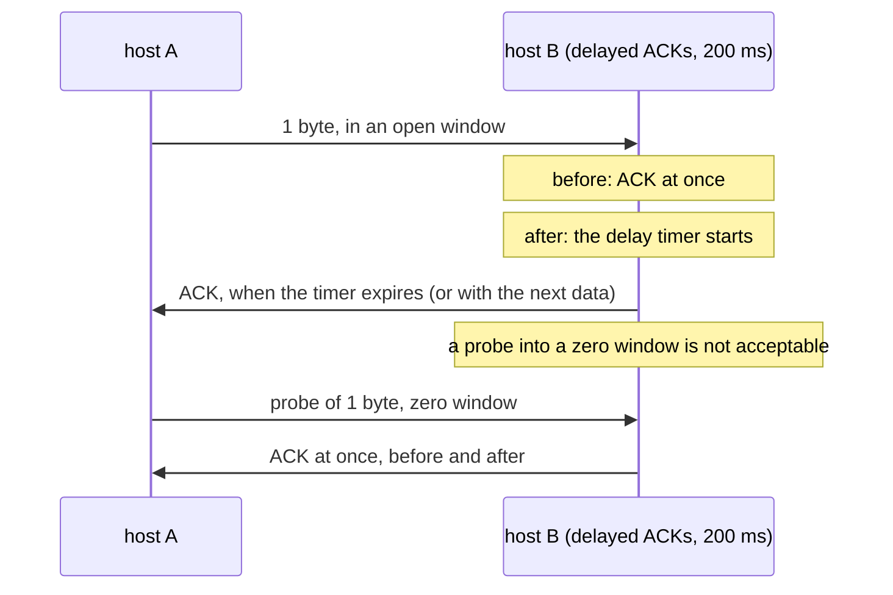

# The ACK of a data segment of 1 byte: tests for "tcp: fix: a data segment of 1 byte in an open window gets a delayed ACK (RFC 9293 SHLD-18)"

Plan and commit: [baseline-catch-up-defect-repairs.md](../../../plan/pending/baseline-catch-up-defect-repairs.md), change R10, commit C17, subject "tcp: fix: a data segment of 1 byte in an open window gets a delayed ACK (RFC 9293 SHLD-18)". The fault is BD-32 of [baseline-catch-up-defects.md](../../../plan/pending/baseline-catch-up-defects.md).
Included tests:

- [Rfc9293OneByteSegmentDelayedAck.test](rfc/Rfc9293OneByteSegmentDelayedAck.test), program `rfc9293_one_byte_segment_delayed_ack`
- [Rfc9293ZeroWindowProbeAckAtOnce.test](rfc/Rfc9293ZeroWindowProbeAckAtOnce.test), program `rfc9293_zero_window_probe_ack_at_once`

## Protocol requirement and current gap

RFC 9293 section 3.8.6.3: "A TCP endpoint SHOULD implement a delayed ACK (SHLD-18)", with a delay of less than 0.5 s (MUST-40). A receiver with delayed ACKs delays the ACK of a data segment that is in order and not a full segment. Section 3.10.7.4 sends an ACK at once for a segment that is not acceptable, such as a zero-window probe: that ACK tells the sender the window.

`TcpConnection::processSegment1stThru8th()` set `ack_now` for each in-order data segment of 1 byte, with the comment "TODO how to check if it is really a persist probe?". So a segment of 1 byte in an open window got its ACK at once, also with delayed ACKs. A real probe arrives in a zero window, is not acceptable, and gets its ACK at once on the path of a segment that is not acceptable, so the special case is not needed for it.

Linux has no special case for a segment of 1 byte.

## Code correction and protocol result

The three lines of the special case are deleted. A data segment of 1 byte in an open window now goes through the same path as each other small in-order segment: with delayed ACKs, its ACK waits for the delay timer, or leaves earlier with the next data or with the ACK of the next segment. The other reasons for an ACK at once stay: a segment out of order, a segment that is not acceptable, a FIN, and the second full segment.

## Test scenarios and assertions

**Rfc9293OneByteSegmentDelayedAck.** Host B has delayed ACKs with a delay of 200 ms. Host A sends one byte into the open window of host B and has nothing more to send; host B sends nothing back. Assertions: host B sends no ACK of the byte in the 0.19 s after the byte arrives, and sends it in the next 0.05 s. Before the commit, host B sends the ACK at once, at 0.20001264 s, and the test fails there.

**Rfc9293ZeroWindowProbeAckAtOnce** (the guard). Host A sends 5000 bytes with an MSS of 1000 bytes; host B advertises 3952 bytes, has delayed ACKs, and reads nothing. After four segments its window is zero, and host A sends a probe of 1 byte when its persist timer expires. Assertion: host B sends the ACK of the probe in the 0.05 s after the probe arrives, before the delay timer can expire. It passes before and after the commit.

**tcp_nagle_2.test** (module test). Its expected trace had the behavior of BD-32: the ACK of the first segment of 1 byte at once. Now that ACK leaves when the delay timer expires, and the sender sends the data that waits in full segments; the server application receives the same 3074 bytes in 5 packets. The commit changes the expected trace.

## Protocol diagrams

## Execution and evidence

- In the editor, after a debug build: `run_protocol_tests!(project; file = "Rfc9293", mode = "debug")` and the module tests of the delayed ACK, the persist timer, Nagle, the window and the receive buffer; the results are in the plan.
- `examples/inet/nclients` `inet__inet` (Telnet over `Tcp`, 3000 s): TCP sends 715 segments in place of 1244, because the pure ACKs fall from 636 to 107. The server sends its ACK with the echo, and a client sends the ACK of an echo with its next keystroke or when the delay timer expires.
- The fingerprints and the statistical tests that move, with their reasons, are in the message of the commit.

## Coverage limits

- The tests cover `Tcp`. `TcpLwip` has its own receiver and does not change.
- No test covers a probe into a window that opens while the probe travels; such a probe is acceptable and now gets a delayed ACK, as other small segments do.
