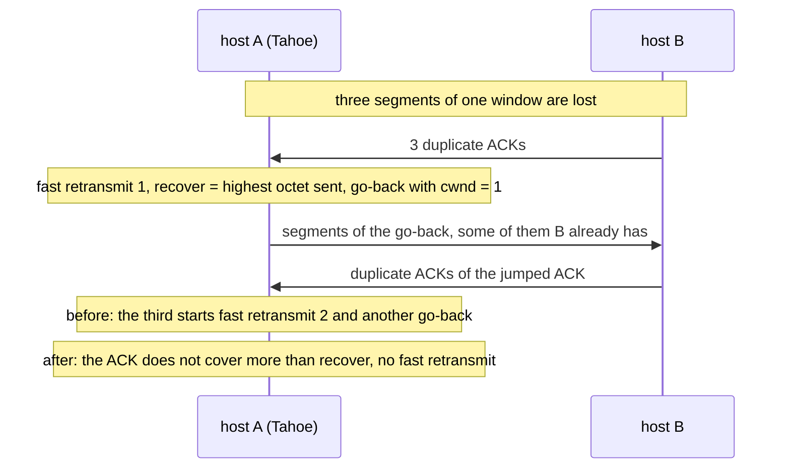

# One fast retransmit in each window for TcpTahoe and TcpWestwood: tests for "tcp: fix: TcpTahoe and TcpWestwood start one fast retransmit in each window (RFC 6582 section 6)"

Plan and commit: [baseline-catch-up-defect-repairs.md](../../../plan/pending/baseline-catch-up-defect-repairs.md), change R5, commit C13, subject "tcp: fix: TcpTahoe and TcpWestwood start one fast retransmit in each window (RFC 6582 section 6)". The fault is BD-39 of [baseline-catch-up-defects.md](../../../plan/pending/baseline-catch-up-defects.md).
Included tests:

- [Rfc6582TahoeOneFastRetransmitPerWindow.test](rfc/Rfc6582TahoeOneFastRetransmitPerWindow.test), program `rfc6582_tahoe_one_fast_retransmit_per_window`
- [Rfc6582WestwoodOneFastRetransmitPerWindow.test](rfc/Rfc6582WestwoodOneFastRetransmitPerWindow.test), program `rfc6582_westwood_one_fast_retransmit_per_window`

## Protocol requirement and current gap

RFC 6582 section 6 names the problem: without SACK, a sender can not tell the duplicate ACK of a lost segment from the duplicate ACK of a segment that it sent again and that the receiver already had, so the losses of one window can start several fast retransmits. Its guard is the variable recover: at a fast retransmit and at a retransmission timeout (the steps "Three duplicate ACKs" and "Retransmit timeouts" of section 3.2), recover is the highest sequence number sent, and the third duplicate ACK starts a fast retransmit only when the cumulative ACK covers more than recover.

`TcpTahoe` and `TcpWestwood` tested `dupacks == dupthresh` and nothing else. Tahoe goes back to slow start from the first unacknowledged segment at its fast retransmit and at a timeout; Westwood retransmits one segment and inflates cwnd at its fast retransmit, as Reno does, and goes back only at a timeout. After a go-back, the duplicates of the segments that the receiver already had started another fast retransmit and another go-back. In `examples/inet/tcpclientserver` `inet-tahoe` run 0 the sender repeats this cycle about every 8 ms: 163 fast retransmits.

## Code correction and protocol result

Both flavours start recover at ISS - 1 when the connection is established, as `Rfc6582Recovery` does, so that a loss of the first data segment gets a fast retransmit. At a timeout, both set recover to `snd_max - 1`. Tahoe also sets it at its fast retransmit, because that goes back too; the fast retransmit of Westwood does not go back, so it leaves recover. The third duplicate ACK starts a fast retransmit only when `snd_una - 1 > recover`, the test of `Rfc6582Recovery`; Westwood also inflates cwnd for further duplicates only then. The heuristics of RFC 6582 section 4 stay out, as in `~TcpNewReno`. So a real loss inside a go-back, below recover, waits for the retransmission timer.

## Test scenarios and assertions

Both tests run the flavour without SACK; host A sends 300000 bytes to host B. An observer marks a fast retransmit: a segment that host A sends again while it holds three duplicates of one ACK.

**Rfc6582TahoeOneFastRetransmitPerWindow.** The relay removes the 40th, 42nd and 44th data segments, once each. The guard forbids a second fast retransmit while the cumulative ACK does not cover more than the highest octet that host A had sent at the last fast retransmit; the run must end with the ACK of all data. Before the commit, the duplicates of the go-back start a second fast retransmit at t = 0.2089 s, with the cumulative ACK 117672 equal to that octet + 1; after it, the test passes.

**Rfc6582WestwoodOneFastRetransmitPerWindow.** The relay removes six data segments of one window, the 40th, 42nd, 44th, 46th, 48th and 50th, so the retransmission timer expires. The guard forbids a fast retransmit after a timeout while the cumulative ACK does not cover more than the highest octet that host A had sent at the timeout. Before the commit, the go-back starts a fast retransmit at t = 1.2093 s with the cumulative ACK 95952 below 117672; after it, the test passes.

## Protocol diagrams

## Execution and evidence

- In the editor, the 39 protocol tests of RFC 5681, RFC 6582, RFC 6298 and the TCP algorithm classes and 28 module tests that use TcpTahoe or TcpWestwood pass in debug mode after the series; before it, both new tests fail as above.
- `examples/inet/tcpclientserver` `inet-tahoe` and `inet-westwood`, runs 0 to 6, before and after the series: the table of the plan. Fewer fast retransmits in most runs (run 0 of Tahoe: 163 to 5); more timeouts in Tahoe runs 3 and 6 and Westwood run 5, which have high loss rates.
- The fingerprints and the statistical tests that move, with their reasons, are in the message of the commit.

## Coverage limits

- The timeout path of Tahoe and a second real loss in the window of a fast retransmit of Westwood have no test of their own.
