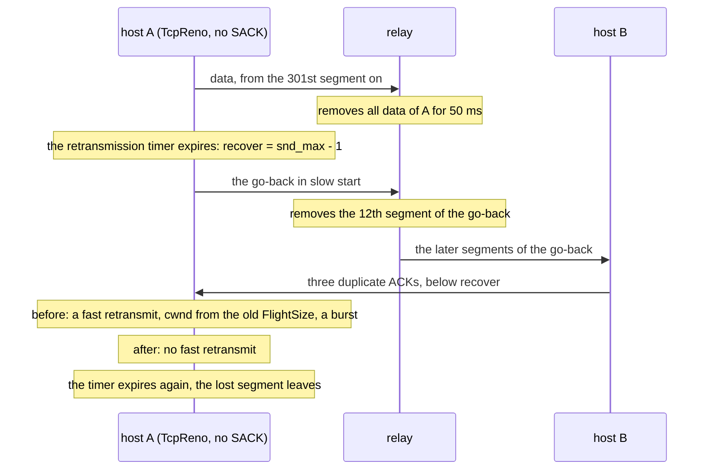

# The fast retransmit of TcpReno after a timeout: tests for "tcp: fix: TcpReno starts no fast retransmit in the recovery of a timeout (RFC 6582 section 6)"

Plan and commit: [baseline-catch-up-defect-repairs.md](../../../plan/pending/baseline-catch-up-defect-repairs.md), change R9, commit C16, subject "tcp: fix: TcpReno starts no fast retransmit in the recovery of a timeout (RFC 6582 section 6)". The fault is BD-14 of [baseline-catch-up-defects.md](../../../plan/pending/baseline-catch-up-defects.md).
Included tests:

- [Rfc6582RenoNoFastRetransmitAfterTimeout.test](rfc/Rfc6582RenoNoFastRetransmitAfterTimeout.test), program `rfc6582_reno_no_fast_retransmit_after_timeout`

## Protocol requirement and current gap

RFC 6582 section 6: after a retransmission timeout, the sender goes back and sends again segments that the receiver can already have. Their duplicate ACKs must not start a fast retransmit. The guard is the variable recover. The step "Retransmit timeouts" of section 3.2: "After a retransmit timeout, record the highest sequence number transmitted in the variable recover", and the third duplicate ACK starts a fast retransmit only when the cumulative ACK covers more than recover.

`TcpNewReno` has the guard (`Rfc6582Recovery::onRexmitTimeout()`), and `TcpTahoe` and `TcpWestwood` got it in R5. `TcpReno` and `DcTcp` without SACK use `Rfc5681Recovery`, which had none. So a fast retransmit in the go-back took ssthresh by equation (4) of RFC 5681 from a FlightSize that still held the data of before the timeout. cwnd jumped, and the go-back sent many retransmissions at once. RFC 5681 section 3.1 limits only the sequence numbers to `snd_una + cwnd`, so these retransmissions are no violation of RFC 5681; the fast retransmit itself is the fault.

Linux has the same guard: after an RTO it is in the state `TCP_CA_Loss`, and duplicate ACKs start no fast recovery before `snd_una` passes `high_seq`.

## Code correction and protocol result

`Rfc5681Recovery` gets the flag `recoverAfterTimeout`, which only `TcpReno` sets, and so `DcTcp`, which extends it. With the flag, the constructor sets `recover = iss - 1`, as `Rfc6582Recovery` does, a timeout (`onRexmitTimeout()`) sets `recover = snd_max - 1`, and the third duplicate ACK starts a fast retransmit only when `snd_una - 1 > recover`. `TcpNewReno` builds a temporary `Rfc5681Recovery` for each step of RFC 5681 and keeps `recover` itself, so the class touches `recover` only with the flag. A fast retransmit does not set recover: a second loss in one window still gets a fast retransmit, as RFC 5681 defines it for Reno.

## Test scenarios and assertions

**Rfc6582RenoNoFastRetransmitAfterTimeout.** `TcpReno` without SACK, as `examples/inet/tcpwindowscale`; host B offers a window of 1000000 bytes, and host A sends 1000000 bytes. The relay removes every data segment of host A for 50 ms from its 301st segment on, so the retransmission timer of host A expires. In the go-back, the relay removes the 12th data segment of host A, so the later segments of the go-back bring duplicate ACKs. Observers keep the cumulative ACK, its duplicates, the highest octet sent, and that octet at each timeout. Assertions: host A sends no segment again while it holds three duplicates of one ACK and that ACK does not cover more than the highest octet sent at the last timeout; the run ends with the ACK of all data, after at least one timeout. Before the commit, host A starts a fast retransmit at 1.42777008 s, takes ssthresh and cwnd 68056 from the FlightSize of before the timeout, and sends 35 segments at once; after it, the test passes, and the lost segment leaves at a second timeout (2.4273 s).

## Protocol diagrams

## Execution and evidence

- In the editor, after a debug build: `run_protocol_tests!(project; file = "Rfc5681|Rfc6582|Rfc6298|TcpAlgorithmClass|DcTcp", mode = "debug")`, 42 tests, and the module tests of the algorithms, the retransmission and DCTCP, 38 tests, pass; the new test fails before the commit as above.
- `examples/inet/tcpwindowscale` `WS_enabled` (TcpReno without SACK, 600 s) shows the fault at 22.6027 s: after the timeout at 14.34 s, the third duplicate ACK of the go-back starts a fast retransmit with ssthresh 217800, and the client sends 123 segments at once. With the guard it sends none there, cwnd stays higher (lowest ssthresh 163350 in place of 17424), and the server receives 270253500 bytes in place of 180130764.
- The fingerprints and the statistical tests that move, with their reasons, are in the message of the commit.

## Coverage limits

- No test runs `DcTcp` without SACK.
- The test covers one loss in the go-back. A second loss in one window outside the recovery of a timeout keeps its fast retransmit, and the tests of RFC 5681 cover that case.
