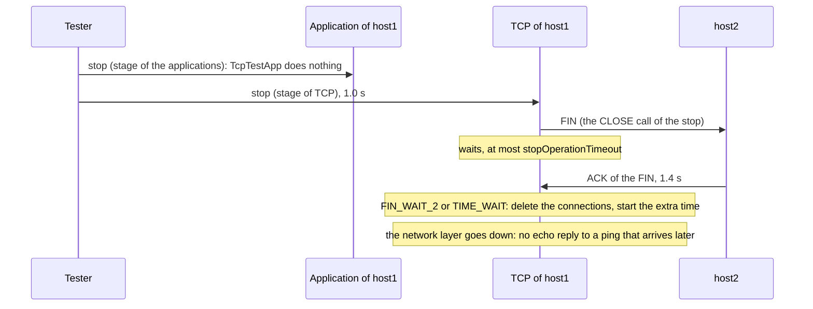
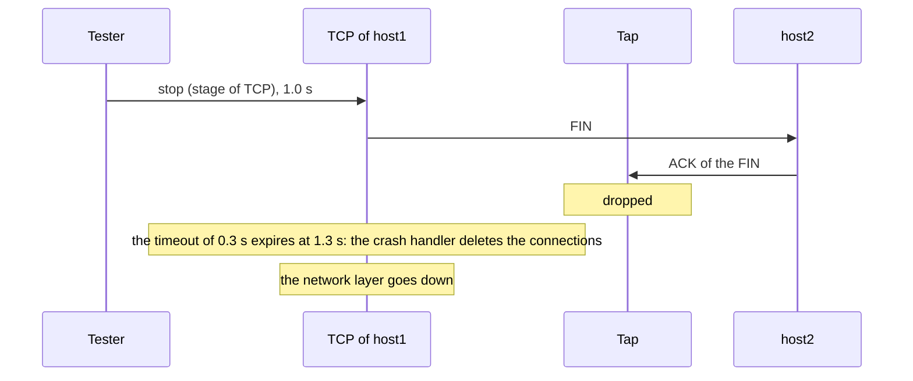

# C4: The stop of Tcp closes its connections and waits for them

When a node stops (the lifecycle operation `ModuleStopOperation`, for example a `<shutdown>` of a scenario script), its modules stop in stages from the applications down to the physical layer. A connection that its application left open should end with a FIN, as a host that shuts down closes its sockets, so that the peer does not keep a half-open connection. `Tcp.stopOperationTimeout` names the time that the stage of TCP may take for this.

The original scenario, findings PF-10 and PF-9 of the [catalog of the parameter tests](../../../doc/project/evidence/model/tcp/parameters.md#findings): `Tcp::handleStopOperation()` deleted all connections at once, without a segment, and waited for nothing (a FIXME in the code said "close connections??? yes, because the applications may not close them!!!"). So the timeout acted only when `stopOperationExtraTime` was longer. And with `stopOperationExtraTime = -1s`, the default of 28 other modules of INET, the run stopped: the handler called `delayActiveOperationFinish()` and then `startActiveOperationExtraTimeOrFinish()`, whose branch for a negative value invoked the done callback of the lifecycle controller inside `handleOperationStage()`.

The correction changes the stage of TCP:

1. With `stopOperationTimeout = 0s`, the stage deletes all connections at once, as before.
2. Else `Tcp::closeConnectionsForStop()` issues the CLOSE call of RFC 9293 section 3.10.4 to each connection that is still open (LISTEN, SYN_SENT, SYN_RECEIVED, ESTABLISHED, CLOSE_WAIT), through the CLOSE processing of `TcpConnection`. A listening connection and one in SYN_SENT end at once; the others send their queued data and a FIN.
3. The stage waits while a connection has data or a FIN that the peer has not acknowledged. `TcpConnection::stateEntered()` tells `Tcp` about each change of a state, and `Tcp` checks its connections in an event of its own (`stopCheckTimer`), because a check inside the processing of a connection must not delete that connection. A connection in FIN_WAIT_2 or TIME_WAIT needs nothing more from this node; the stage does not wait for the 2 MSL of TIME_WAIT.
4. When no connection waits, `Tcp::finishStop()` cancels the timeout, deletes the rest of the connections, and starts the extra time. When nothing waits from the start, it does so inside the stop handler, without `delayActiveOperationFinish()`, so a negative extra time ends the stage at once, as the mixin means it (PF-9). The timeout bounds only the wait: at the timeout, the crash handler deletes all connections.
5. During the wait the applications are down already. A message to an application that is down would stop the run, so `Tcp::sendToApp()` drops what the connections would send them. A command that an application sent just before it went down arrives after the stage of TCP has closed the connection, so `Tcp::handleUpperCommand()` ignores the commands of the applications during the wait.

The waits, scenario `waits` of the tests: host1 stops at 1 s with a connection that its application left open.

The timeout, scenario `expires`: the ACK of the FIN never comes.

## Direct checks

The tests of the timeout use a `TcpTestApp` on host1, which takes no part in the lifecycle and so never closes its connection, a link delay of 100 ms (a round trip of 400 ms), and pings of host2 every 50 ms; the last echo reply that host2 gets shows when the stage of TCP ends.

- [TcpStopOperationTimeoutZero.test](parameter/module/TcpStopOperationTimeoutZero.test) (`0s`): host2 receives no FIN, and the last reply is the reply to the ping 5, whose request reached host1 before 1 s. It passes before and after the correction, because `0s` keeps the old behavior.
- [TcpStopOperationTimeoutWaits.test](parameter/module/TcpStopOperationTimeoutWaits.test) (`2s`): host2 receives the FIN of host1, and the last reply is the reply to the ping 13, whose request reached host1 before the ACK of the FIN at 1.4 s. Before the correction it failed: no FIN came.
- [TcpStopOperationTimeoutExpires.test](parameter/module/TcpStopOperationTimeoutExpires.test) (`0.3s`): a tap rule drops the segments of host2 after the stop; host2 receives the FIN, and the last reply is the reply to the ping 11, whose request reached host1 before the timeout at 1.3 s. Before the correction it failed.
- [TcpStopOperationExtraTimeNegativeAlias.test](parameter/module/TcpStopOperationExtraTimeNegativeAlias.test) (`-1s`, no connection): the stage ends at the stop. Before the correction the run stopped with the usage error (PF-9).

The FIN is observed where it arrives, at the TCP of host2, because the stop sends it inside the action of the tester, before the next step of the test listens. Each test of the timeout fails with the values of the other two classes. The tests of the extra time without a connection keep their verdicts, and the module tests of the lifecycle (`opp_run_module_tests -m debug -f lifecycle`, 51 tests) pass. The fingerprint tests of all examples, showcases and tutorials that stop nodes keep their values (207 runs), so no example needs `stopOperationTimeout = 0s`.

The checks use one connection. They do not cover a connection with data in the send queue at the stop, or a connection in SYN_RECEIVED.
