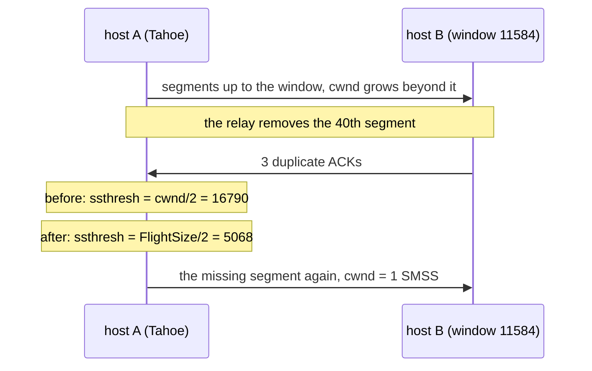

# The threshold of TcpTahoe from FlightSize: tests for "tcp: fix: TcpTahoe takes ssthresh from FlightSize, as RFC 5681 equation (4) says"

Plan and commit: [baseline-catch-up-defect-repairs.md](../../../plan/pending/baseline-catch-up-defect-repairs.md), change R5, commit C12, subject "tcp: fix: TcpTahoe takes ssthresh from FlightSize, as RFC 5681 equation (4) says". The fault is BD-8 of [baseline-catch-up-defects.md](../../../plan/pending/baseline-catch-up-defects.md).
Included tests:

- [Rfc5681TahoeThresholdFlightSize.test](rfc/Rfc5681TahoeThresholdFlightSize.test), program `rfc5681_tahoe_threshold_flight_size`

## Protocol requirement and current gap

RFC 5681 section 3.1, equation (4), sets the threshold after a loss: "ssthresh = max (FlightSize / 2, 2*SMSS)", for a loss that the retransmission timer finds and, by section 3.2, step 2, for the third duplicate ACK. Section 3.1 also warns: "An easy mistake to make is to simply use cwnd, rather than FlightSize, which in some implementations may incidentally increase well beyond rwnd."

`TcpTahoe::resetToSlowStart()`, which the third duplicate ACK and the timeout call, set ssthresh to max(cwnd / 2, 2*SMSS). TcpTahoe grows cwnd by one segment for each ACK of new data, also when the window of the receiver and not cwnd limits what it sends, so cwnd can be far above FlightSize. `~TcpReno` and `~TcpNewReno` take FlightSize since `b2313324ef`.

## Code correction and protocol result

`resetToSlowStart()` takes the FlightSize from its caller, as `TcpClassicAlgorithmBase` does: the third duplicate ACK gives `conn->getFlightSize()`, which leaves out the data of limited transmit (RFC 3042), and the timeout gives the outstanding data `snd_max - snd_una`, as `calculateSsthreshForRto()`. cwnd still falls to one SMSS.

## Test scenarios and assertions

**Rfc5681TahoeThresholdFlightSize.** Host A runs TcpTahoe without SACK and without limited transmit and sends 300000 bytes; host B offers a window of 8 segments (11584 bytes), so the window and not cwnd limits host A. The relay removes the 40th data segment once; the later segments make host B repeat its ACK. Observers keep FlightSize from the segments and the ACKs, and the last value of cwnd. Assertions: at the third duplicate ACK, cwnd is larger than FlightSize, so the test tells the two formulas apart; the next ssthresh is max(FlightSize / 2, 2*SMSS). Before the commit, cwnd is 33580 and FlightSize 10136 there, and ssthresh is 16790 in place of 5068; after it, the test passes.

## Protocol diagrams

## Execution and evidence

- In the editor, `run_protocol_tests!(project; file = "Rfc5681|Rfc6582|Rfc6298|TcpAlgorithmClass|TcpInitialSsthresh", mode = "debug")` after a debug build: before the commit the new test fails as above; after the series of R5 the 39 tests pass. The module tests that use TcpTahoe or TcpWestwood (`tcp_algorithm_tahoe`, `tcp_tahoe_*`, `tcp_sack_*` and others, 28 tests) pass.
- The fingerprints and the statistical tests that move, with their reasons, are in the message of the commit.

## Coverage limits

- The test covers the third duplicate ACK. The timeout path takes the same line with the outstanding data and has no test of its own.
