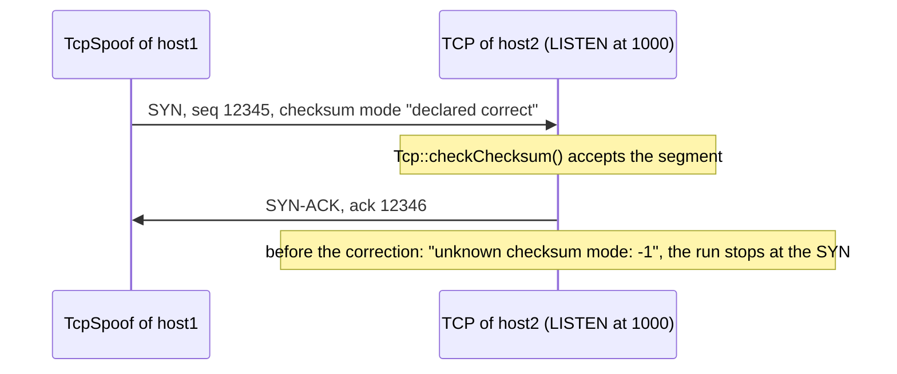

# C8: TcpSpoof declares the checksum of its segments correct

`TcpSpoof` takes the place of the TCP of a node and sends one fabricated segment at the time `t`. Its NED says that it "sends fabricated TCP packets", so a TCP that receives such a segment must be able to process it: answer a SYN with a SYN-ACK, or a segment without SYN with a RST (RFC 9293 section 3.10.7.2). The checksum of TCP is never optional (RFC 9293 section 3.1), and `Tcp` checks it by the checksum mode of the header (`Tcp::checkChecksum()`): a computed checksum is checked, a checksum declared correct is accepted, and another mode stops the run.

The original scenario, finding PF-11 of the [catalog of the parameter tests](../../../doc/project/evidence/model/tcp/parameters.md#findings): host1 has `TcpSpoof` in place of its TCP and sends a SYN to host2:1000, where `TcpEchoApp` listens. At the arrival of the SYN, the TCP of host2 stopped the run with "unknown checksum mode: -1". `TcpSpoof::sendSpoofPacket()` set no checksum mode, so the header kept `CHECKSUM_MODE_UNDEFINED`. No TCP could take a segment of `TcpSpoof`, so the spoof tests dropped each segment at the tap after host1 sent it.

The correction sets the mode `CHECKSUM_DECLARED_CORRECT` in the header (decision D6 of the plan). That is the mode that `Tcp` writes with its default `checksumMode = "declared"`. A computed checksum is a later option, which no finding asks for.

## Direct checks

- [TcpSpoofIsSYNTrueAnswer.test](parameter/spoof/TcpSpoofIsSYNTrueAnswer.test) (`isSYN = true`, facet `true-answer`): host1 sends the SYN of the spoof at 1 s, and the TCP of host2 answers with a SYN-ACK that acknowledges 12346. Before the correction it failed, because the run stopped at the SYN; after it, it passes. With `isSYN = false` it fails, because a listener does not answer a segment without SYN and ACK.
- The other 13 spoof tests in [parameter/spoof/](parameter/spoof/) observe the segment of the spoof on the wire. Before the correction a tap rule dropped the segment after host1 sent it, so that the receiver did not stop the run; the correction removes that rule, and the observations stay the same. They keep their verdicts: 12 PASS, and `TcpSpoofSeqNoIss.test` fails for PF-13, which C9 repairs.

The cross-class check of the spoof group found a defect of `Tcp` that the tap rule hid: with `isSYN = true`, the run of `TcpSpoofIsSYNFalse.test` continues after the SYN-ACK of host2. host1 has no TCP, so its IP answers the SYN-ACK with an ICMP Protocol Unreachable, and the forked connection of host2 sends "connection refused" to an application that has no socket for it. The dispatcher of host2 then stops the run with "Unknown socket". The next commit, C8a, repairs that defect.

The checks cover the IPv4 path and the IPv6 path of the segment (`TcpSpoofDestAddressHostIpv6.test`), but an answer only on IPv4. They do not check a computed checksum, which `TcpSpoof` does not offer.
