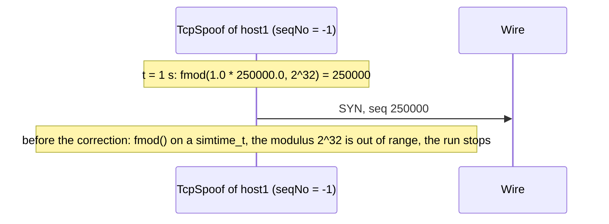

# C9: TcpSpoof takes the ISS of the clock as Tcp does

`TcpSpoof.seqNo` gives the sequence number of the fabricated segment, and its NED says "-1 for TCP ISS". `Tcp` takes the ISS of a connection from the clock when `initialSendSequenceNumber = -1`: one tick in 4 microseconds, modulo 2^32 (RFC 9293 section 3.4.1; `TcpConnection::selectInitialSeqNum()`). So with `seqNo = -1`, the spoof must send the number that a TCP of the node would take at the same time: 250000 at 1 s.

The original scenario, finding PF-13 of the [catalog of the parameter tests](../../../doc/project/evidence/model/tcp/parameters.md#findings): host1 has `TcpSpoof` with `seqNo = -1` and sends one segment at 1 s. The run stopped at 1 s with "simtime_t: Cannot represent 4.29497e+09, out of the range ... allowed by the current scale exponent -12".

The cause is the order of the conversion in `TcpSpoof::chooseInitialSeqNum()`. It called `fmod()` with `simTime() * 250000.0`, which is a `simtime_t`, so the modulus 2^32 became a `simtime_t` too. With the time scale of picoseconds, a `simtime_t` holds at most about 9.2 million seconds, and 2^32 is more than that. `TcpConnection::selectInitialSeqNum()` converts the time to a double first (`SIMTIME_DBL(simTime()) * 250000.0`), so it has no such limit.

The correction takes the expression of `TcpConnection::selectInitialSeqNum()` (decision D8 of the plan). The spoof and `Tcp` then give the same number at the same time, also at the boundary of a tick, where an integer computation could differ by one from the double of `Tcp`. The expression is one line, and no shared place of `tcp_common` and `tcp` fits a function for it, so the commit writes it again, with a comment that names its source.

## Direct checks

- [TcpSpoofSeqNoIss.test](parameter/spoof/TcpSpoofSeqNoIss.test) (`seqNo = -1`, class `iss`): the segment of the spoof at 1 s carries the sequence number 250000. Before the correction it failed, because the run stopped at 1 s; after it, it passes. With `seqNo = 12345` it fails.
- [TcpSpoofSeqNoValue.test](parameter/spoof/TcpSpoofSeqNoValue.test) (`seqNo = 12345`, class `value`) keeps its verdict PASS. Before the correction the cross-class check gave no verdict for it with `-1`, because the run stopped; now it fails with `-1`, as the check requires.

The cross-class check of the spoof group gives a verdict for each of its 8 runs, and each run fails with the value of the other class. The checks use one time, 1 s. They do not check the wrap at 2^32, which comes after about 4.8 hours of simulation time.
