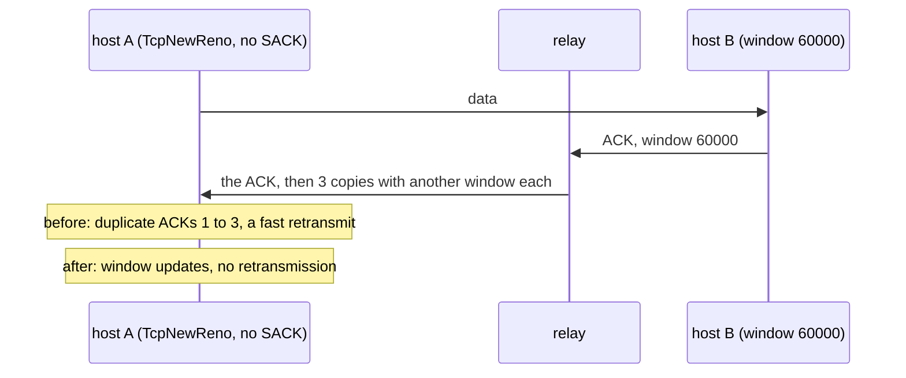

# A window update is no duplicate ACK: tests for "tcp: fix: a window update is no duplicate ACK (RFC 5681 section 2)"

Plan and commit: [baseline-catch-up-defect-repairs.md](../../../plan/pending/baseline-catch-up-defect-repairs.md), change R7, commit C14, subject "tcp: fix: a window update is no duplicate ACK (RFC 5681 section 2)". The fault is BD-4 of [baseline-catch-up-defects.md](../../../plan/pending/baseline-catch-up-defects.md).
Included tests:

- [Rfc5681WindowUpdateNoDuplicateAck.test](rfc/Rfc5681WindowUpdateNoDuplicateAck.test), program `rfc5681_window_update_no_duplicate_ack`
- [Rfc5681SmallerWindowNoDuplicateAck.test](rfc/Rfc5681SmallerWindowNoDuplicateAck.test), program `rfc5681_smaller_window_no_duplicate_ack`

## Protocol requirement and current gap

RFC 5681 section 2 counts an acknowledgment as a duplicate only when, among other conditions, "(e) the advertised window in the incoming acknowledgment equals the advertised window in the last incoming acknowledgment". A window update, an ACK that repeats the acknowledgment number with another window, is therefore no duplicate, and three of them must not start a fast retransmit.

`TcpConnection::processAckInEstabEtc()` writes the window of an ACK at SND.UNA into `snd_wnd` (`updateWndInfo()`) before the duplicate ACK test. `Rfc5681Recovery::isDuplicateAck()`, which `Rfc6582Recovery` uses too, compared the window of the ACK with that `snd_wnd`, so condition (e) always held. `TcpAlgorithmBase::isDuplicateAck()`, the test of `TcpTahoe`, `TcpVegas`, `TcpWestwood` and `TcpNoCongestionControl`, had no condition (e) at all. The SACK recovery (`Rfc6675Recovery`) defines a duplicate ACK by its SACK blocks, so the fault acts only without SACK.

Linux departs from the text of condition (e): `tcp_may_update_window()` takes the window of an ACK that acknowledges nothing new only when it grows or is zero, and only then sets `FLAG_WIN_UPDATE`, which makes the ACK no duplicate. So for Linux an ACK with a smaller window, which a receiver can offer when out-of-order data takes its buffer, stays a duplicate, and a repeated zero window does not.

## Code correction and protocol result

`updateWndInfo()` answers whether the ACK is a window update, and the connection keeps the answer in the state variable `snd_wnd_updated` for the ACK at SND.UNA in process. Both duplicate ACK tests read it as condition (e). The new parameter `duplicateAckWindowRule` selects the rule: "rfc", the default of `Tcp`, takes any change of the window, as condition (e) says; "linux", which `LinuxTcp` sets, takes a larger or a zero window only, as Linux.

## Test scenarios and assertions

Both tests run TcpNewReno without SACK, whose duplicate ACK is that of RFC 5681. Host A sends 300000 bytes; host B advertises 60000 bytes. The relay sends the third acknowledgment of data of host B three more times, 10 microseconds apart, and changes the window of each copy. No segment is lost, so any retransmission of host A is wrong.

**Rfc5681WindowUpdateNoDuplicateAck.** The copies advertise 60100, 60200 and 60300 bytes: window updates under both rules. Assertions: the third copy arrives at host A, host A retransmits nothing, and the run ends with the acknowledgment of all data. Before the commit, host A counts the copies as duplicate ACKs 1 to 3 and starts a fast retransmit at 0.2009128 s; after it, the test passes.

**Rfc5681SmallerWindowNoDuplicateAck.** The copies advertise 59900, 59800 and 59700 bytes. Host A has far less than that in flight, so no data is beyond the smaller windows. Under the rule of the RFC, the default, the copies are no duplicates. The assertions and the result before and after the commit are those of the first test.

`tests/module/tcp_rcvbuf_shrink_3.test` has a receiver whose window shrinks with out-of-order data (`windowShrinkAllowed`), and it expects a fast retransmit from these ACKs. It now selects `duplicateAckWindowRule = "linux"` for its sender, and its expected output stays the same; under the rule of the RFC its ACKs are no duplicates.

## Protocol diagrams

## Execution and evidence

- In the editor, after a debug build: both tests fail before the commit as above; with the commit, `run_protocol_tests!(project; file = "Rfc5681|Rfc6582|TcpAlgorithmClass|Rfc9293FlowControl|Rfc9293ShrunkWindow|Rfc9293SwsOverride|Rfc9293NoWindowShrink|Rfc9293DuplicateSegment", mode = "debug")` passes, 41 tests. The 49 module tests of the algorithms and of the window give 45 PASS; the 4 `tcp_stresstest_*` fail on a machine whose OMNeT++ prints a line "Network hash", with and without the commit.
- The commit moves no stored fingerprint and no statistic: the stored runs use SACK, or they get no window update during a transfer without it.

## Coverage limits

- The tests run TcpNewReno. `TcpTahoe`, `TcpVegas`, `TcpWestwood` and `TcpNoCongestionControl` take the same condition through `TcpAlgorithmBase::isDuplicateAck()`, with no test of their own for a window update.
- No test runs the rule of Linux with a larger or a zero window; `tcp_rcvbuf_shrink_3` runs it with a smaller window.
