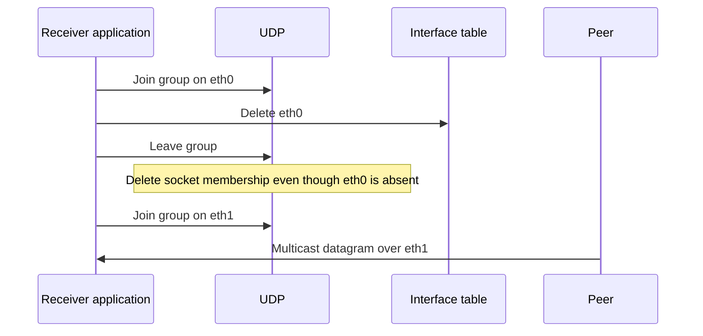

# UDP multicast membership after interface removal

Plan C6a: **Udp: leave multicast groups after interface removal**.

The socket owns its group memberships, while the interface table owns network interfaces. Removing an interface must not prevent a later socket leave from releasing its membership. `MulticastInterfaceRemoval.test` joins a real socket on `hostA.eth0`, deletes that interface through `IInterfaceTable::deleteInterface()`, leaves the group and joins it on `hostA.eth1`. A peer sends one multicast datagram over the second Ethernet link, and the socket must receive it exactly once.

The parent uses a throwing lookup for the saved interface ID during leave. The corrected provider uses the nonthrowing lookup and skips only the absent interface's filter update. Surviving interface updates and socket membership deletion remain unchanged. The fixture observes real socket delivery rather than calling UDP's private membership helpers. Its single IPv4 group exercises the shared provider path; it does not establish arbitrary multicast routing or MLD behavior.

Final verification on 2026-11-14 passed this case as part of the combined 25-case protocol command recorded in [the AODV interface reviewer document](../aodv/interface-changes.md). The runner exited 0 in debug mode, General/run 0/seed 0, with fixed Ethernet links. The socket received exactly one multicast datagram after physical interface deletion, leave and rejoin. The INET library SHA256 was `bcb9f5d13fa867ddca91b87c45121fe280c38c2a6042d8fc4b830e7d777e1011`.

Exact commands, library hash, source/INI/NED snapshots and stdout/stderr are retained in `/home/miguel/workspace/ai-logs/executions/aodv-live-owned-protocol-bcb9f5d13fa8/`; `record.json` holds the shared run record. The standalone selector is `MulticastInterfaceRemoval\.test` in suite `^tests/protocol/udp$`. Exact-parent execution remains unverified; the predicted parent exception follows its throwing source lookup.

Mermaid rendering passed in the series-wide [implementation record](../../../doc/project/evidence/model/aodv/remaining-features-results.md).
