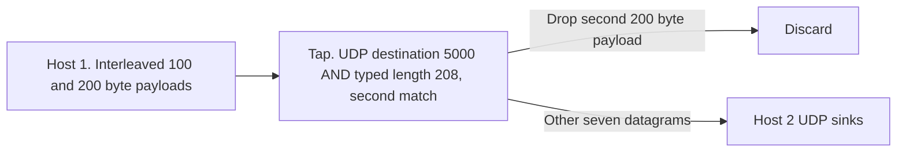

# Selecting a precise packet for fault injection

> **Kind:** report · **Status:** snapshot 2026-11-16 · **Seal:** none · **Owns:** — · **Stands on:** [dtls.md](https://github.com/mgonzalezlopezudc/inet/blob/5284847df92eea8451bf056d8722fabb0ddf65bd/plan/done/dtls.md), [AUTHORING.md](../lib/AUTHORING.md)

Publication association: C01. The retained execution statements refer to their original donor revisions. Fresh reconstructed results and exact-parent execution status are recorded separately; no historical PASS is attributed to this prefix.


This document covers the generic interception preparation needed by C4 of the DTLS plan. [TypedTapPredicate.test](TypedTapPredicate.test) checks test-framework selection, not a new UDP requirement. Nested DTLS handshake messages require typed inspection that the existing expression-only interception API cannot express. Selecting the next UDP datagram after a sender callback is insufficient: earlier records may still be queued on the link.

The extension combines a typed predicate with the existing expression, direction and size filters before counting matching occurrences. It leaves protocol parsing and decisions in the production endpoint. Existing expression-only callers retain their behavior.

## Setup and observations

Two ordinary hosts exchange UDP datagrams through the existing PacketTap, with declared checksums/FCS and seed 0. One application sends four 100-byte payloads at 0.20, 0.22, 0.24 and 0.26 seconds. Another sends three 200-byte payloads at 0.21, 0.23 and 0.25 seconds. Both target UDP port 5000.



The typed selector recursively finds the represented UDP header and matches its length of 208 bytes, including the UDP header. The destination-port expression must also match. An additional long payload uses port 5001 between the first and second selected packets; it must not advance the occurrence counter. The tap drops only the second selected frame. The receiving UDP module must deliver all four short payloads, exactly two long payloads to port 5000 and the one long payload to port 5001. It must never deliver application sequence number 1 from the long-payload sender to port 5000. This identity assertion distinguishes the required second victim from dropping an arbitrary long packet. The positive delivery counts also prevent a disconnected fixture from passing a pure absence assertion.

Before this preparation, the fixture cannot compile because the interception overload does not exist. That is an API/setup difference, not a demonstrated parent protocol defect. Using the parent's expression-only selector for every UDP datagram would count short payloads too and select a different packet. No exact parent execution with an adapted fixture has been performed.

## Execution

After loading `.envrc` and building the matching debug INET library, run from the checkout root:

```sh
opp_run_protocol_tests --load . -p inet -m debug --no-build -w '^tests/protocol/udp$' -f 'TypedTapPredicate\.test$'
```

The test-framework library must also rebuild after its source changes; the runner handles that compilation. The strengthened case, including the selected-victim identity assertion, passed in debug mode with seed 0 in 3.917 seconds on 2026-11-16, recorded in `audit/dtls/typed-tap-predicate.log`; generated raw output is `tests/protocol/udp/work/TypedTapPredicate/test.out`. This case establishes both selectors and occurrence counting for represented UDP chunks. DTLS fragment loss, ACK behavior and recovery require their own production-path cases. Mermaid source has been inspected, but rendering has not been verified locally.
