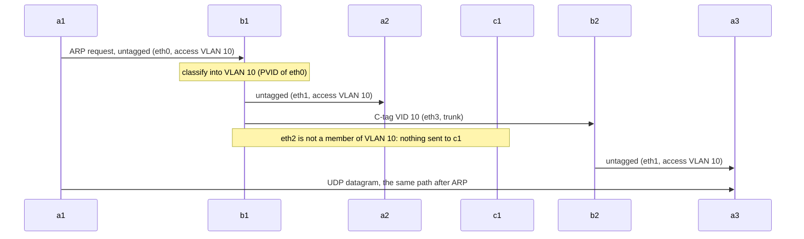
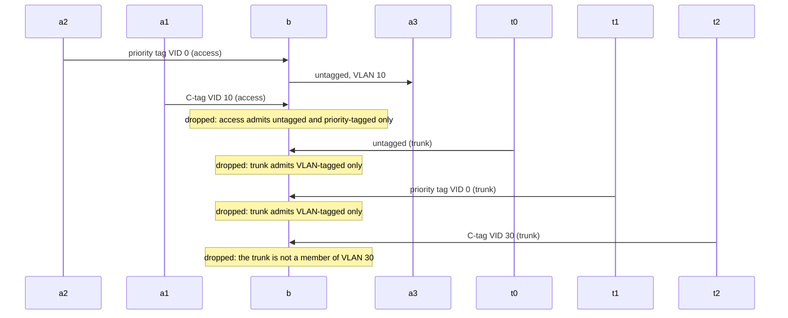
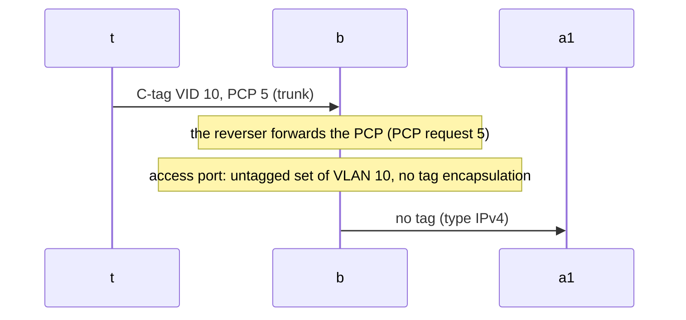
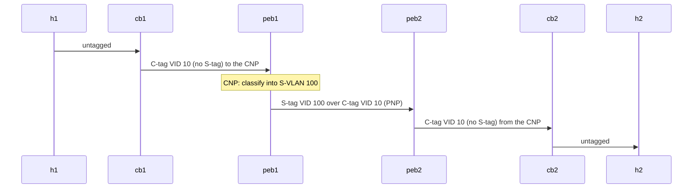

# IEEE 802.1Q port types: tests for "linklayer.vlan: add: Ieee8021adPolicy, the VLAN policy of a bridge set by port type"

Plan and commit: the plan `inet-2026-11-01_ieee8021ad-policy.md` (kept outside the repository, in the plan collection of the author), commit C1, subject "linklayer.vlan: add: Ieee8021adPolicy, the VLAN policy of a bridge set by port type".
Included tests:

- [Ieee8021qAccessTrunkForwarding.test](Ieee8021qAccessTrunkForwarding.test), program `ieee8021q_access_trunk_forwarding`
- [Ieee8021qAcceptableFrameTypes.test](Ieee8021qAcceptableFrameTypes.test), program `ieee8021q_acceptable_frame_types`
- [Ieee8021qUntaggedSetNoPriorityTag.test](Ieee8021qUntaggedSetNoPriorityTag.test), program `ieee8021q_untagged_set_no_priority_tag`
- [Ieee8021adPortBasedServiceInterface.test](Ieee8021adPortBasedServiceInterface.test), program `ieee8021ad_port_based_service_interface`

## Protocol requirement and current gap

IEEE 802.1Q-2018 gives every bridge port a few parameters: the Acceptable Frame Types (6.9: "Admit Only VLAN-tagged frames", "Admit Only Untagged and Priority-tagged frames", "Admit All frames"), a PVID for port-based classification (6.9, 6.9.1 f), the member set of each VLAN (8.6.2 ingress filtering, 8.6.4 egress filtering) and the untagged set of each VLAN (8.8.2). The usual port types are fixed settings of these parameters. An access port admits only untagged and priority-tagged frames, classifies them into its PVID, and is the only member of the untagged set of that VLAN. A trunk admits only VLAN-tagged frames of its VLANs and sends them tagged. In an IEEE 802.1ad provider network the same two settings, applied to the S-tag (6.9: one port uses "one but not both" tag types), are the Customer Network Port with a port-based service interface (3.52, 15.3) and the Provider Network Port (3.198, 17.5.3.3.1).

Before the commit, INET had no module that configures a port by these parameters. A user wrote four maps per port for the filters and mappers of `VlanPolicyLayer`. The configurations in INET show what goes wrong with that: `examples/ethernet/providerbridging` accepts only `[-1]` on its access ports and CNPs, so a priority-tagged frame is dropped there, against 6.9.1 f and 15.3; and every bridge of that example needs `forwardPcp = false`, because `VlanReqMapper` keeps the tag encapsulation of a frame that has a PCP request but no VLAN request, so a frame of an untagged port leaves with a priority tag (VLAN ID 0) when the PCP is forwarded.

## Code correction and protocol result

The commit adds `Ieee8021adPolicy` (`src/inet/linklayer/vlan/Ieee8021adPolicy.{ned,h,cc}`), a simple module for the `vlanPolicy` slot of `BridgingLayer`. Its `ports` parameter gives each port a type (`access`, `trunk`, `cnp`, `pnp`) and its VLAN ids. On reception, an `access` or `cnp` port sets the VLAN indication of an untagged or priority-tagged frame to its VLAN id and drops every other frame; a `trunk` or `pnp` port passes the frames of its VLANs and drops every other frame, untagged and priority-tagged ones included. On transmission, an `access` or `cnp` port sends the frames of its VLAN untagged: it removes the VLAN, PCP and drop eligible requests of its tag type and the encapsulation request for the tag protocol, so no tag of any kind is added. A `trunk` or `pnp` port requests the tag protocol for the frames of its VLANs. All other frames are dropped.

In the scenarios below, the same frames that a correct IEEE 802.1Q bridge would forward are forwarded, with the tags that the port types prescribe, and the frames that the Acceptable Frame Types forbid are discarded.

## Test scenarios and assertions

All four tests use `EthernetSwitch` bridges with `BridgingLayer`, `Ieee8021qProtocol` and `Ieee8021adPolicy`, and `StandardHost` hosts with `LayeredEthernetInterface` at 100 Mbps. A host that must send tagged frames has an 802.1Q layer and a `VlanPolicyLayer` whose outbound mapper tags all of its frames with one VLAN id. The observations are the `packetSentToLower` and `packetReceivedFromLower` signals of the bridge's network interfaces, where the whole frame is visible, the `packetDropped` signal of the bridge's VLAN policy, and the `packetReceivedFromLower` signal of the receiving host's UDP. "Untagged" is asserted through the type field of the Ethernet header: the IPv4 type 2048 (or ARP 2054) when no tag follows, 33024 (0x8100) when a C-tag follows, 34984 (0x88A8) when an S-tag follows. The tag fields are read as `ieee8021qctag.vid`, `ieee8021qctag.pcp` and `ieee8021qstag.vid`.

**Ieee8021qAccessTrunkForwarding.** Two C-VLAN bridges b1 and b2 joined by a trunk of VLANs 10 and 20; a1, a2 (b1) and a3 (b2) are on access ports of VLAN 10, c1 (b1) and c2 (b2) on access ports of VLAN 20; the hosts have no 802.1Q layer and use ARP. a1 sends one UDP datagram to a3 at 0.1 s, c2 one to c1 at 0.2 s. Assertions: the ARP request of a1 leaves b1's eth1 (a2) untagged and the trunk with a C-tag of VLAN ID 10, in either order; it never leaves eth2 (c1) before 0.15 s; a3 gets the datagram; the datagram of c2 arrives at b1 on the trunk with VLAN ID 20, leaves eth2 untagged, and c1 gets it. Before the commit the module type does not exist and the test cannot start; after it, the test passes.

**Ieee8021qAcceptableFrameTypes.** One C-VLAN bridge b with three access ports of VLAN 10 (a1, a2, a3) and three trunks of VLANs 10 and 20 (t0, t1, t2), all hosts with GlobalArp. a2 sends a priority-tagged datagram to a3 at 0.1 s, a1 a datagram C-tagged with VLAN ID 10 at 0.2 s, t0 an untagged one at 0.3 s, t1 a priority-tagged one at 0.4 s, and t2 one of VLAN ID 30 at 0.5 s, each to its own UDP port of a3. Assertions: a2's datagram arrives with VLAN ID 0, leaves eth2 untagged, and a3 gets it (6.9.1 f); each of the other four arrives on its port with the expected tag and is then dropped by the VLAN policy of b (6.9.1 b 4, 6.9.1 a, 6.9.1 b 3, 8.6.2); a guard over the whole run fails the test if a3 gets any datagram on a port other than 5000.

**Ieee8021qUntaggedSetNoPriorityTag.** One C-VLAN bridge b with an access port of VLAN 10 (a1, no 802.1Q layer) and a trunk of VLAN 10 (t); the direction reverser of b forwards the PCP (the default). t sends a datagram to a1 at 0.1 s, tagged with VLAN ID 10 and PCP 5. Assertions: the frame arrives on the trunk with VLAN ID 10 and PCP 5; it leaves the access port with the IPv4 type in its Ethernet header, that is with no tag at all (8.8.2); a1 gets it.

**Ieee8021adPortBasedServiceInterface.** Customer C-VLAN bridges cb1 and cb2 (an access port of C-VLAN 10 to h1 and h2, a trunk of C-VLAN 10 as uplink) and provider edge bridges peb1 and peb2 (S-VLAN bridges, `vlanTagType = "s"`): the uplinks of the customers, and the ports of the customer systems s1 and s2 on peb1, are CNPs of S-VLAN 100; peb1 and peb2 are joined by a PNP of S-VLAN 100. s1 sends S priority-tagged frames, s2 S-tagged frames of VLAN ID 100. All hosts use GlobalArp. h1 sends a datagram to h2 at 0.1 s, s1 at 0.2 s, s2 at 0.3 s. Assertions: h1's datagram arrives at peb1 with the C-tag of VLAN ID 10 and no S-tag, crosses the PNP with an S-tag of VLAN ID 100 over the C-tag of VLAN ID 10, leaves peb2 toward cb2 with the C-tag only, and h2 gets it; s1's datagram arrives with an S priority tag and crosses the PNP with S-VLAN ID 100 (15.3); s2's datagram arrives with an S-tag of VLAN ID 100 and is dropped by the VLAN policy of peb1 (6.9.1 b 4 with the S-tag), and a guard over the whole run fails the test if it appears on the PNP.

## Protocol diagrams

The ARP request of a1 is flooded within VLAN 10 only (Ieee8021qAccessTrunkForwarding):

What each port admits (Ieee8021qAcceptableFrameTypes):

The PCP of the frame does not become a priority tag on the access port (Ieee8021qUntaggedSetNoPriorityTag):

The S-tag over the C-tag between the provider edge bridges (Ieee8021adPortBasedServiceInterface):

## Execution and evidence

Debug build of the commit's tree (`make MODE=debug` from the repository root). `opp_run_protocol_tests -m debug -w '^vlan$'` is the intended command; in the author's environment the opp_repl tools cannot start (a NumPy built for another Python version), so the tests ran through `opp_test`, one executable per test as the runner does (each test defines its own default program): `opp_test gen -w work/<Test> <Test>.test`, then `opp_makemake -f --deep -o runner -I../../lib -I<inet>/src -L<inet>/src -lINET_dbg -L../../lib -lprotocoltest_dbg` and `make MODE=debug` in the work folder, then `opp_test run -w work/<Test> -p runner <Test>.test` with `NEDPATH=.:<inet>/tests/protocol/lib:<inet>/src`. Seed set 0, sim-time-limit 1 s, the configuration of each `.test` file.

Executed result on the commit's tree, 2026-11-01: all four tests PASS.

Mutation checks, executed the same day on a modified copy of `Ieee8021adPolicy.cc`, restored afterwards:

- Accepting VLAN-tagged frames on access ports: Ieee8021qAcceptableFrameTypes fails (a3 gets the datagram of a1 at 0.2 s, caught by the guard).
- Keeping the tag encapsulation of an untagged port when a PCP request is present, as `VlanReqMapper` does: Ieee8021qUntaggedSetNoPriorityTag fails (a1 receives a priority-tagged frame it cannot process, and the simulation stops with an error).
- Not removing the PCP request alone, without the encapsulation change: the test still passes. The removal of the encapsulation request is what keeps the tag off; removing the PCP and drop eligible requests keeps no stale request on the frame, and no test observes it.

The diagram rendering was not checked (no Mermaid renderer in the author's environment): unverified.

## Coverage limits

The tests establish the four port types in the `vlanPolicy` slot of `BridgingLayer`, with LayeredEthernetInterface, for unicast UDP and ARP broadcasts, and the acceptable frame types of 6.9.1 for the C-tag (access, trunk) and the S-tag (CNP). They do not cover: VLAN ID 4095 on the wire (a trunk drops it because it cannot be a member, but no test sends it); multicast; frames sent by the bridge itself (STP, gPTP, applications in the switch), which an access or CNP port sends untagged and a trunk or PNP port drops; the drop eligible indicator; the PNP's reception of a frame without an S-tag (the trunk case of the same code path is covered); run-time configuration, which C2 covers with a module test; and configuration errors, which the module tests `tests/module/Ieee8021adPolicyInvalid_*.test` cover.
