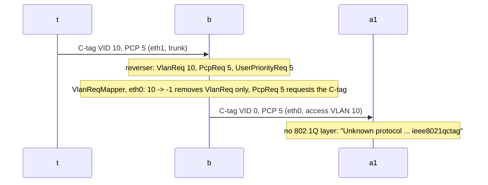
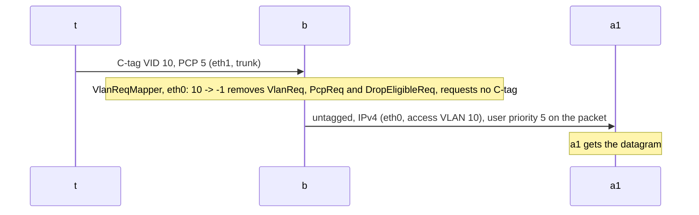

# The untagged set with the default VLAN policy: tests for "linklayer.vlan: fix: VlanReqMapper sends a frame untagged, with no request for the tag, when its VLAN leaves untagged"

Plan and commit: [baseline-catch-up-defect-repairs.md](../../../plan/pending/baseline-catch-up-defect-repairs.md), change R3, commit C9, subject "linklayer.vlan: fix: VlanReqMapper sends a frame untagged, with no request for the tag, when its VLAN leaves untagged". The fault is BD-44 of [baseline-catch-up-defects.md](../../../plan/pending/baseline-catch-up-defects.md).
Included tests:

- [Ieee8021qVlanReqMapperUntaggedNoPriorityTag.test](Ieee8021qVlanReqMapperUntaggedNoPriorityTag.test), program `ieee8021q_vlan_req_mapper_untagged_no_priority_tag`

## Protocol requirement and current gap

IEEE 802.1Q-2018 8.8.2 gives each VLAN an untagged set: the ports that send the frames of that VLAN untagged. The priority of a frame is a parameter of the service, not of its tag: on reception it is decoded from the tag (6.9.1 h), and a tagging layer passes it down unchanged (6.9.2). A bridge port sends a frame of a VLAN either VLAN-tagged or untagged; a priority tag (VLAN ID 0) on a port of the untagged set is neither.

INET keeps the priority of a frame as its user priority (`UserPriorityReq`): the tag checker sets it from the PCP of a received tag, and the direction reverser forwards it always. A `PcpReq` of a tag type asks for the PCP field of the tag of that type. The direction reverser of a bridge also copies the PCP of a received tag as a `PcpReq`, by default (`forwardPcp = true`).

`VlanReqMapper` is the outbound mapper of `VlanPolicyLayer`, the default VLAN policy of `BridgingLayer`. Before the commit, a map to -1 removed only the VLAN request, and the module requested the encapsulation of its tag protocol when a VLAN request or a PCP request was present. So each frame that arrived tagged and left on a port of the untagged set got a tag of VLAN ID 0, also with PCP 0. `Ieee8021adPolicy` does this right; four configurations set `forwardPcp = false` to avoid the fault.

## Code correction and protocol result

On a map to -1, `VlanReqMapper::processPacket()` now removes the VLAN, PCP and drop eligible requests of its tag type and requests no encapsulation of its tag protocol, as `Ieee8021adPolicy::processSentPacket()` does on an untagged port. A frame with no map entry keeps the behavior of before: a host that requests a PCP alone still sends a priority-tagged frame. The user priority of the frame stays.

The same commit removes `forwardPcp = false` from the two module test configurations that set it only to avoid the fault (`tests/module/lib/vlan-access-trunk.ini` and `tests/module/EthernetUnknownEtherType_1.test`), so their hosts behind access ports check the repair too. Commit C10 removes it from `examples/ethernet/vlan` and `showcases/ethernet/sharedcore`.

## Test scenarios and assertions

**Ieee8021qVlanReqMapperUntaggedNoPriorityTag.** One C-VLAN bridge b with `VlanPolicyLayer`: eth0 (a1) is an access port of VLAN 10 (the outbound map 10 to -1, the inbound map of untagged and priority-tagged frames to 10), eth1 (t) a trunk of VLAN 10. The direction reverser of b forwards the PCP (the default). a1 has no 802.1Q layer; t tags its frames with VLAN ID 10 and PCP 5. t sends a UDP datagram to a1 at 0.1 s. Assertions, each within 0.15 s: the datagram arrives at b on the trunk with a C-tag of VLAN ID 10 and PCP 5; it leaves eth0 with the IPv4 type 2048 in its Ethernet header, that is with no tag; a1 gets it. Before the commit, b sends a C-tag of VLAN ID 0 and PCP 5 on eth0, and a1 stops the run with "Unknown protocol: protocolId = 32, protocolName = ieee8021qctag"; after it, the test passes. The test is `Ieee8021qUntaggedSetNoPriorityTag.test` with the default policy in place of `Ieee8021adPolicy`.

## Protocol diagrams

Before the commit:

After the commit:

## Execution and evidence

- In the editor, `run_protocol_tests!(project; suite = "vlan", mode = "debug")` after a debug build of the branch: before the commit the new test fails as above and the other four tests of `tests/protocol/vlan` pass; after it all five pass.
- The module tests that use the changed files pass after the commit: `EthernetUnknownEtherType_1`, `Ieee8021adPolicy_1`, `Ieee8021adPolicy_runtime_1`, `VlanIndMapper_1`, `VlanPolicyLayer_runtime_1` and `VlanPolicyMapsInvalid_1` to `_6`.
- Debug runs of `showcases/ethernet/sharedcore` `FiltersAndMappers` and of five configurations of `examples/ethernet/vlan` with `forwardPcp = true` for every bridge. Before the commit: the showcase answers 0 of 80 pings, the inbound filters of the four service provider bridges drop 4 frames each, and its pcap of `pebW` eth0 shows frames with an S-tag of VLAN ID 0 and PCP 0 over the C-tag; in the VLAN example, `DoubleTagged` stops at host2 with "Unknown protocol ... ieee8021qstag", and `Asymmetric` transfers 0 bytes. After the commits, all six runs work, and each scalar equals the run of before the commits with `forwardPcp = false`.

## Coverage limits

- The protocol test covers the C-tag. The S-tag (a provider edge bridge with `VlanPolicyLayer` and `vlanTagType = "s"`) takes the same line and is covered by the showcase run (`pebE` toward `sp1e`), not by a protocol test of its own.
- `PcpTrafficClassClassifier` reads only `PcpReq` and `PcpInd`, not the user priority, so on an untagged port it gets no traffic class from the priority, as before with `forwardPcp = false`. That is outside this commit.
