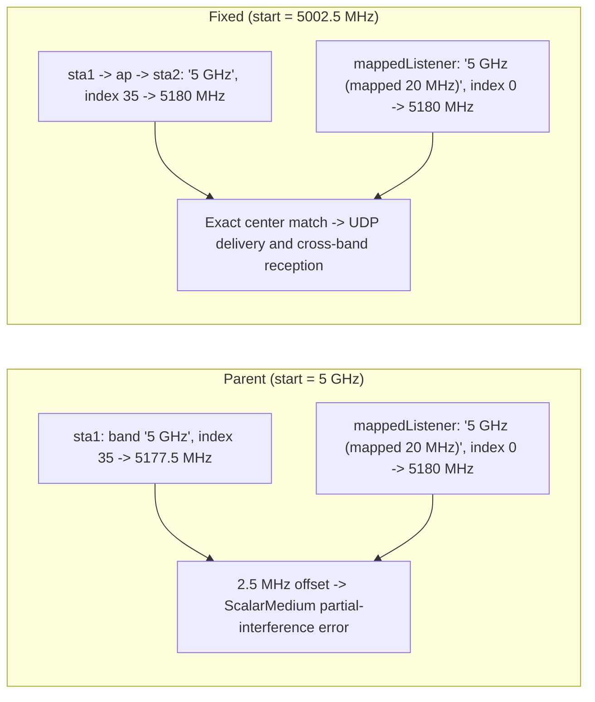

# Arithmetic 5 GHz band centers

IEEE Std 802.11-2024, Clause 17.3.8.4.2, Equation (17-27) (and Clause 19.3.15.3, Equation (19-88)), defines 5 MHz channel centers in the 5 GHz band as `Channel center frequency = Channel starting frequency + 5 * n_ch (MHz)` for `n_ch = 1..200` with a 5 GHz starting frequency (`5005..6000 MHz`). Annex E, Table E-4, operating class 115 places standard channel `36` at `5180 MHz` (`n_ch = 36`).

`Ieee80211CompliantBands::band5GHz` previously constructed `"5 GHz"` with `start = GHz(5)`, `spacing = MHz(5)`, and `200` channels. Because `Ieee80211ArithmeticalBand::getCenterFrequency(channelIndex)` returns `start + spacing / 2 + spacing * channelIndex`, every channel landed `2.5 MHz` below the IEEE 5 MHz grid (`5002.5 + 5 * channelIndex` MHz).

Commit `BD-28`, `ieee80211: fix: align 5 GHz arithmetic band centers to 5 MHz grid`, sets `start = MHz(5002.5)` on `Ieee80211CompliantBands::band5GHz`. Index `i` (`0..199`) maps to `n_ch = i + 1` (`5005..6000 MHz`), matching `band2_4GHz`'s zero-based offset and aligning index `35` (`n_ch = 36`) with `"5 GHz (mapped 20 MHz)"` index `0` at `5180 MHz`.



## Tests

[`A_5ghzBandCenters.test`](11a/A_5ghzBandCenters.test) runs an 802.11a infrastructure network (`ap`, `sta1`, `sta2`) on a scalar radio medium across three channel indices of `"5 GHz"` (`0`, `35`, and `199`), alongside a passive ad-hoc `WirelessHost` (`mappedListener`) tuned to `"5 GHz (mapped 20 MHz)"` index `0` (`5180 MHz`). `sta1` associates with `ap` and sends a 1000-byte UDP datagram to `sta2` at `t = 1 s`.

An audit module subscribes to `transmissionStartedSignal` on `sta1.wlan[0].radio`, `packetSentToUpperSignal` on `mappedListener.wlan[0].radio`, and `packetReceivedSignal` on `sta2.app[0]`. It verifies that both the initial management transmission and the `ST_DATA` transmission carry the expected `Ieee80211Channel` and `INarrowbandSignalAnalogModel` center frequency (`5005`, `5180`, or `6000 MHz`), that `sta2` receives the UDP payload, and that `mappedListener` receives `ST_DATA` only in Run 1 (`5180 MHz`).

[`Ieee80211Band_1.test`](../../unit/Ieee80211Band_1.test) verifies `getCenterFrequency(index) == MHz(5000 + 5 * (index + 1))` across all 200 indices (`0..199`), out-of-bounds rejection (`-1` and `200`), preserved unmapped standard-channel rejection on `"5 GHz"`, and unchanged `"5.9 GHz"` centers (`5860..5920 MHz`).

Coverage limits: `A_5ghzBandCenters.test` checks scalar-medium 802.11a OFDM transmissions on boundary channels `0` and `199` plus channel `35`; `"5 GHz"` intentionally retains no `getStandardChannelNumber()`/`getChannelIndex()` mapping for HT management and supplies no regulatory-domain model.

## Comparison

All runs use seed set `0`. The parent is `0cb56f4a6f`, which supplied `out/clang-release/src/libINET.so` for the parent run against the compiled release fixture of `A_5ghzBandCenters.test`.

| Run | Channel index | Expected center | Parent result (`0cb56f4a6f`) | Fixed result |
| --- | ---: | --- | --- | --- |
| 0 | 0 | 5005 MHz | Fail (`5.0025 GHz` mismatch at first transmission) | Pass (`5005 MHz`, UDP delivered) |
| 1 | 35 | 5180 MHz | Fail (`5.1775 GHz` vs `5.18 GHz` partial interference) | Pass (`5180 MHz`, UDP + cross-band reception) |
| 2 | 199 | 6000 MHz | Fail (`5.9975 GHz` mismatch at first transmission) | Pass (`6000 MHz`, UDP delivered) |

Run these commands from the INET checkout root after loading the OMNeT++ environment (`source <omnetpp-root>/setenv`) and INET's tracked `source setenv` (which exports `INET_ROOT`):

```sh
make -j$(nproc) MODE=debug
make -j$(nproc) MODE=release
opp_run_unit_tests --load . -p inet -m debug --no-build -f 'Ieee80211Band_1\.test'
opp_run_protocol_tests --load . -p inet -m debug --no-build \
  -w '^tests/protocol/wifi$' -f '/(A_5ghzBandCenters|A_5ghz)\.test$'
opp_run_protocol_tests --load . -p inet -m release --no-build \
  -w '^tests/protocol/wifi$' -f '/A_5ghzBandCenters\.test$'
```

For the parent comparison, run the compiled release fixture from `tests/protocol/wifi/work/A_5ghzBandCenters` with the parent `out/clang-release/src` in `LD_LIBRARY_PATH`:

```sh
for r in 0 1 2; do
  LD_LIBRARY_PATH="<parent-checkout>/out/clang-release/src:$LD_LIBRARY_PATH" \
    ./A_5ghzBandCenters -u Cmdenv -f test.ini -n ".:../../ned:../../../lib:$INET_ROOT/src" -r $r
done
```
