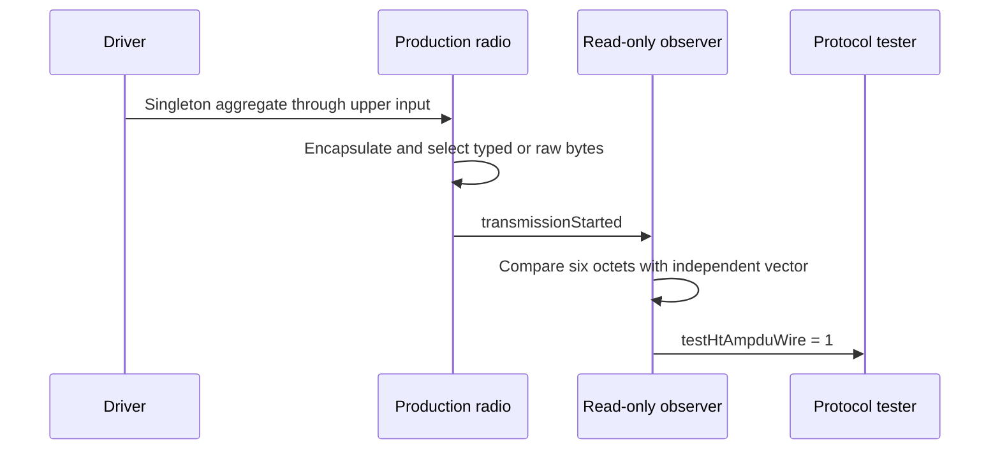

# PHY P1: Preserve singleton aggregation in HT-SIG bytes

This document belongs to PHY P1, **ieee80211: add: preserve HT-SIG fields through byte conversion**. Its protocol test is [WifiHtAmpduWire.test](common/WifiHtAmpduWire.test). The [PHY plan](../../../plan/pending/ieee80211-ampdu-phy-reception.md) defines the supported profile.

Before this commit, the HT serializer supplies no HT-SIG octets. A singleton aggregate can lose its aggregation identity after byte conversion. After this commit, the production radio supplies HT-SIG fields and CRC. The serializer preserves their six-octet representation. This protocol test observes those octets at actual transmission start.

## Requirement and independent expectation

IEEE Std 802.11-2024 Figure 19-6 defines HT-SIG fields. Clause 19.3.9.4.4 defines CRC over bits 0 through 33, with complemented C7 first. The canonical nodes are `ieee80211-2024:figure:19-6` and `ieee80211-2024:clause:19.3.9.4.4`. Their physical PDF pages are 3432–3434. These are normative PHY requirements.

The test sends one four-octet delimiter followed by a 100-octet MPDU representation. HT mixed format uses MCS 0, 20 MHz, one spatial stream, and long GI. The PSDU therefore contains 104 octets. Its Aggregation field must remain true even though the aggregate contains only one member.

The expected HT-SIG octets are `00 68 00 0F B4 01`. Polynomial long division supplies the fixed CRC value `0x6D`, independently of the production shift register. The unit fixture retains the same independent vector. The protocol fixture adds the production encapsulation and transmission path.

## Setup, stimulus, and assertions

The fixture contains one production scalar radio and a test driver. The driver sends the singleton aggregate at 1 ms through the radio's upper input gate. A read-only observer receives the radio's `transmissionStarted` notification. The observer borrows the transmission packet only during that callback.

Two runs select typed transmission and raw-byte transmission. Both use seed zero and end at 2 ms. The observer requires the same six expected octets in both runs. It also decodes an independent byte packet and checks the 48-bit length, 104-octet PSDU length, MCS, Aggregation, GI, and CRC.

The decoded-field checks use OMNeT++ descriptors. These descriptors expose generated fields by name. The fixture therefore compiles with the parent's header declaration. The assertions still require every field and the independent byte vector. A missing field fails at runtime. No conditional check accepts the parent's missing capability.

The protocol tester requires one `testHtAmpduWire` event after all assertions pass. A missing transmission cannot pass through an empty observation. The observer creates no packet or protocol state in the production radio.



On the parent, the missing serializer cannot produce the six expected HT-SIG octets. On this commit, the byte comparison and independent decode must pass. No expected-failure marker suppresses either requirement.

## Verification and limits

Use the current debug library before the selected protocol run:

```sh
make MODE=debug -j8
opp_run_protocol_tests -p inet -m debug -w '^tests/protocol/wifi$' -f 'WifiHtAmpduWire\.test$' --no-concurrent
```

The installed runner can require the temporary compatible descriptor described in the [execution record](../../../plan/pending/ieee80211-ampdu-phy-execution.md). The expected result is two successful runs and `PROTOCOLTEST wifi_ht_ampdu_wire: PASS`. The [comparison record](ampdu-ht-sig-wire-comparison.md) reports the parent and commit executions with identical fixture bytes.

This test establishes transmit representation. It does not establish peer reception, member FCS acceptance, deaggregation, upper delivery, or implicit Block Ack. The wire unit fixture checks malformed fields. The separate layout fixture checks bounded ranges. The diagram follows the gate and notification paths in the fixture. Diagram rendering remains unverified when no Mermaid renderer is available.
