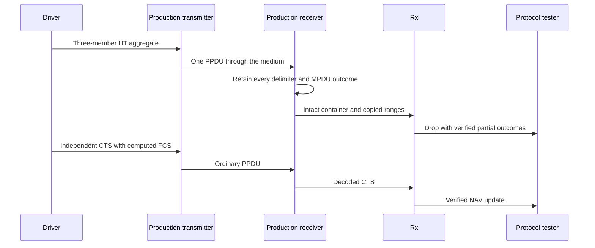

# PHY P2: Preserve partial outcomes at the MAC boundary

This document belongs to PHY P2, **ieee80211: add+change: retain partial HT A-MPDU PHY outcomes**. Its protocol test is [WifiHtAmpduPartialReception.test](common/WifiHtAmpduPartialReception.test). The [PHY plan](../../../plan/pending/ieee80211-ampdu-phy-reception.md) defines the receiver contract and later MAC work.

Before this commit, the receiver samples the aggregate as one packet. It cannot retain a failed member beside successful members. Rx can also inspect an aggregate container as a standalone MAC frame. After this commit, cached PHY decisions retain bounded range outcomes. The result indication copies those outcomes. Rx rejects the container before standalone FCS or MAC header checks.

## Requirement and model boundary

IEEE Std 802.11-2024 Clause 9.7.1 and Table 9-659 define A-MPDU subframes and delimiter fields. Their canonical nodes are `ieee80211-2024:clause:9.7.1` and `ieee80211-2024:table:9-659`. Physical PDF pages 1840–1842 cover the relevant layout. Figure 19-6 defines the HT-SIG Aggregation field on physical PDF pages 3432–3434.

These requirements define the represented aggregate. Independent delimiter and MPDU error probabilities are an explicit INET model abstraction. The standard does not require the fixture's chosen synthetic loss pattern. That pattern makes the copied-outcome contract deterministic. It supplies no error-accuracy or goodput claim.

## Setup, stimulus, and assertions

The fixture uses a production scalar transmitter, medium, receiver, MAC, and Rx. The recipient uses HCF in HT mixed mode at 20 MHz. A test error model inherits NIST support but fixes common-field success. Its range operation returns failure for the configured length. Four configurations select lengths of 100, 101, 102, and 4 octets. These configurations fail the first MPDU, middle MPDU, last MPDU, or all delimiters.

At 1 ms, the driver submits members of 100, 101, and 102 octets. Three alignment octets follow the 101-octet member. The complete PSDU contains 318 octets. The driver selects HT MCS 0 and the run's GI before production radio encapsulation.

At the production Rx drop signal, the observer checks the intact PSDU length and clear container bit-error flag. The copied indication must report a successful header, complete content, and six bounded ranges. Their offsets are 0, 4, 104, 108, 212, and 216 octets. Each range must report failure exactly when its length equals the configured failed length. All other ranges must report success. Delimiter loss must not erase the separate MPDU outcomes.

The observer reads the indication through OMNeT++ descriptors, which expose generated fields by name. The fixture therefore compiles on the parent without the new indication class. A missing indication fails at runtime. The observer reads each field without a change to protocol state. No conditional check accepts missing data.

Rx must reject that container once through its normal drop path. At 2 ms, the driver submits an independent CTS with computed FCS and a 50-microsecond Duration field. The observer requires one 50-microsecond NAV update after the aggregate drop. This control proves that the ordinary acceptance path remains usable after the rejection.

The protocol tester requires `testHtAmpduPartial` followed by `testHtAmpduControl`. These events occur only after their assertions pass. A missing aggregate, missing drop, wrong outcome, or missing control result cannot pass through an empty observation.

The four loss patterns combine with both GIs, typed and raw-byte transmission, and whole-signal and separate-part reception. These combinations produce 32 runs. Every run uses seed zero and ends at 4 ms. The deterministic probabilities require no extra seeds. The existing module fixture separately retains dimensional-radio, DCF, malformed-input, and cached-query controls.



The parent lacks the copied range indication and the aggregate-safe Rx boundary. Its whole-packet result cannot satisfy these assertions. This commit must retain the six outcomes and complete the later CTS control for every loss pattern. No expected-failure marker suppresses either requirement.

## Verification and limits

Use the current debug library before the selected protocol run:

```sh
make MODE=debug -j8
opp_run_protocol_tests -p inet -m debug -w '^tests/protocol/wifi$' -f 'WifiHtAmpduPartialReception\.test$' --no-concurrent
```

The installed runner can require the temporary compatible descriptor described in the [execution record](../../../plan/pending/ieee80211-ampdu-phy-execution.md). The expected result is 32 successful runs and `PROTOCOLTEST wifi_ht_ampdu_partial_reception: PASS`. The [comparison record](ampdu-partial-reception-comparison.md) reports the parent and commit executions with identical fixture bytes.

This fixture verifies PHY outcomes at the current MAC boundary. It does not verify member acceptance, upper delivery, implicit Block Ack, or correlated FEC errors. The diagram follows the actual send, receive, drop, and NAV sequence. Diagram rendering remains unverified when no Mermaid renderer is available.
