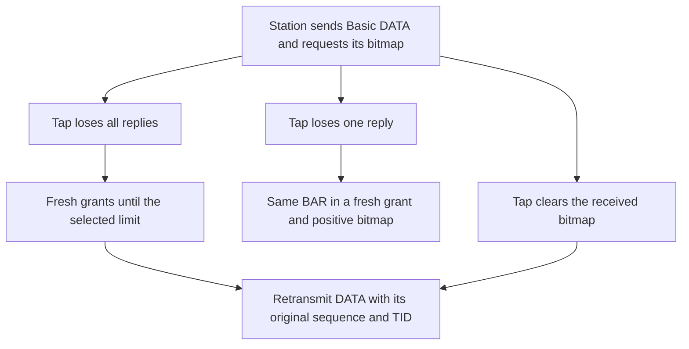

# Retry an unanswered Basic Block Ack request

The access category advances its EDCA retry count whenever a transmitted Basic Block Ack Request (BAR) goes unanswered. It also advances the counter when a BAR loses internal contention. The DATA retry counters belong to the individual DATA frames. `Ieee80211BlockAckScheduling_1.test` checks both failures and the reset after a successful TXOP.

A lost reply can conceal reception of every DATA MPDU in the batch. The EDCAF retains the BAR's receiver, TID, starting sequence number and retry count between grants. HCF opens a later TXOP with that request. A retry is counted when a BAR has been sent and its reply times out. Expiry and agreement teardown invalidate the pending request. After the retry limit, the existing Block Ack failure path makes unresolved DATA eligible for recovery.

`WifiBlockAckDataRetry.test` uses an associated station and AP with a Basic agreement and a BAR threshold of one. A radio tap drops the first Block Ack, drops every Block Ack at retry limits zero through four, or clears the first reply bitmap. Each expected retry must open a later grant with the same request fields. The lost-first-reply case requires a successful bitmap and checks for duplicate DATA. The other cases require the original DATA sequence and TID with Retry set.

The parent source makes DATA eligible immediately after a missing reply. That path fails the next-BAR assertion when a positive retry limit is expected. The retry fixture does not model corruption at a second station or an association reset while a retry is pending.
