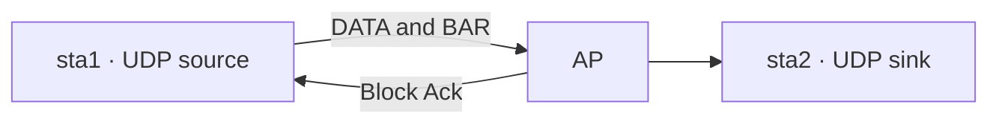
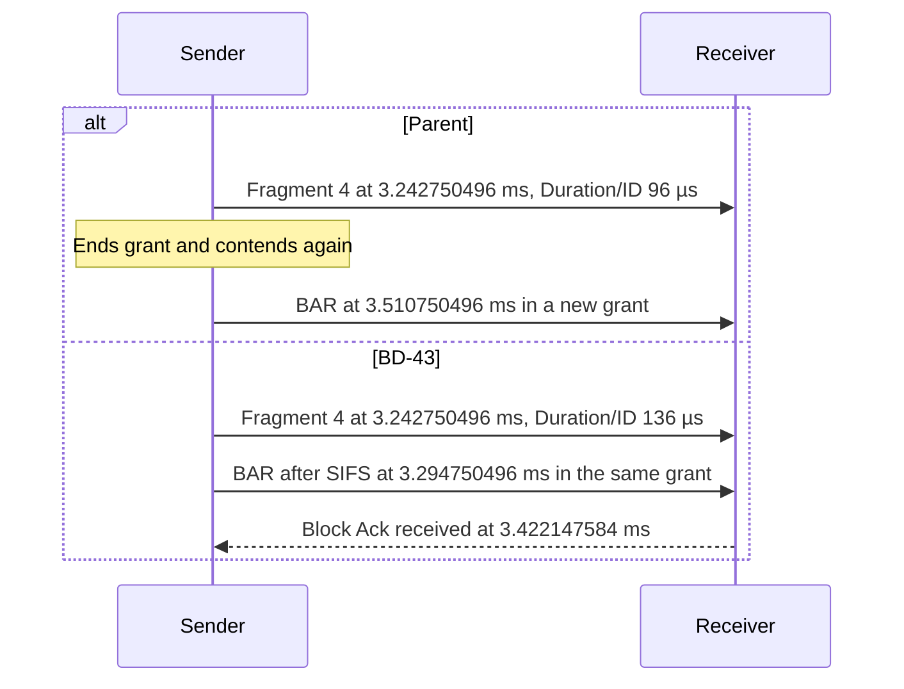
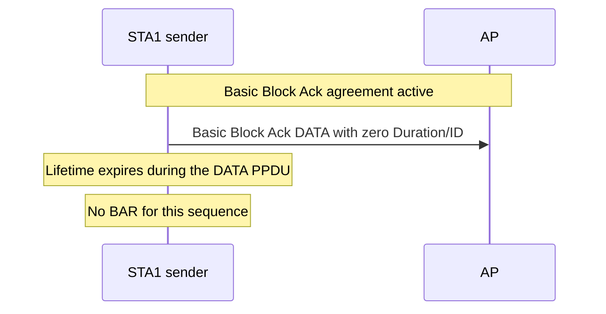
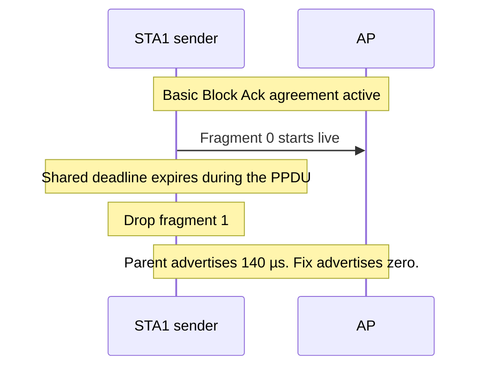
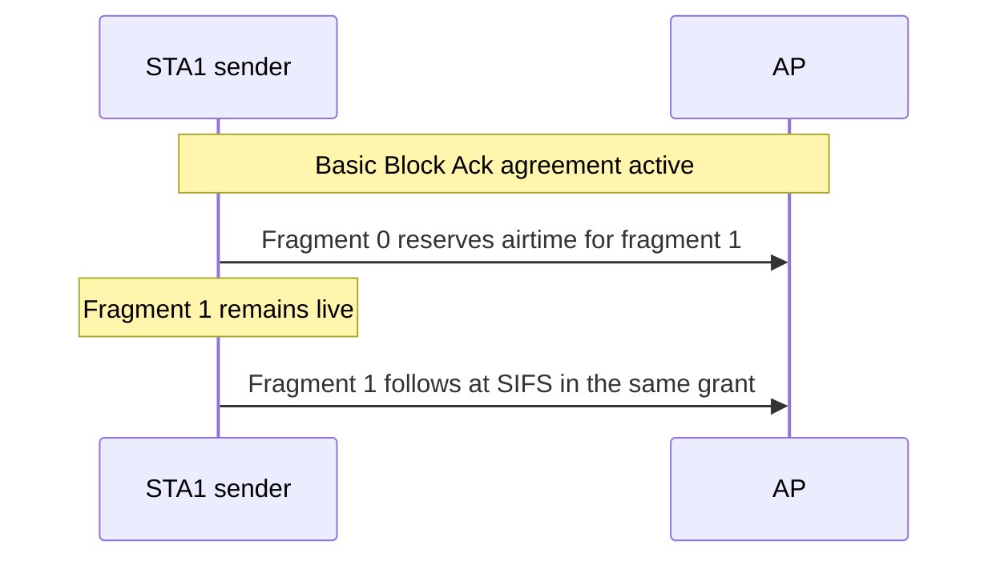
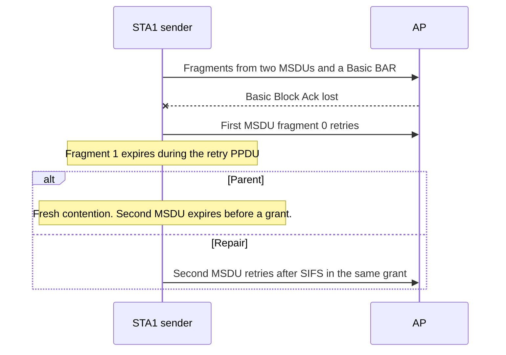
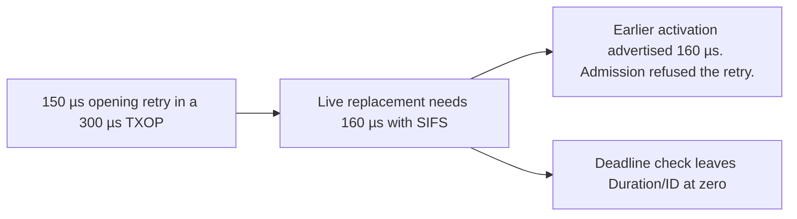
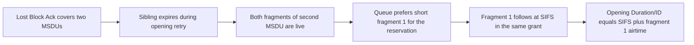

# Basic Block Ack feedback scheduling

[BD-43](../../../plan/pending/baseline-catch-up-defects.md#basic-block-ack-feedback-scheduling-bd-43)
concerns a station that contends again to send a due Basic Block Ack Request (BAR).
Under single protection, the preceding Block Ack policy DATA can advertise zero
Duration/ID even when the sender's transmission opportunity (TXOP) has time for the
BAR and its reply. The EDCA sequence can select the BAR, but HCF rejects it because
the sender's reservation timer, TXNAV, is empty.

Before sending the DATA, HCF supplies the active TXOP to the originator ACK policy
and asks which BAR would be due if that DATA became outstanding. The policy uses
the existing threshold, agreement window and ordering, with the current DATA
removed from the next-candidate search.
HCF predicts the airtime of the BAR and its immediate Block Ack reply. When that
exchange and both short interframe spaces (SIFS) fit, HCF advertises the interval in
the DATA. After transmission, normal BAR selection runs again and HCF checks the
selected exchange against the live TXNAV and TXOP deadline. An exchange that cannot
fit can still contend for its own grant.

IEEE Std 802.11-2024 §§9.2.5.2(a)(5), 9.2.5.2(a)(9), 10.23.2.8 and 10.23.2.9
specify the EDCA timing and Duration/ID rules used here. The model retains the
historical Basic bitmap and immediate response from IEEE Std 802.11e-2005
§§7.2.1.7–8. The 2024 edition reserves the Basic format's type value.

## Forecast unit test

The preparation commit `4c1c7b1e02` adds the forecast query and extends
[Ieee80211BlockAckScheduling_1.test](../../unit/Ieee80211BlockAckScheduling_1.test).
With a threshold of five and one MPDU about to become outstanding, the forecast
defers feedback when an eligible same-peer/TID successor is inside the agreement
window. With no successor it selects the BAR for that MPDU. Both cases check the
full result against live selection after transmission and check that the forecast
leaves the ACK state and queue intact.
The fixture also checks that a custom queue can supply both peek results by
overriding the exclusion-aware method alone.

## Protocol regression

[WifiBasicBarReservation.test](common/WifiBasicBarReservation.test) uses an
infrastructure BSS. The sender starts a 1,000-byte UDP burst at 1 s with 100 µs
interarrival time. The stations use Basic agreements, single protection and a
BAR threshold of one MPDU. The test observes the first Block Ack policy DATA after
the successful ADDBA response. Both runs use seed 0.
The sender's test ACK policy verifies that HCF supplies the voice EDCAF's TXOP
and that the grant has positive remaining time when forecasting. The test
matches the forecast to the DATA transmission by packet tree ID.



- With a 4 ms TXOP, the preparation commit `4c1c7b1e02` sends the BAR in a fresh grant.
  The test detects this at the BAR transmission. The fix advertises both SIFS
  intervals and the BAR/Block Ack airtime. The matching BAR starts one SIFS
  after DATA in the same grant, and the reply confirms receipt within its
  advertised interval.
- With a 350 µs TXOP, the feedback does not fit. The control requires zero
  Duration/ID on the DATA, a later grant for the BAR, and the matching bitmap
  in that later grant.

The assertions identify the grant, sequence number and TID at the MAC. Loss
recovery, agreement teardown and application delivery are outside this fixture.
On `4c1c7b1e02` in debug, the fitting case fails the same-grant BAR assertion.
The short-grant case reaches the reply in a fresh grant and fails because the
forecast callback was absent. Both cases pass with HCF activation in debug and
release.

```sh
opp_run_protocol_tests --load . -p inet -m debug --no-build \
  -w '^tests/protocol/wifi$' -f 'WifiBasicBarReservation\.test$'
```

## Fragmentation trace

In `PacketSizeHCFfragblockack`, run 0, seed 0, both senders send fragment 4 of
`UdpBasicAppData-1` at 3.242750496 ms. The parent advertises 96 µs of protection
and sends the BAR at 3.510750496 ms after starting a new grant. With the fix, the
DATA advertises 136 µs and the BAR starts at 3.294750496 ms in the original grant.
The 42 µs DATA PPDU and the following 10 µs SIFS account for the full gap to the
BAR on the fix. The matching Block Ack arrives at 3.422147584 ms, when the sender
ends the grant.



## Matched workload checks

These release-mode comparisons use run 0 and seeds 0–2 in each configuration.
The Normal Ack columns use the corresponding configuration on `68d99ceb95`.
Basic columns compare that parent with the scheduling fix. For QoS, deliveries
come from the four sink application scalars in Background, Best Effort, Video,
Voice order. Fragmentation runs use the single receiving application. The
observer counts BAR and Block Ack transmissions at the MAC, tracks consecutive
holder frames between `txopStarted` and `txopEnded`, and counts agreement-added
signals across both originators and recipients. Expired datagrams are distinct
source application packets with a MAC lifetime drop and no sink receipt.

| Configuration | Seed | Normal Ack deliveries | Basic deliveries | BARs opening grants | BARs after DATA | Block Acks sent | Agreements added | Expired undelivered |
| --- | ---: | ---: | ---: | ---: | ---: | ---: | ---: | ---: |
| `MacQosWithBlockAck` | 0 | 902/5000/5000/5000 | 654/4894/5000/5000 → 654/4876/5000/5000 | 3352 → 42 | 0 → 3453 | 3252 → 3424 | 4804 → 6075 | 4452 → 4470 |
| `MacQosWithBlockAck` | 1 | 1392/5000/5000/5000 | 606/4772/5000/5000 → 773/4845/5000/5000 | 3433 → 47 | 0 → 3454 | 3295 → 3414 | 4824 → 6063 | 4622 → 4382 |
| `MacQosWithBlockAck` | 2 | 1637/5000/5000/5000 | 725/5000/5000/5000 → 640/3319/5000/5000 | 3284 → 39 | 0 → 3619 | 3135 → 3600 | 4664 → 6396 | 4275 → 6041 |
| `PacketSizeHCFfragblockack` | 0 | 406 | 218 → 339 | 1013 → 0 | 0 → 1512 | 964 → 1424 | 2 → 2 | 0 → 0 |
| `PacketSizeHCFfragblockack` | 1 | 399 | 223 → 328 | 1011 → 0 | 0 → 1495 | 958 → 1401 | 2 → 2 | 0 → 0 |
| `PacketSizeHCFfragblockack` | 2 | 406 | 212 → 326 | 1000 → 0 | 0 → 1502 | 939 → 1411 | 2 → 2 | 0 → 0 |
| `ThresholdHCFfragblockack` | 0 | 2929 | 1896 → 2825 | 9014 → 0 | 0 → 13104 | 8517 → 12341 | 2 → 2 | 119 → 0 |
| `ThresholdHCFfragblockack` | 1 | 2931 | 1884 → 2844 | 8986 → 0 | 0 → 13094 | 8489 → 12374 | 2 → 2 | 126 → 0 |
| `ThresholdHCFfragblockack` | 2 | 2938 | 1864 → 2831 | 9000 → 0 | 0 → 13117 | 8494 → 12338 | 2 → 2 | 153 → 0 |
| `OnlyPacketSizeHCFfragblockack` | 0 | 19994 | 18844 → 19996 | 6272 → 0 | 0 → 7674 | 5923 → 7258 | 2 → 588 | 0 → 0 |
| `OnlyPacketSizeHCFfragblockack` | 1 | 19997 | 18705 → 19997 | 6286 → 0 | 0 → 7692 | 5931 → 7238 | 2 → 600 | 0 → 0 |
| `OnlyPacketSizeHCFfragblockack` | 2 | 19996 | 18760 → 19991 | 6280 → 0 | 0 → 7662 | 5941 → 7231 | 6 → 634 | 0 → 0 |

The observer left one of 7,693 BARs unclassified in the fixed
`OnlyPacketSizeHCFfragblockack` seed-1 run. All other BARs in the table were
classified by their observed position in the grant.

Fragmentation delivers more datagrams in all nine paired runs. The fixed
`PacketSize` and `Threshold` cases still deliver fewer than Normal Ack on these
inputs. The fixed `OnlyPacketSize` case delivers within five datagrams of Normal
Ack on all three seeds.

QoS delivery varies by seed. In seed 2, Best Effort delivers 1,681 fewer
datagrams and records 1,681 additional undelivered lifetime expiries. Video
and Voice deliver all 5,000 datagrams in every run and record zero undelivered
expiries.

| QoS seed | Background expired, Normal Ack | Background expired, Basic | Best Effort expired, Normal Ack | Best Effort expired, Basic |
| ---: | ---: | ---: | ---: | ---: |
| 0 | 4098 | 4346 → 4346 | 0 | 106 → 124 |
| 1 | 3608 | 4394 → 4227 | 0 | 228 → 155 |
| 2 | 3363 | 4275 → 4360 | 0 | 0 → 1681 |

Agreement additions rise in QoS and fixed-threshold packet-size runs despite
fewer BAR-only grants. These runs use the same agreement teardown policy on
both sides. The cause of the QoS seed-2 delivery loss needs separate
investigation, as does the effect of retaining idle agreements.

## Fingerprint comparison

All 12 selected run-0 release fingerprint cases pass on `4c1c7b1e02` against the
store from `7bff6e8c4c`. HCF activation matches six old cases and moves
six. All 12 pass after activation against the approved store. The sender traces
show the first changed DATA reservation in each case. Five traces show an earlier first BAR. In
`HCFfragblockack`, the first BAR was already within TXNAV and its time stays
the same. The preceding DATA now advertises 136 µs for the actual BAR exchange
in place of the 168 µs forecast for a DATA successor.

| Case | First DATA with a changed reservation | Duration/ID, µs | First BAR time, ms |
| --- | --- | ---: | ---: |
| `MacQosWithBlockAck` | `Voice-2` | 0 → 136 | 1004.121774 → 1004.101774 |
| `HCFfragblockack` | `UdpBasicAppData-1-frag4` | 168 → 136 | 4.589368 → 4.589368 |
| `OnlyPacketSizeHCFfragblockack` | `UdpBasicAppData-3` | 0 → 136 | 2.844397 → 2.408397 |
| `PacketSizeHCFfragblockack` | `UdpBasicAppData-1-frag4` | 96 → 136 | 3.510750 → 3.294750 |
| `ThresholdHCFfragblockack` | `UdpBasicAppData-1-frag4` | 116 → 136 | 4.400353 → 4.184353 |
| TXOP showcase `General` | `small-8+small-9` | 0 → 136 | 13.620495 → 13.560495 |

The table records the approved updates to the fingerprint store. Each case
uses the same runtime and ingredients as the parent.

| Configuration | `tplx` | `~tNl` | `~tND` |
| --- | --- | --- | --- |
| `examples/wireless/qos`, `MacQosWithBlockAck` | d6f0-9afb → d89f-a805 | 8749-e815 → 8215-5d92 | e376-de12 → 9aae-074f |
| `showcases/wireless/fragmentation`, `HCFfragblockack` | 9e1c-d516 → 3df7-6f1a | b909-2580 → 7ee1-4611 | 0b68-2518 → 1ab2-0601 |
| `showcases/wireless/fragmentation`, `OnlyPacketSizeHCFfragblockack` | fe35-255b → 011a-7cb2 | e460-3fd4 → 12cb-f4a8 | 2d02-c17e → d41b-e94c |
| `showcases/wireless/fragmentation`, `PacketSizeHCFfragblockack` | 4b06-d242 → df4f-0d28 | 3ba7-53da → d8ed-756c | f0c9-0464 → 15c1-66b0 |
| `showcases/wireless/fragmentation`, `ThresholdHCFfragblockack` | ab82-7db0 → 3a8f-3252 | 9c87-a84c → 836b-2de8 | 5c21-60c7 → 4ef0-b886 |
| `showcases/wireless/txop`, `General` | e18e-688a → 167f-31bb | f30c-6aa4 → f0a0-8802 | 0b46-385f → 724d-0c32 |

The `MacQos` configuration in `examples/adhoc/qos` enables Basic Block Ack
in run 1. At 513.346687888 ms, both versions transmit fragment number 2
of `Voice-16+Voice-17+Voice-18`. The parent
advertises zero Duration/ID and sends the BAR at 513.566687888 ms in a
fresh grant. With BD-43, the DATA advertises 136 µs. The sender starts
the BAR at 513.466687888 ms, one SIFS after DATA in the original grant.
The receiver replies with the Block Ack for the same TID and starting
sequence number. The changed feedback timing also changes the order of
subsequent Voice and Video DATA.

At the stored 10-second limit, `40ec3e1577` matches all three old values.
The activation produces the new values in debug and release CI.

| Configuration | `tplx` | `~tNl` | `~tND` |
| --- | --- | --- | --- |
| `examples/adhoc/qos`, `MacQos`, run 1 | fb07-79a3 → 0ef5-75c8 | ecaf-89f7 → 868a-9bbf | 9398-0fae → 79a8-1974 |

## DATA that expires during transmission

The expiration case in [WifiBasicBarReservation.test](common/WifiBasicBarReservation.test)
uses the same established Basic Block Ack agreement and 4 ms grant as the first
control. The sender's voice MSDU lifetime is 920 µs. The first Block Ack DATA starts
with about 100 µs of lifetime left and takes 174 µs to transmit. The test checks
that the lifetime ends inside the PPDU, that DATA advertises zero Duration/ID, and
that the sender issues no BAR for that sequence during the observation window.

The earlier forecast counted the transmitting DATA toward the BAR threshold and
reserved 128 µs. At DATA completion the live outstanding-frame scan already
excluded that DATA. The forecast now evaluates that same lifetime rule at the
scheduled PPDU end, so the expiring DATA cannot make a BAR due. The test covers the
originator's reservation and BAR selection. It does not measure third-party NAV.



### Fragment successor lifetime

Run 3 splits DATA at 850 bytes and uses a 1,300 µs voice MSDU lifetime.
After ADDBA, fragment 0 starts live and its 150 µs PPDU crosses the
shared deadline. The parent skips the BAR but still advertises 140 µs
for the in-progress sibling. HCF discards that sibling during the PPDU.
The new assertion fails on the parent's nonzero Duration/ID. The fix
checks the queued successor at the earliest start after DATA and SIFS,
so the same frame advertises zero. The fixture also observes the sibling
drop and checks that no matching BAR follows.



Run 4 disables RTS for the sender, uses a longer lifetime, and raises
the BAR threshold to two. Fragment 0 reserves airtime for live fragment 1.
Both versions send fragment 1 after SIFS in the original grant. The
fixture checks that the first field covers the following DATA and SIFS.
Both runs use seed 0 and observe the sender MAC.



### A live retry after an expired sibling

[WifiBasicBarRetrySuccessor.test](common/WifiBasicBarRetrySuccessor.test) uses
seed 0, 850-byte fragmentation, a 2,260 µs voice lifetime, and a 4 ms
single-protection TXOP. STA1 establishes a Basic Block Ack agreement and
sends fragments from two MSDUs. The tap drops the AP's first Block Ack at
STA1. It covers both MSDUs, whose unconfirmed fragments become eligible
for retry. The first retry starts at 1.002222617676 s. Its sibling expires
at 1.002360 s, during the 150 µs PPDU.

The parent cleared the successor reservation. The second MSDU's first
fragment was still live at the next SIFS, but the sender had to contend
again and the fragment expired at 1.002460 s before the next grant.
With the repair, HCF looks past candidates whose lifetime has ended by
DATA completion. The live retry starts at 1.002382617676 s in the same
grant. The fixture checks Retry, sequence and fragment identity, SIFS,
the original grant, and Duration/ID coverage for SIFS plus DATA. A BAR
in place of the expected next transmission also fails the assertion.

The forecast continues to use in-progress frames in transmit order.
A candidate still eligible at DATA completion must also survive until
the scheduled start. This test exercises expiry during the PPDU at the
originator.



### A live retry outside the TXOP budget

The same fixture's short-grant run uses a 300 µs TXOP and a 2,710 µs
voice lifetime. The 150 µs opening retry leaves 150 µs. Its sibling
expires during the PPDU. The replacement is still eligible at SIFS
and would need 160 µs including SIFS. The earlier activation
advertised 160 µs even though admission rejected the replacement.
The short-grant assertion fails against that implementation and
passes when DATA advertises zero. The 4 ms run checks that a fitting
retry still follows in the same grant.

The replacement forecast uses both the complete exchange airtime
and the airtime encoded by single protection. It includes applicable
RTS/CTS and immediate responses in the complete cost. A forecast
must fit the TXOP deadline and leave enough encoded TXNAV for
admission. Both fixtures use a fixed seed and disable RTS for the
sender's tested frames.



### Response airtime in the replacement forecast

The budget checks derive SIFS from the opening retry's PHY mode. The two response
cases use test policies that identify the second MSDU's first fragment from the
original transmission and apply only after a Block Ack timeout. The sender
still establishes an actual Basic agreement, loses the AP's reply and follows
its normal queue, expiry, forecast and transmission paths.

In the 350 µs Normal Ack case, the replacement DATA and the two SIFS intervals
fit the remaining TXOP. The configured 6 Mbps ACK makes the complete exchange
too long. The test checks the complete estimate and observes zero Duration/ID
on the opening retry.


In the 4 ms RTS/CTS case, the complete exchange fits the grant. The fixture
checks the RTS/CTS interval and the complete estimate independently using
the configured 6 Mbps RTS, 12 Mbps CTS, and actual DATA airtime. A fallback
to the RTS mode changes the estimated CTS airtime and fails the assertion.
The full exchange exceeds the interval single protection can encode for RTS/CTS, so strict TXNAV
admission leaves the opening DATA's Duration/ID at zero. Checking the
estimator's airtime also catches a missing CTS cost when the final field is
already zero.


### Replacement retry with a custom queue order

Run 4 of `WifiBasicBarRetrySuccessor` repeats the 4 ms grant and lost Block Ack from run 0.
When the first MSDU's sibling expires, both fragments of the second MSDU are eligible
for retry. The test queue prefers its shorter fragment 1. Its ordering hook receives
the outgoing DATA and projected completion time during forecasting, then the current
time during live selection. The fixture checks the transmitted sequence and fragment,
the grant, the SIFS spacing and the exact Duration/ID against the transmitted frame's
PHY airtime. An oversized reservation for fragment 0 fails that last check even if
fragment 1 transmits at the right time.


