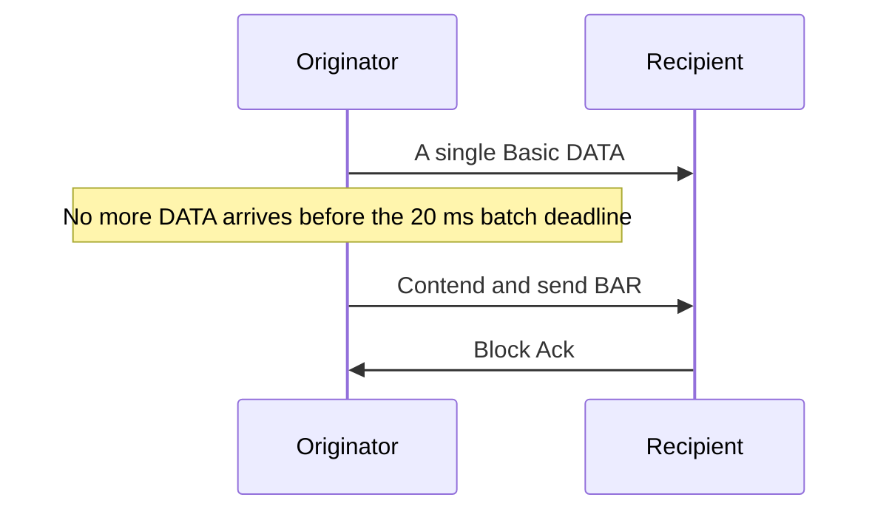
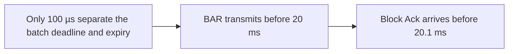

# Bound the wait for Basic feedback

A short queue gap can make the sender request feedback for a single MPDU. When the Basic batch is below threshold, its oldest outstanding transmission now establishes a deadline. HCF schedules a wakeup for that deadline so the BAR can contend without another arrival. A full batch, a blocked transmit window, or a nearer DATA or agreement expiry can make feedback due sooner. Setting the delay to zero retains immediate feedback when no same-agreement DATA can proceed.

`WifiBasicBarDeadline.test` leaves a single outstanding DATA at the end of a real association and ADDBA exchange. The test computes DATA completion from its transmitted PHY mode. It requires BAR at or after 20 ms from completion and checks that the AP answers. The parent makes the single BAR due as soon as DATA finishes because the queue is empty. This case checks the timer and contention wakeup. It does not measure how frequently an arriving packet fills a batch under load.

`WifiBasicBarDeadlineNearExpiry.test` gives one transmitted DATA an expiry 20.1 ms after completion and sets the batch timer to 20 ms. The earlier policy waited until the timer fired because the DATA would still be alive then. The test requires the BAR to transmit before 20 ms and the Block Ack to arrive before 20.1 ms. Other traffic can still delay channel access.

