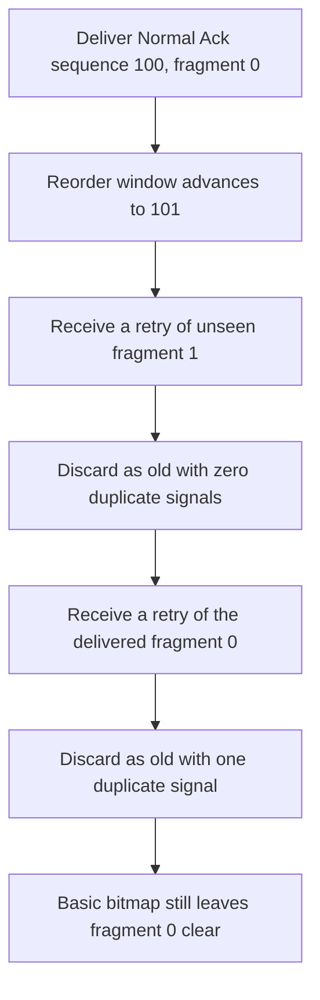
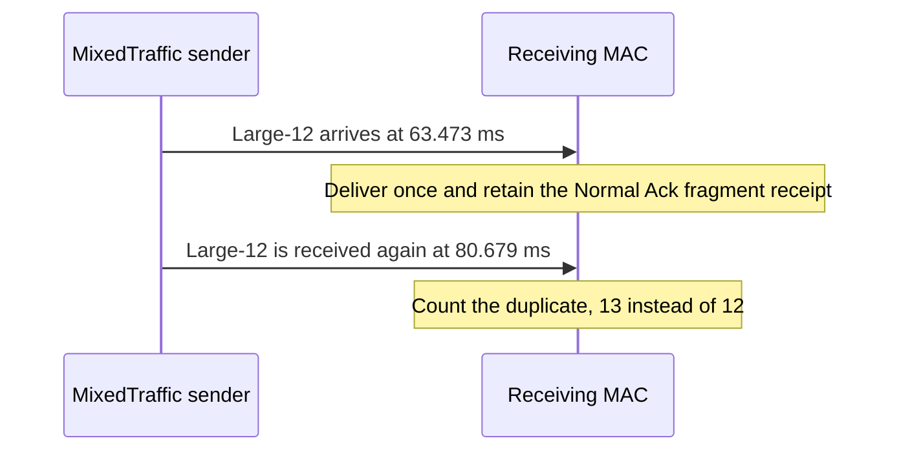

# Basic Normal Ack retry reporting

**Plan entry** `BA-BASIC-NORMAL-ACK`. **Commit** `ieee80211: fix: count Normal Ack retries under Basic Block Ack`. [Plan](../../../plan/pending/baseline-catch-up-defects.md#basic-normal-ack-retry-reporting)

A QoS frame can use Normal Ack while a Basic Block Ack agreement is active. If the sender misses its ACK, it can retry a fragment the recipient already delivered. The receiver applies the agreement receive-window path for duplicate handling under IEEE Std 802.11-2024, Table 10-6, RC9/RR4. The INET drop signal records a duplicate when that path has evidence of an earlier arrival.

Before this fix, the Basic receipt record held only Block Ack policy fragments. A received Normal Ack fragment could be delivered and its retry discarded behind the window without a duplicate signal. The record now retains the exact Normal Ack fragment for duplicate detection. Its Basic bitmap bit stays clear while the sequence remains in the receipt record.

## Case 18

The fixture supplies a Basic agreement starting at sequence 100 with four window positions. It calls the production recipient service and subscribes to its duplicate-drop signal. The fixture builds the Basic bitmap with the production response builder and checks fragment 0 before and after the retries. [Module test](../../module/Ieee80211BlockAckReordering_1.test)



A debug probe on the earlier reporting code at `0d540d0ad7` observed zero duplicate-drop events for the received Normal Ack fragment's retry. The fixed debug run at `ee8ed8b201` passed case 18 and all 19 selected scenarios. The fixture injects the retry directly and checks recipient behavior at that boundary.

## MixedTraffic run 0

The receiving MAC delivered `Large-12` at 63.473 ms and received its retry at 80.679 ms. Counting that retry raised the receiving MAC's duplicate total from 12 to 13. The approved result refresh affects drop counts, bytes, and packet-size vectors. The earlier six-case release comparison passed at `ee8ed8b201` against statistics pin `3b8824556b54ca115714966cdfd3a81de17318fa`.



## Verification

Run from the INET worktree root at the Basic Normal Ack commit. The debug module fixture uses seed set 0 and selects cases 0 through 18 at this step.

```sh
source .envrc
make -C src -j8 MODE=debug
opp_run_module_tests --load . -p inet -m debug --no-build \
  -f 'Ieee80211BlockAckReordering_1\.test$'
```

The release comparison covers all nine run-0 cases affected by duplicate reporting, including `General`, `NoFragmentation`, and `Fragmentation` in the Block Ack showcase. The runner reads the local `statistics` checkout. Set it to the `statistical` pin in this revision's `inet.opp` before comparing results.

```sh
make -C src -j8 MODE=release
opp_checkout_test_baselines --load . -p inet statistical &&
statistics_status=$(git -C statistics status --porcelain --untracked-files=all) &&
test -z "$statistics_status" &&
opp_run_statistical_tests --load . -p inet -m release --no-build \
  -w '^(examples/wireless/qos|showcases/wireless/(blockack|fragmentation))$' \
  -c '^(MacQosWithBlockAck|General|NoFragmentation|Fragmentation|MixedTraffic|HCFfragblockack|OnlyPacketSizeHCFfragblockack|PacketSizeHCFfragblockack|ThresholdHCFfragblockack)$'
```

The check stops the comparison if `statistics` has local changes. Preserve those changes and use a clean checkout for verification. If the installed `opp_repl` lacks the checkout command, fetch and check out the exact SHA from `inet.opp` in `statistics`, verify it with `git -C statistics rev-parse HEAD`, then run the same cleanliness check and comparison.

### Historical verification

The debug module and six-case release runs exited 0. The working directory for both was `/opt/workspace-opt/inet-ieee80211-basic-blockack-bitmap`. The release run used the run-0 default and the pin recorded above. It used these build and test commands.

```sh
source .envrc
d="$PWD/ai-logs/basic-blockack-bitmap/devin-split"
make -C src -j8 MODE=release > "$d/basic-build-release.log" 2>&1
opp_run_statistical_tests --load . -p inet -m release --no-build \
  -w '^(examples/wireless/qos|showcases/wireless/(blockack|fragmentation))$' \
  -c '^(MacQosWithBlockAck|MixedTraffic|HCFfragblockack|OnlyPacketSizeHCFfragblockack|PacketSizeHCFfragblockack|ThresholdHCFfragblockack)$' > "$d/basic-statistics.log" 2>&1
```

The debug evidence is in `basic-build-debug.log`, `basic-module-debug.log`, and `basic-module.out` in the same evidence directory. The earlier probe and `MixedTraffic` trace are in the neighboring `devin-duplicate-reporting/` directory.
