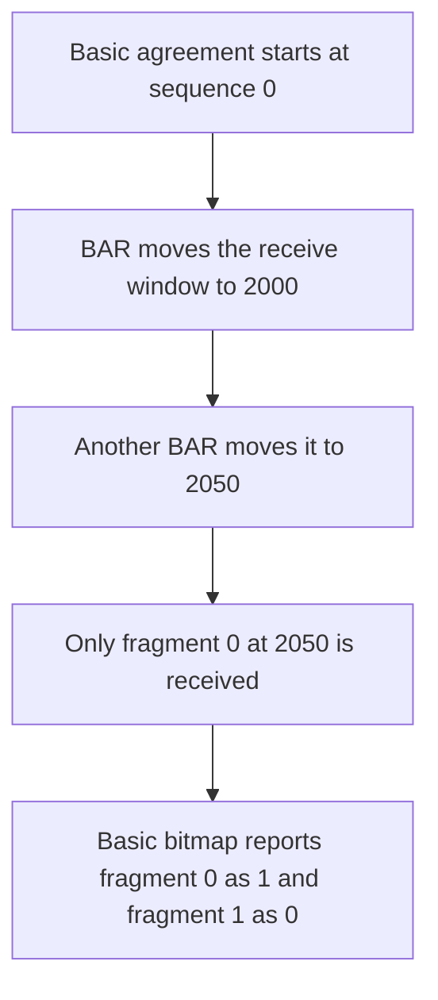

# Basic Block Ack receipt reporting

Plan entry [BD-29/30](../../../plan/pending/baseline-catch-up-defects.md#basic-block-ack-bitmap-bd-29-and-bd-30).
Commit subject `ieee80211: fix: false acknowledgments in the Basic Block Ack bitmap`.

IEEE Std 802.11e-2005 §9.10.3 (PDF p. 120) defines the historical Basic Block Ack bitmap.
The recipient reports an explicit receipt for each sequence and fragment in the tracked range.
A missing fragment has a clear bit. The recipient reports positions before that range as old
using cyclic sequence order.

## What the tests exercise

In [WifiBasicBlockAckMissingData.test](common/WifiBasicBlockAckMissingData.test), a station
associates with an AP and negotiates Basic Block Ack. The radio tap drops the first standalone
Block Ack policy DATA at the AP. With the request threshold set to one MPDU, the station sends
a BAR for that sequence and TID. The AP generates the real Basic Block Ack response and the
station receives it. The fixture checks the missing fragment's bit at the station before
checking the retransmission's sequence, TID, and Retry bit.
The second run delivers group QoS DATA in place of the first unicast. It keeps the peer
and TID and uses a sequence 66 positions ahead, outside the 64-position unicast window.
The Basic response must still leave the missing unicast bit clear and the sender must retry.
The third run sets the group sequence equal to the missing unicast sequence. After the
initial clear bit, the first received unicast retry must set its bit in the next Basic reply.

[Ieee80211BlockAckRecord_1.test](../../unit/Ieee80211BlockAckRecord_1.test) checks the receipt
record directly. Starting at sequence 4093, it records fragment 1 of sequences 4093, 4095, and 0.
Sequence 4094 and the unreceived fragments remain clear. The fixture checks the empty record
before inserting receipts, then advances the retained start to sequence 0 and verifies that a
stale removal cannot move it backward.

[Ieee80211BlockAckReordering_1.test](../../module/Ieee80211BlockAckReordering_1.test)
exercises the recipient data service and the production Basic response builder.
Runs 11–13 cover successive BARs without a delivery, a valid BAR exactly half a sequence
cycle ahead of the last retained delivery, and a receive-window move triggered by DATA.
Each run records fragment 0 of a live MSDU and checks that its missing fragment 1 has a
clear bit. Run 11 also checks that a stale BAR preserves the new window and that arrival
of fragment 1 completes delivery.
Runs 15 and 16 exercise the same group sequence with active Basic and Compressed agreements.
After unicast sequence 0, the service delivers broadcast sequence 66 independently, keeps
the unicast window at 1, and reports sequence 1 missing until unicast sequence 1 arrives.
Each run also delivers a broadcast at sequence 1 just before the first received unicast
retry at the same sequence. The retry must be delivered and acknowledged, and a second
copy must be discarded. Run 17 checks the same delivery sequence without an agreement.



## Repair

The parent's Basic record inferred the cutoff from the numerically first map entry and
acknowledged every query when the map was empty. `BlockAckRecord` now owns an explicit Basic
receipt start initialized by the recipient agreement from ADDBA. An accepted forward
receive-window move retires earlier Basic receipts even when it releases no complete MSDU.
The last delivered sequence can still have explicit receipt state, so a valid forward
receive-window move can retire exactly half a sequence cycle from that retained sequence.
The bitmap builder queries sequence and fragment positions individually. Compressed Block Ack
keeps its separate receipt window.

Group QoS DATA uses a separate sequence space (IEEE Std 802.11-2024, Table 10-5).
The recipient bypasses the individual agreement for group traffic, including receipt
tracking, reordering, and inactivity updates. Basic and Compressed window logic use the
same forward distance calculation while retaining their own policies.

IEEE Std 802.11-2024, Table 10-6, RC2/RR1 and RC9/RR4 govern duplicate filtering here.
The modeled non-DMG QoS receiver omits group entries from the ordinary duplicate cache
and lets the Block Ack receive window detect duplicates for agreement traffic. A group
frame therefore cannot make an unrelated unicast retry look like a second received copy.

The Block Ack receive window now reports a duplicate retry when it can match the exact
fragment in the reorder buffer or in retained receive history. The recipient emits its
existing duplicate-drop signal once before the packet is discarded. A stale sequence
whose receipt history has been retired does not count as a confirmed duplicate.

## Verification

The baseline build at `bee6f62eea` failed the new protocol case in run 0 when the station
received the incorrectly set bit. The unit case failed on the false receipt at 4094.
An early run of the unit fixture also reproduced the empty-record failure directly.
Upstream advanced to `763fde6c8e` by adding the completed catch-up plan, so the parent
of the published change has the same simulation and test inputs as the baseline build.

With the repair, the new protocol case observes a clear bit and retransmission of the
original DATA. Both Basic and Compressed receipt-record unit tests pass. The 11n Basic
and Compressed Block Ack protocol controls pass. The four module tests for reordering,
agreement lifecycle, and Compressed exchange and input also pass.

The existing `WifiBlockAckDataRetry.test` has the same missed retransmission deadline in
run 0 and simultaneous-transmission error in run 1 on the parent and repaired trees.

The receive-window regressions in runs 11–13 of `Ieee80211BlockAckReordering_1.test`
each failed on the initial PR head `22d184debc` because the production bitmap set the
missing fragment's bit. These cases pass with the window advancement
correction. The audit probe returns bits `1, 0` for the received and missing fragments
of sequence 2050.

Run 14 records fragment 0 at sequence 4095. Three forward BARs move the window through
a full sequence cycle, returning to 4095 without receiving new DATA. The response
must leave fragment 0 clear at the reused sequence number. Keeping the retired entry
incorrectly sets that bit. All 15 runs passed, and run 14 failed at this assertion
when receipt erasure was disabled in a diagnostic build.

Before the group isolation repair, broadcast sequence 66 moved the individual window
from 1 to 3 without a delivery. The new Basic receipt boundary then caused a reply to
acknowledge missing unicast sequence 1. The updated over-the-air test fails at the
bitmap assertion on that build. With the repair it observes the broadcast at the AP,
a clear bit in the reply, and the original unicast retry. The Basic and Compressed
module cases also check group delivery and unchanged agreement state.

On the previous PR revision, the matching-sequence over-the-air run passed the check for
the initial clear bit but failed on the next reply. The receiver had discarded the first
unicast retry as a duplicate of the broadcast. The revised run observes the positive bit
for that retry. The receive-window reporting stage selected 18 recipient module runs, including
the duplicate and no-agreement controls.

The duplicate-drop assertions in runs 15 and 16 check one signal for a retry of a delivered
unicast and one for a retry of a buffered unicast. The matching broadcast and the first
received unicast retry emit no duplicate-drop event.

Run 17 first delivers unicast sequence 1 outside any agreement, then verifies that the
ordinary cache drops its duplicate. Next it opens a fresh Basic agreement starting at
sequence 1. The first in-window retry of sequence 1 is delivered and sets its Basic
receipt bit. It emits no duplicate-drop event despite the matching ordinary cache entry.

The next two steps add case 18 for [Basic Normal Ack retries](basic-blockack-normal-ack-retries.md) and case 19 for [Compressed retries after a reorder gap](compressed-blockack-retry-receipts.md). Both passed, and the final recipient module run completed all 20 scenarios successfully.

From the worktree root, load `.envrc`, build the debug model, and use the focused selectors:

```sh
make -j8 MODE=debug CC=clang CXX=clang++
opp_run_unit_tests --load . -p inet -m debug --no-build -f 'Ieee80211(BlockAckRecord|CompressedBlockAckRecord)_1\.test$'
opp_run_protocol_tests --load . -p inet -m debug --no-build -w wifi -f '(WifiBasicBlockAckMissingData|WifiBlockAckDataRetry|N_BlockAck|N_CompressedBa)\.test$'
opp_run_module_tests --load . -p inet -m debug --no-build -f 'Ieee80211(BlockAck(Reordering|Lifecycle)|CompressedBlockAck(Exchange|Input))_1\.test$'
```

The production fixture covers the empty-record defect with one missing MPDU and one
agreement. The focused unit fixture supplies the wrap boundary and per-fragment checks.

## Fingerprints

The table compares upstream parent `0cb56f4a6f` with the rebased receipt fix at
`57a76fbd6c`. Correcting the Basic bitmap lets senders retry data that the parent
falsely acknowledged. Three run-0 cases change in all three fingerprint ingredients,
for nine changed entries. The rebase incorporates the 35 ms Wi-Fi radio-medium
default, which shifts cleanup timer events and changes the three `tplx` values.
The `~tNl` and `~tND` values carry forward from the original repair.

| Directory and configuration | Limit | `tplx` | `~tNl` | `~tND` |
| --- | --- | --- | --- | --- |
| `examples/wireless/qos`, `MacQosWithBlockAck` | 10 s | `19dc-903b` → `716a-3916` | `2a8a-50ee` → `379d-6957` | `4301-882d` → `5f30-8885` |
| `showcases/wireless/blockack`, `MixedTraffic` | 1 s | `dcd3-7b9d` → `ce47-9019` | `5c1f-69a8` → `3184-e20c` | `6182-6da3` → `f3b6-5975` |
| `showcases/wireless/fragmentation`, `OnlyPacketSizeHCFfragblockack` in `parameterstudy.ini` | 10 s | `04dd-6520` → `c5cb-4d7a` | `e816-9097` → `be94-2399` | `1641-e12d` → `af6f-b8e9` |

On 2026-11-24, the release comparison at `57a76fbd6c` ran from
`/opt/workspace-opt/inet-pr1478-fingerprint-evidence.e0HNs5/inet`. It reused the
library built at `06eda5e1b2` with `make -C src -j5 MODE=release`. The compiled
inputs match at both revisions. The run used seed set 0 and the three stored
fingerprint ingredients.

```sh
opp_run_fingerprint_tests --load . -p inet -m release --no-build \
    -w '^(examples/wireless/qos|showcases/wireless/(blockack|fragmentation))$' \
    -c '^(MacQosWithBlockAck|Fragmentation|MixedTraffic|NoFragmentation|.*HCFfragblockack)$' -r '^0$'
```

All nine configurations passed and the runner exited 0. The six controls use
the rebased parent expectations. The local release log is
`ai-logs/basic-blockack-bitmap/fingerprint-evidence/receipt-fingerprints.log` in the
Basic Block Ack worktree.

### Historical check before the rebase

On 2026-11-23, the maintainer approved the original nine entries. The debug run
passed all nine selected configurations after the receive-window advancement
correction. Its results refer to the 10 ms radio-medium default in the original
parent. See `ai-logs/basic-blockack-bitmap/fingerprint-publication.log`.

The receive-window reporting change has a separate statistics pin. The maintainer approved
updating the six failing release-mode run-0 cases on 2026-11-24. These are
`MacQosWithBlockAck`, `MixedTraffic`, `HCFfragblockack`, `OnlyPacketSizeHCFfragblockack`,
`PacketSizeHCFfragblockack`, and `ThresholdHCFfragblockack`. The differences measure
discarded frames. For example, the 100-byte `PacketSizeHCFfragblockack` case reports
1,358 duplicate retries where the cache-based baseline recorded 1.
