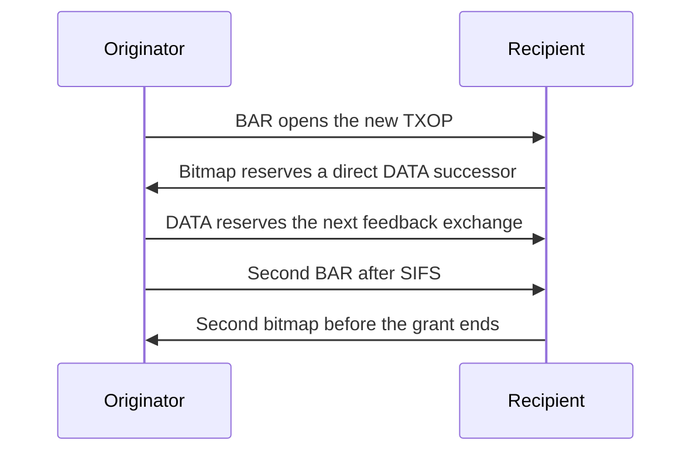
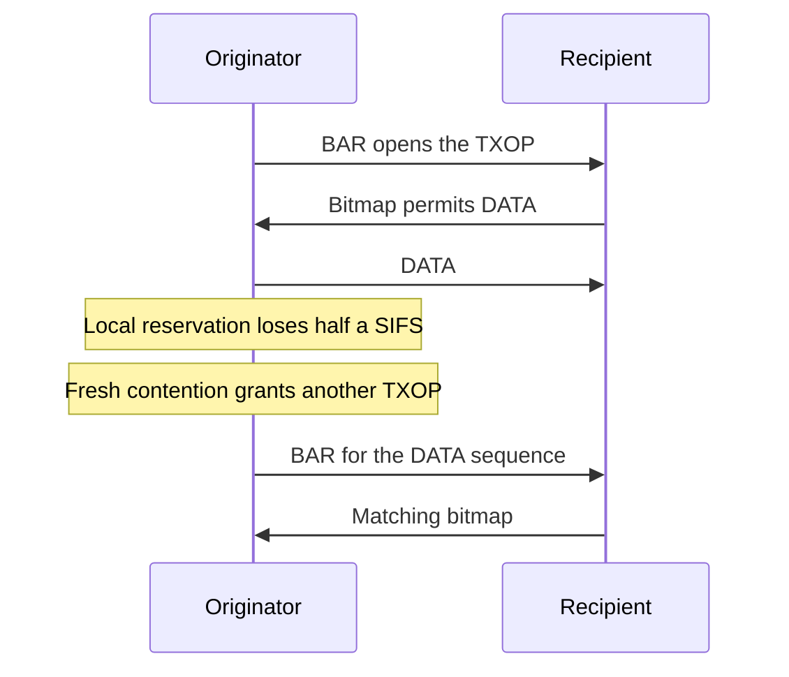

# Send reserved Basic feedback in a BAR-opened TXOP

A Basic BAR can open a TXOP and its reply can leave room for DATA. After DATA transmits, the ACK policy may already need another BAR. HcfFs routes that decision to BAR admission without checking the identity of a planned DATA successor. The leading SIFS, BAR, reply SIFS and Block Ack must fit the current TXOP and its reservation.

`WifiBasicFeedbackInBarOpenedTxop.test` adapts the seed-17 fragmentation fixture to a fixed infrastructure exchange. An intercepted first reply causes a BAR to open a fresh grant. The matching bitmap permits queued DATA under the same agreement, and that DATA advertises airtime for the next feedback exchange. The test derives SIFS from the transmitted PHY mode and checks the second BAR and bitmap against the same TXOP start and DATA sequence number.

This fixture verifies the frame order and airtime admission using a retry to start the grant. The original showcase reproduction observes a BAR that is due under the normal feedback policy.

The second run shortens the sender's local TXNAV by half a SIFS after DATA. It requires the same BAR and bitmap sequence after another contention grant.

