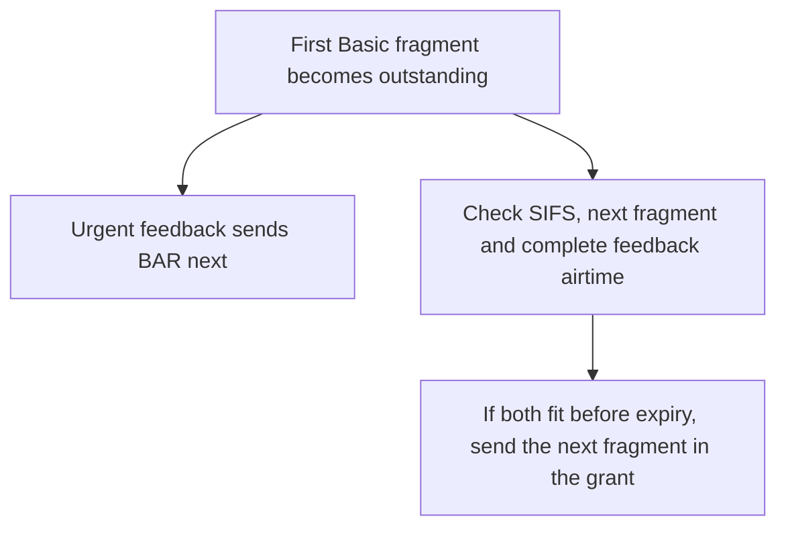

# Budget a Basic fragment and its feedback before expiry

The batching deadline can make feedback urgent when an outstanding fragment's lifetime is shorter than the remaining delay. With airtime-aware feedback, HCF checks whether the next numbered fragment and the BAR plus reply can both complete before the earliest expiry and the TXOP deadline. The sender also needs a reservation for the next fragment. The option defaults to false.

`WifiBasicFragmentFeedbackAirtime.test` uses seed 9, a 10 ms DATA lifetime and a 250 B fragmentation threshold. With the same feedback deadline and zero idle grace in both runs, it observes the first Basic fragment and checks the next frame in the same grant. The control sends BAR immediately. With the airtime check enabled, the next fragment of that sequence follows in the same TXOP.

The test covers a fitting next fragment and the disabled option. It does not measure delivery under varying channel conditions.
