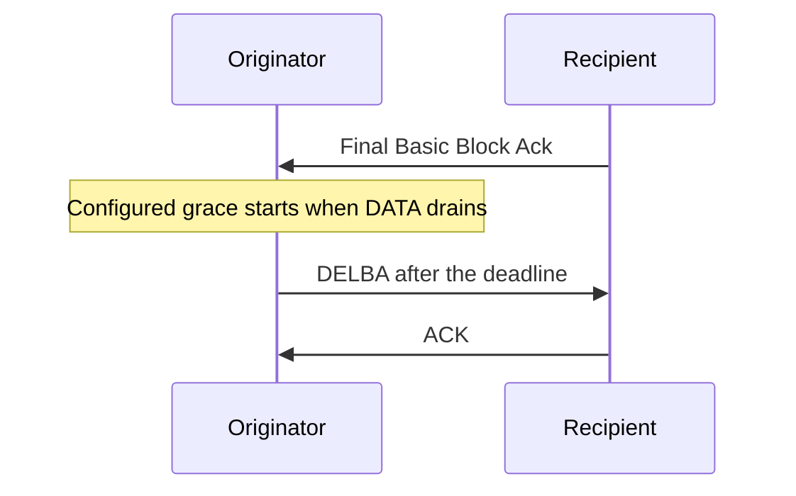

# Retain Basic agreements during a short idle gap

When the queue and outstanding DATA for a Basic agreement drain, HCF can defer transfer-completion DELBA for a configured idle grace. New DATA for that peer and TID cancels the deadline. Agreement teardown or association reset clears that state. The default of zero uses the immediate completion path.

`WifiBlockAckTransferCompletion.test` sends a small transfer with an ordinary window or a one-position window. It repeats each setup at zero and 5 ms grace, with feedback batching disabled. It checks the last Block Ack, the DELBA time and its acknowledgment. The parent starts DELBA directly after the final bitmap and cannot satisfy the 5 ms timing assertion. The window case also checks feedback before the sender can use the next position.

This test measures completion delay. It does not measure agreement reuse across workload-driven queue gaps.
