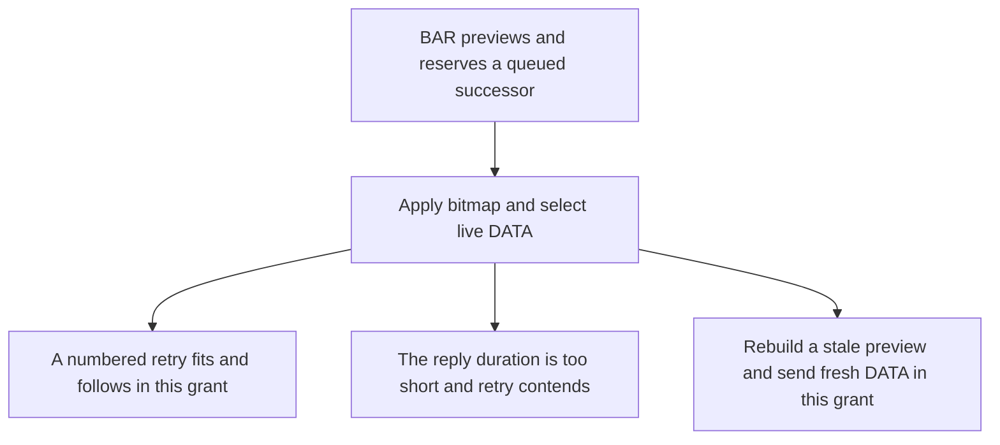

# Select DATA after applying the Basic bitmap

A preview describes the queue before the reply. Applying the bitmap can make an earlier numbered MPDU eligible, and a queued source can disappear while the request is in flight. After applying the bitmap, HCF selects the live next DATA for the same peer and TID. If the candidate is fresh and the preview is stale, HCF rebuilds the preview against the remaining reservation. It checks the received Duration/ID, TXNAV, the TXOP deadline and the candidate's lifetime before committing the DATA.

`WifiBasicPostBarReselection.test` uses real ADDBA and RTS/CTS. The tap clears one bit in the bitmap, clears the bit and reduces the reply duration, or removes the first queued source as the reply arrives. The two positive scenarios require the numbered retry or replacement DATA to transmit in the original grant. The short reply requires another grant. The parent compares the actual candidate with the original preview identity, so the two positive scenarios cannot continue. The duration control still has to defer.

The fresh replacement must take the next unconsumed sequence number. These cases exercise one agreement at a time.
