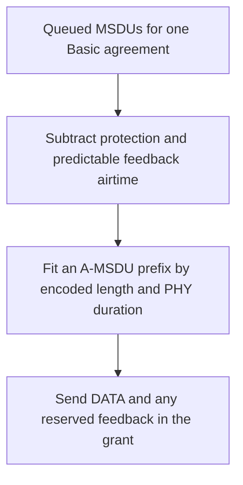
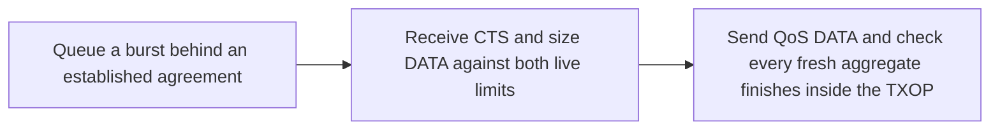
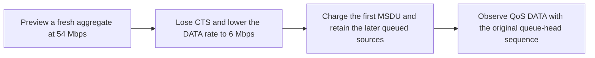
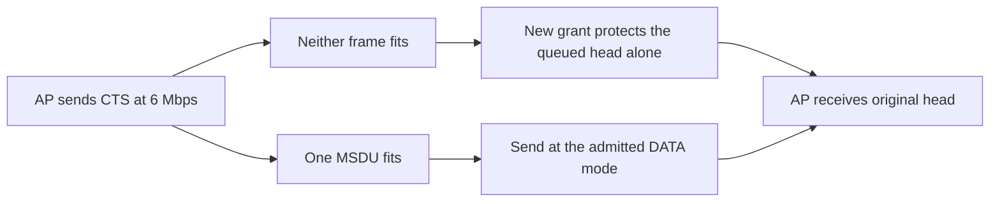
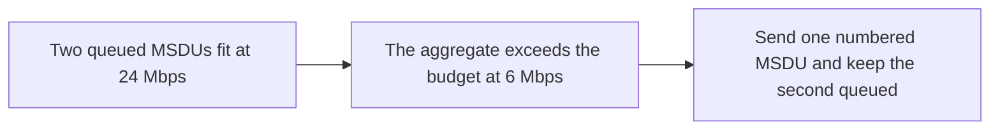

# Size protected Basic DATA

The configured A-MSDU limit can admit a queue prefix whose complete MPDU is too long for the Basic ACK policy or the current reservation. The aggregate policy now tests each prefix with the actual header, FCS and inter-subframe padding included. HCF budgets the opening RTS, CTS and SIFS before selecting DATA. If a smaller prefix would leave room for a predictable BAR and reply, the preview uses that space for feedback.

- `WifiBasicContinuationAggregateLimit.test` fills the station queue during an exchange with its AP. With the Basic byte limit binding, the station sends a 2,132-byte two-subframe A-MSDU one SIFS after the Block Ack.
- `WifiBasicContinuationAirtimeLimit.test` queues several 1,000-byte application messages during the first Basic DATA. At 6 Mbps, the remaining airtime in the 4 ms TXOP permits a single MSDU. The fixture checks that the station sends a 1,066-byte MPDU with the A-MSDU Present bit clear one SIFS after the Block Ack.
- `WifiBasicOpeningAggregateLimit.test` covers the size and airtime limits for the DATA immediately following CTS. It checks the complete MPDU length and Basic ACK policy. `WifiBasicOpeningBarBudget.test` checks the first aggregate and BAR in the same TXOP and covers later DATA after a reply.
- `WifiBasicPostBarContinuation.test` repeats the RTS-opening exchange with a low RTS threshold and with the default threshold. The default-threshold case checks that HCF protects the opening even though the ordinary threshold would allow direct DATA.
- `WifiBasicTxopAdmission.test` checks actual TXOP and TXNAV bounds for every accepted continuation and still requires refusals. With a 300 µs single-protection limit the additional opening protection leaves no continuation, while the 3 ms control admits protected continuations.

For a fresh aggregate opening, RTS protects a preview while its source MSDUs stay in the queue. When CTS arrives, HCF selects the fitting prefix using the current DATA mode, the remaining TXOP and the received CTS Duration/ID. If RTS fails, HCF charges the first eligible MSDU with the RTS failure and leaves the other previewed sources queued.

`WifiBasicOpeningTightTxop.test` uses a 2,986 µs TXOP. In the first run at 6 Mbps, the nominal forecast admits a 2,132-byte A-MSDU. The earlier model finished DATA about 0.992 µs after the TXOP limit. The test requires the eventual DATA to use the previewed sequence number and checks every accepted fresh A-MSDU against the actual TXOP deadline.

On the second run the radio tap drops CTS for the first fresh aggregate. At the RTS timeout the fixture lowers the DATA rate from 54 to 6 Mbps. It requires the eventual DATA to carry the previewed sequence number and the original first IPv4 datagram. It also checks fresh aggregate airtime at the lower rate.

The last two runs use a 24 Mbps CTS forecast at the station and a 6 Mbps CTS at the AP. With 10-byte application messages, neither the aggregate nor the queue head fits the first CTS. The next RTS protects a single preview while the original head is still queued, and budgets the observed CTS airtime. With 100-byte messages, one MSDU fits the first CTS. The fixture lowers the selectable DATA rate immediately before transmission and requires the admitted mode on the air. Both runs check the received CTS covers SIFS and DATA, and identify the original IPv4 datagram at the AP.

**Observed failures.** On the sizing commit's parent (`7ad6c048d7`), both cases failed at the AP: the received DATA did not satisfy the assertion for a single Block Ack MPDU with the previewed sequence number and original IPv4 datagram. Testing the earlier sizing implementation (`aa9314b3ec`) exposed the two causes separately. With 10-byte messages the sender repeated the undersized RTS reservation and failed the queue-head delivery check. With 100-byte messages a second rate query selected a slower mode after admission, and the transmitted DATA failed the mode and CTS-airtime check. With the correction, the AP received the original head after two RTS attempts and one RTS attempt, respectively.

**Coverage.** Runs 2 and 3 exercise a fresh Basic A-MSDU opening under single protection with a positive TXOP limit. Both use the same 24 Mbps forecast and 6 Mbps CTS response. The evidence covers these two packet sizes and the rate change injected immediately before DATA submission in run 3.

Scenario 15 of `Ieee80211CompressedBlockAckAdmission_1.test` exercises the Basic opening with a rate control that alternates 24 and 6 Mbps. When the second rate decision rejects the aggregate, the first RTS protects one numbered MSDU while the second source is still queued. The first DATA must carry the original queue-head payload.

