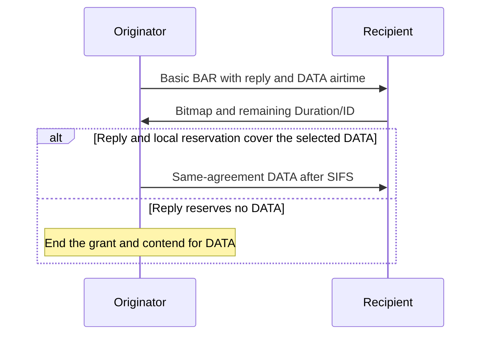

# Reserve eligible DATA in a Basic Block Ack exchange

An immediate Basic Block Ack takes airtime from the BAR's reservation. HCF can also reserve a direct DATA successor if it belongs to the same peer and TID and fits after the reply. Previewing queued DATA leaves sequence allocation and queue ownership untouched. The accepted bitmap, the received reply duration, the TXOP budget and TXNAV determine whether HCF commits the preview.

`WifiBasicBarOpeningContinuation.test` gives an associated station a 350 µs TXOP. The opening RTS/CTS and DATA consume enough airtime that the required BAR must contend separately. The test matches the receiver and TID in the next grant, checks that the reply leaves a reservation, and requires fresh DATA in that grant. Before the change the BAR makes a reply-only reservation, so the reply assertion detects the missing continuation.

`WifiBasicPostBarContinuation.test` gives the station a 4 ms grant so the first DATA and the BAR fit after RTS/CTS. It observes the BAR at SIFS and requires the next DATA to follow the reply within 30 µs. The parent ends the grant before committing the queued successor.

`WifiBasicPostBarReservation.test` shortens the advertised interval to cover only the reply. Its control requires the next DATA in a later grant, even though the TXOP limit alone leaves time. `WifiBasicBarReservation.test` checks that the earlier DATA's Duration/ID covers the actual feedback exchange. A BAR can advertise airtime for its own successor.

The fixtures check the production frame order and reservations. They do not measure throughput or establish post-bitmap reselection when the queued source changes.
