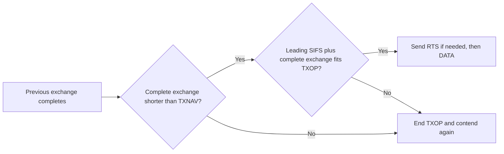

# Basic Block Ack TXOP admission

BD-27 in the [baseline catch-up plan](../../../plan/pending/baseline-catch-up-defects.md#basic-block-ack-txop-admission-bd-27)
was first tested against commit `8c1945c468`, the then-current head of
[PR #1481](https://github.com/inet-framework/inet/pull/1481). The fix was rebased first onto
`c7e7cdaabd` and then onto `42dbb75bfb`.

After a frame exchange, a Wi-Fi sender may start another exchange in the same transmission
opportunity (TXOP) if the complete exchange is shorter than its remaining reservation (TXNAV).
The leading SIFS and the exchange, including any immediate response, must fit the remaining
TXOP time. See IEEE Std 802.11-2024, clauses 10.23.2.8 and 10.23.2.9.

On the parent, Basic Block Ack DATA bypasses the complete exchange check. In multiple protection,
the old check can admit a later RTS or DATA if its start is before the limit. This leaves the CTS,
DATA or immediate ACK to run past the deadline. In single protection, a preceding DATA can also
advertise too little airtime for a subsequent protected exchange.

HCF now uses the selected exchange at the transmit boundary. For a later protected exchange,
it adds RTS, CTS, DATA, any immediate ACK, and the SIFS between them. It checks TXNAV before
the leading SIFS and includes that SIFS in the TXOP calculation. An admitted RTS keeps the
selected DATA rate through CTS. HCF checks the remaining airtime again before submitting
DATA. A frame refused for lack of airtime remains eligible for another grant.



## Protocol regression

[WifiBasicTxopAdmission.test](common/WifiBasicTxopAdmission.test) associates two non-HT ERP stations with an
access point. One station sends 30 UDP datagrams of 700 bytes at 100 µs intervals. The transmitter
uses 24 Mbps for DATA, seed 0, fixed radio positions and zero propagation delay. This follows the
earlier non-HT admission fixture in commit `e01bb3bd5a`. The fixture uses the real ADDBA and
Basic Block Ack exchanges. In single protection it uses unicast fragmentation to make successor
MPDUs available before the current exchange finishes.

The HCF observer calculates the admitted DATA end from its scheduled start and selected rate.
It uses the start of RTS for protected continuations. It checks that a continuation ends by the
TXOP deadline and has exchange airtime strictly below TXNAV at the admission decision. The run
must see Basic DATA, a received Basic Block Ack and a refused DATA continuation. Cases with
insufficient time also verify that HCF
does not submit RTS for an exchange and then refuse its DATA in this zero-delay fixture.

| Run | Protection | RTS threshold | TXOP limit | First violation on PR #1481 | Fix, admitted / refused in release |
| --- | --- | ---: | ---: | --- | ---: |
| 0 | Multiple | 500 B | 1,024 µs | Admitted DATA would end 118 µs late | 14 / 14 |
| 1 | Multiple | 4,096 B | 1,024 µs | Admitted DATA would end 150 µs late | 19 / 4 |
| 2 | Single | 4,096 B | 300 µs | Admitted DATA would end 86 µs late | 41 / 34 |
| 3 | Single | 100 B | 3,000 µs | RTS through DATA exceeds TXNAV | 0 / 58 |

Runs 0–2 must also admit fitting Basic DATA continuations. In run 3, the preceding DATA reserves
airtime for the next fragment, while the next exchange needs RTS and CTS in addition to that
fragment. The station continues sending Basic DATA in fresh grants. The fixture fixes rates
and propagation delay. Its DATA timing assertions exercise the Basic profile's Block Ack
policy, where feedback comes in a separate BAR exchange.

Run the protocol comparison from the relevant INET checkout after building the library for
the selected mode.

```sh
opp_run_protocol_tests --load . -p inet -m debug --no-build \
  -w '^tests/protocol/wifi$' -f 'WifiBasicTxopAdmission\.test$' --no-concurrent
```

All four runs failed on the parent in debug and passed on the fix in debug and release. The Group
Duration/ID, missing Basic DATA, and Compressed Block Ack protocol controls passed in both
modes. The five focused debug module tests also passed. They cover Normal Ack admission,
both protection modes, and the Block Ack admission paths.

## Fingerprint comparison

The original PR #1481 parent matched 12 selected run-0 fingerprint cases in debug. A release
replay of the five affected cases on that parent matched the then-current values for all three
ingredients (`tplx`, `~tNl`, `~tND`). The fix rebased onto `c7e7cdaabd` moved the same five
cases in release. The baseline refresh updates only those 15 run-0 values.
All 12 selected cases pass in release with the refreshed store. Disabling just the
new Basic admission path in the rebased fix reproduces all 15 parent fingerprint values.

In each changed case, the first differing DATA submission follows a Basic Block Ack with
zero Duration/ID. The parent submits DATA in the same TXOP. The fix ends that TXOP and
submits the same MPDU after a new EDCA grant. The times below are the HCF submission times
from the matched run-0 Cmdenv traces.

| Configuration | Deferred MPDU | Parent time (ms) | Fix time (ms) |
| --- | --- | ---: | ---: |
| `HCFfragblockack` | `UdpBasicAppData-1-frag2` | 4.717 | 5.067 |
| `OnlyPacketSizeHCFfragblockack` | `UdpBasicAppData-6` | 5.115 | 5.365 |
| `PacketSizeHCFfragblockack` | `UdpBasicAppData-1-frag5` | 3.638 | 3.728 |
| `ThresholdHCFfragblockack` | `UdpBasicAppData-1-frag5` | 4.528 | 4.818 |
| `MacQosWithBlockAck` | `Voice-33+Voice-34` | 1036.351 | 1036.421 |

## Statistical and chart comparisons

Release CI reported differences in the same five configurations in the run-0 statistical
suite. In `HCFfragblockack`, the longest measured TXOP fell from 3.088 ms to 1.016 ms and
the receiving application counted 2,547 packets instead of 2,903. In
`ThresholdHCFfragblockack`, the transmitter reported 938 lifetime-expired drops instead
of zero. A local release run reproduced the lifetime-expiry count. The five regenerated
scalar files matched the corresponding CI scalar rows and run attributes.

The fragmentation showcase's packet-count and throughput charts and its packet-size,
fragmentation-threshold, and SNIR sweeps changed in the Basic Block Ack series.
The pinned media commit uses the six release CI exports.
