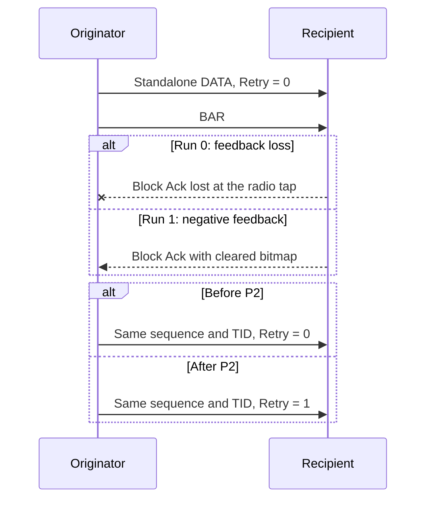

# DATA Retry after failed Block Ack feedback

Plan P2, **Mark DATA retries after failed Block Ack feedback**, changes HCF's transmitted header. The test is [WifiBlockAckDataRetry.test](common/WifiBlockAckDataRetry.test).

Before this commit, HCF can retransmit standalone DATA after failed feedback with Retry clear. The ACK handler already retains the sequence and TID and makes the DATA eligible. The failure therefore concerns the transmitted header, not retransmission eligibility.

After this commit, HCF sets Retry when the ACK status reports missing feedback or negative feedback. IEEE Std 802.11-2024, 9.2.4.1.6 defines this field for retransmitted standalone DATA.

The fixture uses real association and production ADDBA. It captures the first Block Ack DATA identity. Run 0 drops the first Block Ack at the originator. Run 1 clears that response's bitmap. Both runs require the same DATA identity after BAR, with Retry set. A radio tap supplies the fault; it does not create an agreement or change originator state.

The [guide](../../../doc/project/evidence/model/wifi/tests/blockack-data-retry.md) defines setup and assertions. The [comparison](../../../doc/project/evidence/model/wifi/tests/blockack-data-retry-comparison.md) records executed results and limits.

This test checks the standalone Basic compatibility path. It proves neither A-MPDU retry behavior nor complete IEEE 802.11-2024 Basic conformance.
