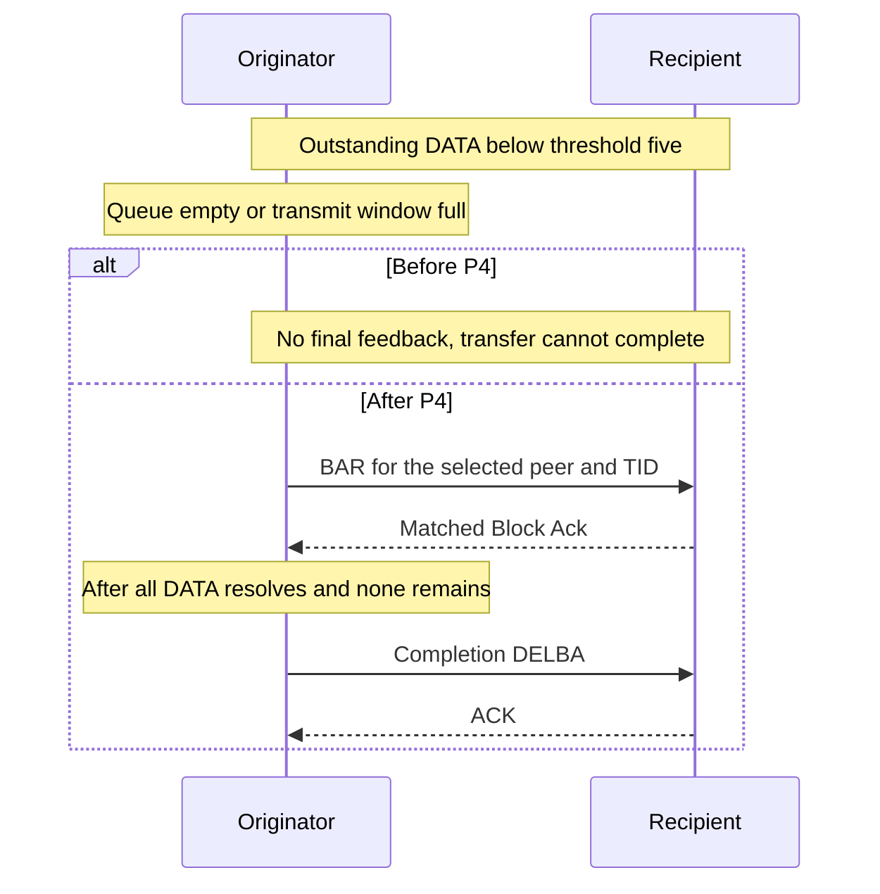

# Basic transfer completion below the BAR threshold

Plan P4, **Complete Basic BAR transfer resolution**, connects outstanding DATA to channel access and final DELBA. The test is [WifiBlockAckTransferCompletion.test](common/WifiBlockAckTransferCompletion.test).

Before this commit, a short group can lack feedback because the BAR threshold is five. Channel access also requires another DATA candidate. Queue exhaustion or a full transmit window can therefore prevent transfer completion.

After this commit, the ACK policy can select BAR below the threshold. HCF requests channel access for that BAR before DATA extraction. Matched feedback resolves the group. When no queued or numbered DATA remains, HCF queues DELBA. IEEE Std 802.11-2024, 10.25.4 supplies the completion requirement.

The fixture uses real association, production ADDBA, and finite UDP bursts. Run 0 sends two packets with an accepted window of 64. Run 1 sends four packets with a one-position window. Both retain threshold five. The next selected DATA-or-BAR transmission after the first Block Ack DATA must be BAR. The test also requires matched feedback, originator-role DELBA, and its ACK.

The output checks require PASS and reject any FAIL from this program. Both runs must succeed; one passing run cannot hide the other's failure.

The [guide](../../../doc/project/evidence/model/wifi/tests/blockack-transfer-completion.md) defines setup and assertions. The [comparison](../../../doc/project/evidence/model/wifi/tests/blockack-transfer-completion-comparison.md) records executed results and limits.

Basic remains an INET compatibility profile. These cases do not establish complete NAV conformance, general Basic DATA admission, or a performance result.
