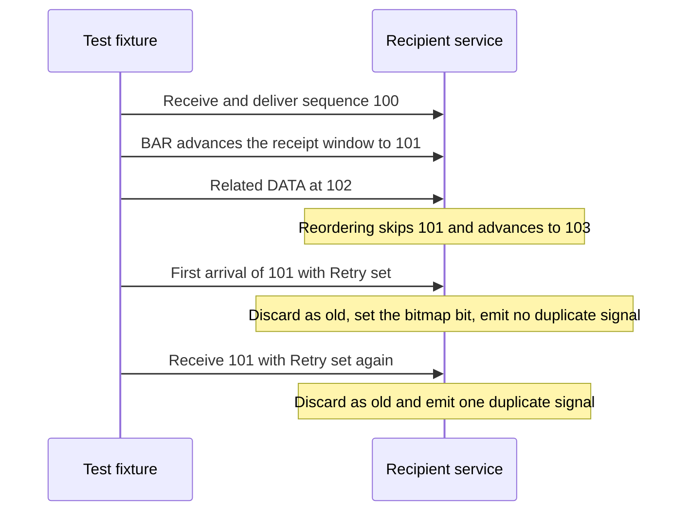

# Compressed retries after a reorder gap

**Plan entry** `BA-COMPRESSED-PRIOR-RECEIPT`. **Commit** `ieee80211: fix: classify late Compressed retries using prior receipts`. [Plan](../../../plan/pending/baseline-catch-up-defects.md#compressed-duplicate-reporting-after-a-reorder-gap)

IEEE Std 802.11-2024, 10.25.6.3 and 10.25.6.6.2.1, describes receipt tracking and reordering separately. INET can still record a sequence in the Compressed bitmap after the reorder window has skipped it. Its duplicate-drop signal describes an arrival for which the receiver already has evidence.

The recipient used to record the current arrival before reordering checked whether the sequence had been seen. A retry received for the first time could therefore supply its own evidence. The recipient now captures the prior receipt before updating the bitmap and passes that snapshot to the reorder service.

## Case 19

The fixture supplies a Compressed agreement starting at sequence 100 with four window positions. It injects a Block Ack Request for 101, then supplies a related frame at 102 so reordering advances to 103. The Compressed receipt window still covers 101. The fixture calls the production recipient service and checks the actual bitmap and duplicate-drop signal. [Module test](../../module/Ieee80211BlockAckReordering_1.test)



A debug probe on the earlier reporting code at `0d540d0ad7` observed one spurious duplicate signal on the first arrival of 101. At the Compressed fix at `019394610e`, case 19 passed, including the repeat and the bitmap assertion. The debug run completed all 20 reordering scenarios successfully. The fixture supplies the agreement and related-frame indication directly, so the result covers the recipient decision and signal.

## Verification

Run from the INET worktree root at the Compressed retry commit. The reordering fixture uses seed set 0 and selects cases 0 through 19 at this step.

```sh
source .envrc
make -C src -j8 MODE=debug
opp_run_module_tests --load . -p inet -m debug --no-build \
  -f '(Ieee80211BlockAckReordering_1|Ieee80211BlockAckLifecycle_1|Ieee80211CompressedBlockAckInput_1|Ieee80211CompressedBlockAckExchange_1)\.test$'
```

The release comparison covers all nine run-0 cases affected by duplicate reporting, including `General`, `NoFragmentation`, and `Fragmentation` in the Block Ack showcase. The runner reads the local `statistics` checkout. Set it to the `statistical` pin in this revision's `inet.opp` before comparing results. This commit inherits the updated pin from the Basic Normal Ack commit.

```sh
make -C src -j8 MODE=release
opp_checkout_test_baselines --load . -p inet statistical &&
statistics_status=$(git -C statistics status --porcelain --untracked-files=all) &&
test -z "$statistics_status" &&
opp_run_statistical_tests --load . -p inet -m release --no-build \
  -w '^(examples/wireless/qos|showcases/wireless/(blockack|fragmentation))$' \
  -c '^(MacQosWithBlockAck|General|NoFragmentation|Fragmentation|MixedTraffic|HCFfragblockack|OnlyPacketSizeHCFfragblockack|PacketSizeHCFfragblockack|ThresholdHCFfragblockack)$'
```

The check stops the comparison if `statistics` has local changes. Preserve those changes and use a clean checkout for verification. If the installed `opp_repl` lacks the checkout command, fetch and check out the exact SHA from `inet.opp` in `statistics`, verify it with `git -C statistics rev-parse HEAD`, then run the same cleanliness check and comparison.

### Historical verification

At `019394610e`, the four debug module fixtures and six release statistical comparisons passed. Both runners exited 0. The release run used run 0 and statistics pin `3b8824556b54ca115714966cdfd3a81de17318fa`. The release working directory was `/opt/workspace-opt/inet-ba-ci-series.LK7eMI/model`. It used these build and test commands.

```sh
source .envrc
d=/opt/workspace-opt/inet-ieee80211-basic-blockack-bitmap/ai-logs/basic-blockack-bitmap/devin-split
make -C src -j8 MODE=release > "$d/compressed-build-release.log" 2>&1
opp_run_statistical_tests --load . -p inet -m release --no-build \
  -w '^(examples/wireless/qos|showcases/wireless/(blockack|fragmentation))$' \
  -c '^(MacQosWithBlockAck|MixedTraffic|HCFfragblockack|OnlyPacketSizeHCFfragblockack|PacketSizeHCFfragblockack|ThresholdHCFfragblockack)$' > "$d/compressed-statistics.log" 2>&1
```

The debug working directory was `/opt/workspace-opt/inet-ieee80211-basic-blockack-bitmap`. Its evidence is in `final-build-debug.log`, `final-module-debug.log`, and `final-module.out` in the same evidence directory. The earlier probe is in the neighboring `devin-duplicate-reporting/` directory.
